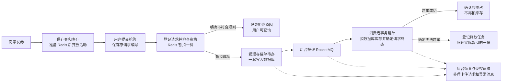
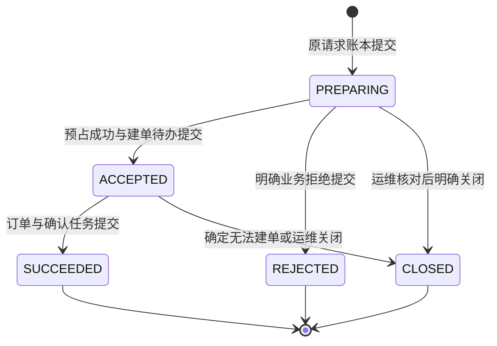
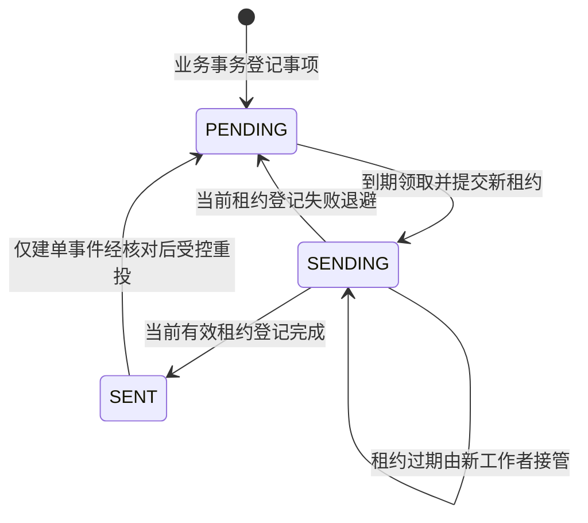
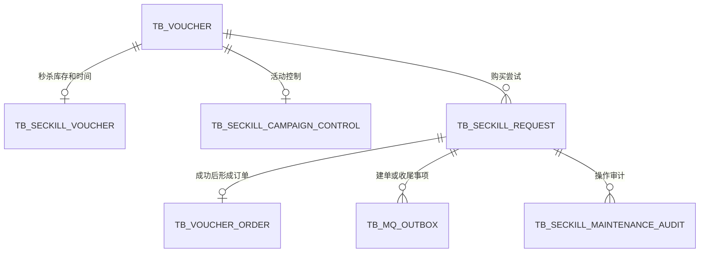
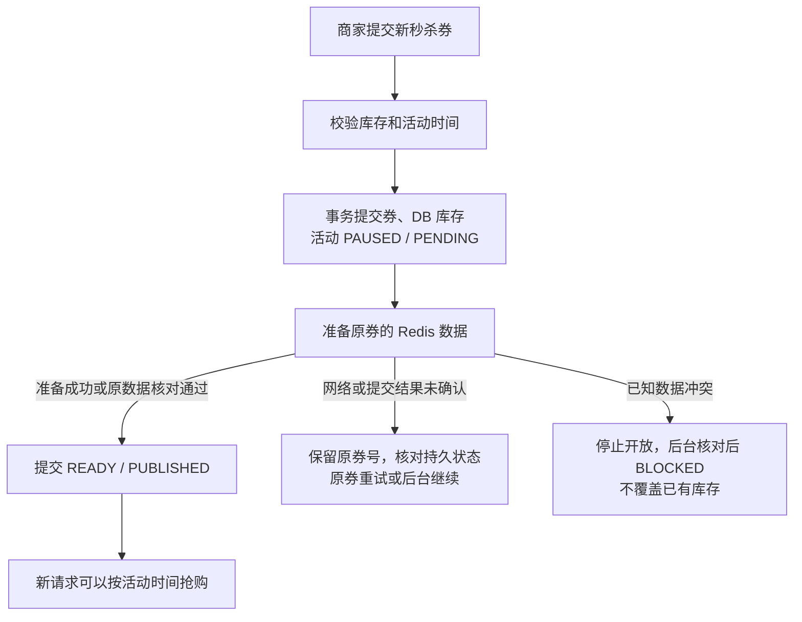
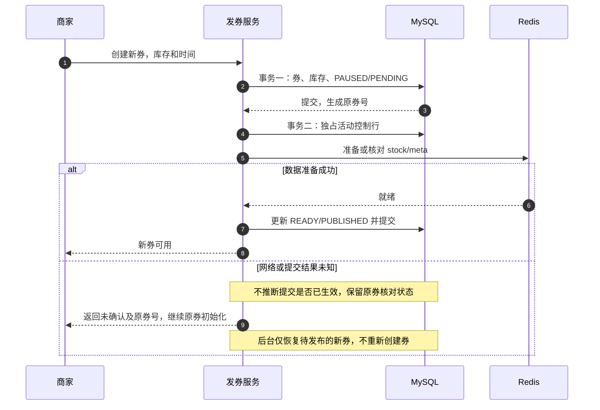
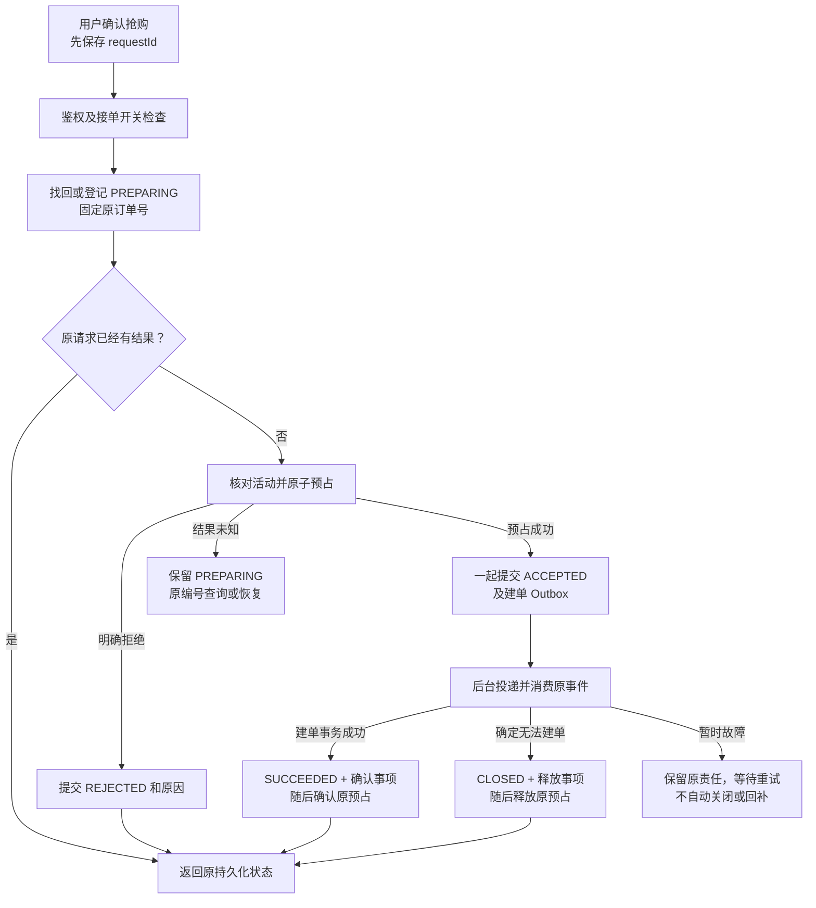
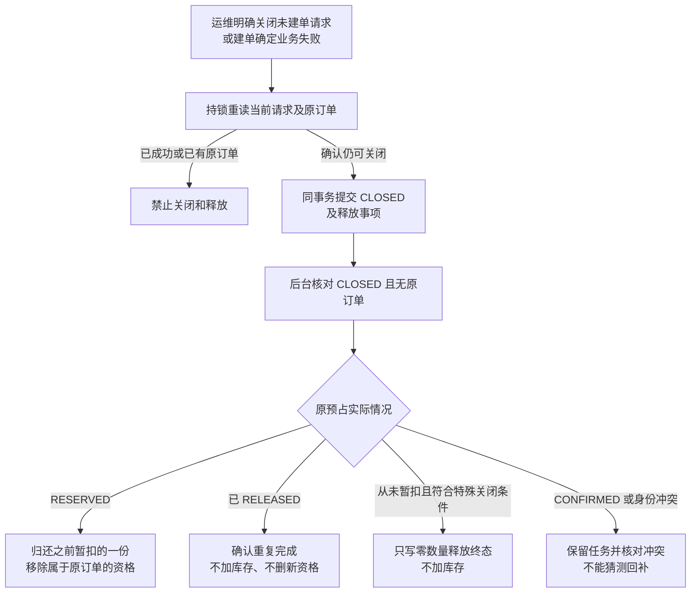
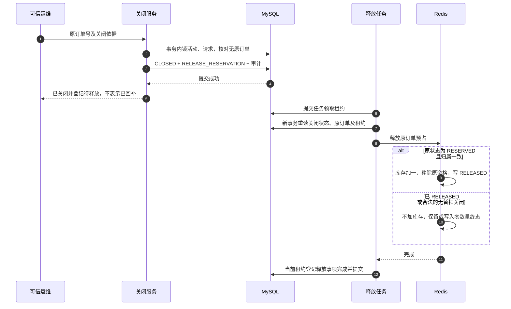
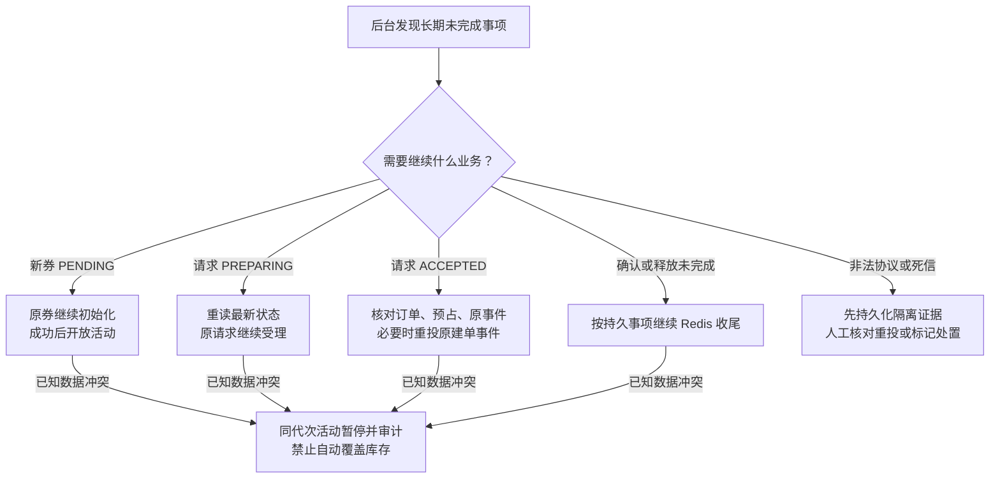

# RocketMQ 秒杀订单整体设计：从发券到异常恢复

普通券已单独补充 [直接数据库购买](ORDINARY_VOUCHER_PURCHASE.md)，不走本文的秒杀预占、Outbox 或 MQ 流程。

日期：2026-10-25。代码基线：`cf86d7d9e6a9394cbe8a6f09f8bf1632106eb5cb`。

这份文档是订单 MQ 优化的总入口，按业务过程组织，不要求先读完五份阶段记录。
“预期结构”和“预期流程”指本次优化要达到的业务契约；下文同时标明当前代码已经做到哪里，避免把设计目标当成验收结果。

当前已实现新券自动发布、可靠受理、Outbox 投递、幂等建单、结果查询、预占确认与释放、后台恢复、消息隔离和受控运维。
默认页面只走 `/voucher-order/reliable`；旧 Controller 和旧 Stream 消费者不再注册，旧代码和历史数据保留。
按用户要求，不再实现旧 Stream 排空、历史券接管或回退旧链路。
真实停进程、重启中间件和长时间 HTTP 压测尚未全部验收，Redis 全量丢失后的在线重建也未实现，详见 [实现与验收边界](#verification)。

## 阅读导航

| 想弄清的问题 | 从这里读 |
|---|---|
| 整体为什么这样优化，哪些组件负责什么 | [1. 优化方向](#direction)、[2. 一张业务总图](#overview) |
| 这些 ID、枚举和状态有什么区别 | [3. 业务编号](#identity)、[4. 状态设计](#states) |
| 数据库最终应有哪些表、字段、索引 | [5. 数据库结构](#database) |
| Redis 每个键里放什么，库存究竟何时加减 | [6. Redis 键设计](#redis)、[7. 库存账](#inventory) |
| 发券、购买、失败后恢复的先后顺序 | [8. 业务流程图与时序图](#flows) |
| 两个请求撞在一起、进程卡住时为什么不会乱 | [9. 事务与锁](#transactions)、[10. 并发和故障场景](#scenarios) |
| maintenance 干什么、如何排查、能不能直接重投 | [11. 后台恢复与运维](#operations) |
| 有没有做完，还有什么限制 | [12. 已实现和待验收](#verification)、[13. 设计取舍](#tradeoffs) |
| 对应代码、旧阶段文档在哪里 | [14. 代码与历史资料](#sources) |

<a id="direction"></a>

## 1. 整体优化方向

### 1.1 优化对象和业务约束

业务范围是：商家发布秒杀券，用户在活动时间内抢购，每个用户对同一张券最多形成一张订单，订单异步创建但最终结果可查询。
每次购买数量固定为 1，成功订单初始是“未支付”；本轮不增加支付、退款、支付超时关单或博客消息业务。

要同时满足四件事：

1. **高并发时不超卖、不重复建单。** Redis 先检查时间、可用库存和资格，数据库仍用条件扣库及唯一索引兜底。
2. **请求不会因为某一次响应丢失就找不到。** 调用 Redis 前先保存请求账本，客户端和后台都沿用原请求、原订单编号。
3. **消息允许重发，业务不能重复生效。** 通过 Outbox 保留待发送事项，通过账本状态、订单主键及业务唯一索引实现幂等。
4. **失败后有人继续做。** 后台执行确认/释放，继续未完成的受理、投递和发布；不能只在日志里写“失败了”。

### 1.2 原方案变化的关键点

旧实现把 Redis 扣库存、记录已购用户和 `XADD` 写 Stream 放在同一个 Lua 中，Redis 内的这几步可以连续执行。
换成 RocketMQ 后，Lua 不能顺便向另一个系统发送消息，出现“Redis 已扣、MQ 未发”的窗口。
因此本次不只是替换消息客户端，而是补齐 **请求记录 → 暂扣 → 持久待办 → 幂等建单 → 收尾与恢复**。

| 原有困难 | 当前设计 | 得到的业务结果 |
|---|---|---|
| Redis 扣了但发送消息失败 | 先有请求账本；受理成功时同事务保存 Outbox | 可沿用原请求继续受理或重投，不凭发送失败回补 |
| 返回订单号后用户不知道是否真建单 | 提交与查询分开，查询请求状态 | “已受理”和“建单成功”不会混为一谈 |
| Broker 重投导致重复执行 | 数据库账本和订单事实共同核对 | 重复消息最多对应一张有效订单 |
| 订单失败后 Redis 暂扣一直占着 | CLOSED 与释放任务同事务提交 | 后台最多归还一次实际暂扣的库存 |
| 服务重启后内存任务消失 | 请求、Outbox、恢复尝试和审计都在 MySQL | 重启后仍有依据继续检查 |
| 缺失 Redis 键被随手重新灌库存 | 活动开放状态、库存版本和初始化资格分开检查 | 发现冲突时暂停，避免在途预占被覆盖 |

### 1.3 三个系统的职责

| 系统 | 负责的事实 | 不应据此推断的结论 |
|---|---|---|
| MySQL | 请求结果、实际订单、实际库存扣减、还没做完的事项 | MySQL 里有订单号，不等于 Redis 已确认收尾 |
| Redis | 当前可抢份数、用户购买资格、每个订单的暂扣及收尾状态 | Redis RESERVED 不等于数据库已建单，CONFIRMED 也须核对实际订单 |
| RocketMQ | 至少一次投递建单事件、失败重试和死信保留 | 发送成功不等于业务成功，进入死信不等于业务取消 |

这里的“最终一致”有前提：依赖能够恢复、持久数据没有同时永久损坏、后台任务继续运行，冲突被核对处置。
它不是每次调用成功后三个系统立即相同，也不是依赖永久故障时还能无限正常接单的承诺。

<a id="overview"></a>

## 2. 一张业务总图



用户同步等待的是“是否可靠受理”的结果，后台继续完成建单和收尾。
查询接口读取当前用户自己的请求账本；页面最终只有 `SUCCEEDED` 才展示“订单创建成功”。
网络不确定时可能先显示 `PREPARING`，并保留原编号；不会把页面等待超时改写成业务失败。

<a id="identity"></a>

## 3. 业务编号：不要把不同编号都当成“消息 ID”

下文用券 `V=501`、用户 `U=7`、订单 `O=90001` 演示。实际订单号通常很长，前端和 Redis 均按字符串传递，示例短号只为方便阅读。

| 编号 | 谁产生，作用是什么 | 重试能否改变 | 例子 |
|---|---|---|---|
| `voucherId` | 数据库券主键，确定本次抢哪张券 | 同一次抢购不能改变 | `501` |
| `userId` | 后端登录上下文，确定请求属于谁 | 不接受客户端伪造 | `7` |
| `requestId` | 前端发送前生成并保存，标识用户的一次购买尝试 | 超时、刷新、重试必须复用 | `buy-501-a` |
| `orderId` | 首次建立账本时由后端生成，贯穿预占、消息和订单 | 原请求永远复用同一值 | `90001` |
| `eventId` | 后端按业务事项和原订单号生成 | 同一事项重发不改变 | `order-90001`、`confirm-90001`、`release-90001` |
| `traceId` | 首次请求的跟踪编号，帮助跨日志定位 | 原账本保留首次值 | `trace-a` |
| Broker `messageId` | Broker 对一次物理消息的编号 | 同一事件重发可能不同 | 不能用它替代订单幂等键 |
| `lease_token` | 每次领取任务生成，标识本轮临时执行资格 | 每次接管必须改变 | 工作者 A 的令牌不能替工作者 B 确认 |
| `epoch` | 活动库存版本，阻止旧任务修改另一版 Redis | 原请求绑定版本不得随意改 | 当前新券首次发布为 `1` |
| `quarantine_id` | 对来源、Topic、物理消息号及正文摘要计算 SHA-256 | 同一隔离身份保持不变 | 64 位小写十六进制字符串 |

`requestId` 的唯一范围是 **同一个用户**，数据库键是 `(user_id, request_id)`：

- U7 用 `buy-501-a` 抢 V501，超时后继续用原编号，仍对应 O90001。
- U7 用同一编号改抢 V502，参数摘要不一致，拒绝复用，不新建订单。
- U8 也叫 `buy-501-a`，属于另一个用户的独立请求；查询不能读取 U7 的结果。
- U7 用两个不同 requestId 抢 V501，是两次独立尝试，但用户券唯一约束仍保证最多一单。

参数摘要为 `SHA-256(userId:voucherId:1)`，最后的 `1` 是固定数量；不是把整个 HTTP JSON 随意哈希。
`schemaVersion=1` 则表示消息正文协议版本，与活动 `epoch`、任务领取次数完全不同。

### RocketMQ 主题、消费组和消息正文

| 对象 | 当前默认值或约定 | 职责 |
|---|---|---|
| 建单 Topic | `hmdp-seckill-order-create` | 承载 CREATE_ORDER，其他收尾事项不发到这里 |
| 生产者组 | `hmdp-order-producer` | 管理发送客户端，不是订单幂等身份 |
| 建单消费组 | `hmdp-seckill-order-create-cg` | 集群模式分摊消费；多个实例不是每个都必须成功消费一次 |
| 标签及业务 Keys | Tag=CREATE_ORDER；Keys 包含 eventId 与 orderId | 订阅和排查，不代替数据库幂等 |
| 原消费组死信 Topic | `%DLQ%` + 实际建单消费组 | 保存原消费组重试耗尽的消息，需有读取权限 |
| 死信观察组 | `hmdp-seckill-order-dlq-cg` | 独立持久化隔离，不能与建单消费组同名 |
| 发送与重试 | 同步发送默认 3s；SDK 额外发送重试默认 0 | 由 Outbox 统一管理应用退避，避免无意叠加多层重试 |
| 正常消费 | 默认 4 个线程、每批 1 条、最大重试配置 16 | 并发普通消息，没有依赖严格 FIFO 来保证订单正确 |

可读消息示例，编号简化，受理时间用 UTC 表示：

```json
{
  "schemaVersion": 1,
  "eventId": "order-90001",
  "orderId": 90001,
  "userId": 7,
  "voucherId": 501,
  "traceId": "trace-a",
  "acceptedAt": "2026-10-25T12:00:00Z"
}
```

消息身份比较不只看 orderId，还核对用户、券、稳定事件前缀、traceId 和原 acceptedAt；协议版本先由消息解析校验。
发布组件按原 Outbox JSON 还原消息再发送，人工重投不能传一份自选正文来改变原订单。
死信观察者写隔离库失败时继续重试，原消费者的最大重试次数与观察者自身的存储重试策略不是同一项配置。

<a id="states"></a>

## 4. 状态为什么分开设计

同一笔购买会同时有几种进度：客户请求、数据库订单、Redis 预占、待办执行和活动开放。
如果只留一个 SUCCESS/FAIL，就无法回答“扣过 Redis 但还没提交受理”“消息已发但订单还没建”“已关闭但还没回补”等实际问题。

### 4.1 请求状态：这次购买尝试走到了哪里

存储位置：`tb_seckill_request.status`；Java 枚举：`SeckillRequestStatus`。

| 状态 | 已经确定的事实 | 为什么需要这个状态 | 谁继续做，是否终态 |
|---|---|---|---|
| `PREPARING` | 原请求和订单号已登记，最终受理尚未确定；Redis 可能还没扣，也可能已扣但响应/提交失败 | 给不确定窗口留下可找回的记录，不能直接说失败 | 客户端原编号重试或后台恢复；非终态 |
| `ACCEPTED` | Redis 预占成功；受理状态、代次、受理时间和 CREATE_ORDER 已一起提交 | 向用户承诺后台有建单责任，但不谎称订单已存在 | Outbox、消费者和恢复任务推进；非终态 |
| `SUCCEEDED` | 对应数据库订单已经存在并核对一致，成功状态与确认任务已提交 | 明确“建单成功”，与消息发送成功分开 | Redis 确认可随后完成；请求终态 |
| `REJECTED` | 尚未受理就被明确业务规则拒绝，例如售罄、未开始或重复资格 | 明确这次尝试不再继续建单，不需要把未扣过的库存加回来 | 不自动恢复此请求；请求终态 |
| `CLOSED` | 这次原本未确定或已受理的请求已被明确终止，且释放任务已提交 | 区别于预占前的拒绝；可能有真实暂扣尚未归还 | 后台释放任务继续收尾；请求终态 |



终态箭头表示不再推进购买结果，不代表删掉记录。不能把 `SUCCEEDED` 改回 `ACCEPTED` 来“重试一次”。
后台补确认、补释放，也不应让已经成功或关闭的请求倒退。

### 4.2 Redis 预占状态：之前那一份库存后来怎样了

存储位置：`reservation:{orderId}` Hash 的 `state`。这些是 Lua 字符串状态，不是 `SeckillReservationResult` 返回码枚举本身。

| 状态 | `quantity` | 库存和资格含义 | 后续可执行动作 |
|---|---|---|---|
| `RESERVED` | `1` | 该订单已经暂扣一份，users 中该用户归属此订单 | 成功后确认；明确关闭后释放 |
| `CONFIRMED` | `1` | 原暂扣已由成功订单使用；不再多扣一份，用户资格保留 | 重复确认幂等；禁止释放 |
| `REJECTED` | `0` | 这次预占明确拒绝，没扣库存；可能由另一订单持有用户资格 | 原请求重复返回原拒绝；特殊关闭收尾可写释放终态但不加库存 |
| `RELEASED` | `0` | 原请求已结束；真实暂扣已归还，或没有暂扣只写入阻止迟到命令的记录 | 重复释放不再加库存；迟到预占不能重新扣 |

没有预占 Hash 不等于“肯定没有任何迟到命令”。`RELEASED` 是有意保留的终态记录，常称“墓碑”：
例如 O90001 已明确关闭，但此前超时的预占命令还在网络里，墓碑使它到达后不能重新扣库存。

`CONFIRMED.quantity=1` 表示该订单使用过一份，不表示库存仍需再扣；`RELEASED.quantity=0` 也不意味着每次执行都应加一。

### 4.3 Lua 预占返回码：这次调用得到了什么判断

Java 枚举：`SeckillReservationResult`。它回答一次调用的结果，而不是替代上一节的持久预占状态。

| 码 / 枚举 | 请求处理方式 | 例子 |
|---|---|---|
| `0 RESERVED` | 提交 ACCEPTED 与建单事件 | 首次暂扣成功，或原订单已 RESERVED 且身份一致 |
| `1 SOLD_OUT` | 提交 REJECTED | 剩余库存 0；本次未扣库存 |
| `2 DUPLICATE_USER` | 提交 REJECTED | U7 的资格已经属于另一个订单 |
| `3 NOT_READY` | 保留 PREPARING，等待核对 | 键缺失、错误类型、元数据未准备或版本不符，不能推断库存没扣过 |
| `4 NOT_STARTED` | 提交 REJECTED | Redis 当前时间早于活动开始 |
| `5 ENDED` | 提交 REJECTED | Redis 当前时间已达到或超过活动结束 |
| `6 TERMINAL` | 保留 PREPARING 并交恢复核对 | 原预占已 CONFIRMED/RELEASED 等，不应重新占用 |
| `7 CONFLICT` | 保留 PREPARING 并交恢复核对 | 同一预占编号绑定的用户或券不相符 |
| 未知码、null、网络异常 | 抛出结果未确认，保留原请求 | 不能把“不知道有没有成功”解释为“没有成功” |

已登记的 Redis REJECTED 原因会重复返回，不会在稍后库存增加时把同一订单改成成功预占。
同理，原订单已 RESERVED 时会优先复用，活动时间已过去也不把这份既有受理责任简单抹掉。

### 4.4 Outbox 状态和事件类型：事项是什么，与做到哪里分开

存储位置：`tb_mq_outbox`。它同时保存建单消息和 Redis 本地收尾事项。

| `event_type` | 谁执行 | 稳定 `event_id` | `SENT` 实际代表什么 |
|---|---|---|---|
| `CREATE_ORDER` | MQ 投递器 | `order-90001` | Broker 发送回执已确认并成功记录；不保证订单已建成 |
| `CONFIRM_RESERVATION` | maintenance 本地执行器 | `confirm-90001` | Redis 确认已执行且数据库回执已登记 |
| `RELEASE_RESERVATION` | maintenance 本地执行器 | `release-90001` | Redis 释放已执行且数据库回执已登记 |

后两类没有再向 RocketMQ 发送“确认/释放”消息；只有 CREATE_ORDER 由 MQ 投递器领取。
字段名 `SENT` 对本地事项实际是“执行完成”，这是共用任务结构的命名取舍，排查时必须结合 event_type。

| `status` | 用途 | 为什么不能只留待发/完成 |
|---|---|---|
| `PENDING` | 等待到期领取，包括失败后的退避等待 | 保留还需要有人做的事项 |
| `SENDING` | 已领取临时租约，正在发送或执行 | 区分正在处理和暂时无人处理；进程退出可在租约过期后接管 |
| `SENT` | 本类型事项的完成回执已登记 | 避免已完成事项被普通扫描不断执行 |



最后一条不是普遍重置能力：请求仍须 ACCEPTED、活动 READY、代次和预占有效，原事件正文必须一致。

### 4.5 活动开放与发布状态：有没有准备好，与为什么不能开放分开

存储位置：`tb_seckill_campaign_control`。

| 字段和值 | 表示什么 | 设计原因 |
|---|---|---|
| `status=READY` | 当前允许新受理及未完成建单按协议推进 | 活动级开门状态，与库存是否为 0 分开 |
| `status=PAUSED` | 暂不允许新受理或 ACCEPTED 正常建单 | 初始化或冲突期间不能继续扩大不一致 |
| `publication_status=PENDING` | 本次新券首次发布尚未完成 | 后台可继续同一券的首次初始化 |
| `publication_status=PUBLISHED` | 首次发布完成 | 重试只核对已有 Redis，不用数据库剩余量覆盖 Redis |
| `publication_status=BLOCKED` | 已发现数据冲突并阻止自动开放 | 不能把严重冲突当成普通发布重试一直覆盖 |
| `publication_status=UNMANAGED` | 历史/外部控制行，不具备新券首次创建资格 | 防止系统把历史暂停活动误认作刚创建、库存尚未使用的新券 |

正常新券走 `PAUSED/PENDING → READY/PUBLISHED`。
已知冲突可把同代次活动置为 `PAUSED/BLOCKED`；当前没有自动解除 BLOCKED 或一键重建入口。
`READY/PUBLISHED` 且库存为 0 是合法组合，不代表发布失败；未到活动开始时间也可以先准备 READY，再由 Lua 检查时间窗。

数据库迁移把 publication_status 设计为 VARCHAR，旧 DDL 注释可能只列出三个值；实际代码还会写 BLOCKED。
设计值应以本表及当前写入逻辑为准，不能只根据旧列注释推断完整状态集合。

### 4.6 关闭原因、订单支付状态、隔离状态

| 维度 | 值与含义 | 容易误解之处 |
|---|---|---|
| `failure_reason` 预占拒绝 | SOLD_OUT、DUPLICATE_USER、NOT_STARTED、ENDED | 说明为什么 REJECTED；不是额外的请求状态 |
| `failure_reason` 建单/人工关闭 | ORDER_CONFLICT、DB_STOCK_INSUFFICIENT、OPERATOR_CLOSED、OPERATOR_CLOSED_PREPARING | 最后一种允许原 PREPARING 缺预占时写零数量墓碑，不允许凭空加库存 |
| `tb_voucher_order.status` | 1 未支付，2 已支付，3 已核销，4 已取消，5 退款中，6 已退款 | 当前 MQ 只新建 status=1；SUCCEEDED 不等于已支付，CLOSED 不等于取消一张既有订单 |
| 隔离 `source` | INVALID 协议非法；DLQ 原消费组死信 | 两类都需先保存证据再 ACK |
| 隔离 `resolved` | 0 待处置，1 已处置 | “已处置”不代表订单成功或库存已释放 |

<a id="database"></a>

## 5. 预期数据库结构

### 5.1 表之间的关系

保留 3 张既有业务表，增加 6 张可靠性表，共 9 张相关表。
下图是业务逻辑关系；当前迁移没有建立物理外键，不应据此认为数据库会自动级联删除或保证所有关联存在。



`tb_seckill_recovery_attempt` 按“资源类型 + 资源编号”关联活动或请求；隔离消息可能完全无法解析订单号，
因此 `tb_seckill_message_quarantine` 不强制归属某条请求，不从物理消息号猜订单号。

### 5.2 三张既有业务表

| 表 | 关键字段和类型 | 键与用途 |
|---|---|---|
| `tb_voucher` | id BIGINT UNSIGNED；shop_id；title/sub_title/rules；pay_value/actual_value BIGINT，单位分；type；status；create_time/update_time | id 自增主键。保留券展示资料，秒杀 type=1 |
| `tb_seckill_voucher` | voucher_id BIGINT UNSIGNED；stock INT；begin_time/end_time TIMESTAMP；create_time/update_time | voucher_id 主键。stock 是随数据库建单扣减的剩余量，条件 `stock>0` 才允许减一 |
| `tb_voucher_order` | id BIGINT；user_id/voucher_id BIGINT UNSIGNED；pay_type；status；create_time/pay_time/use_time/refund_time/update_time | id 主键防同订单重复；新增完整唯一索引 `(user_id,voucher_id)` 防同用户同券多单 |

订单唯一索引包含所有订单状态，没有“退款后自动允许再买”的部分索引语义；本轮也不实现退款库存规则。
索引迁移先列历史重复，再尝试建唯一索引，有重复就失败，不自动删旧数据。

### 5.3 活动控制表 `tb_seckill_campaign_control`

| 字段 | 类型/空值约定 | 业务含义 |
|---|---|---|
| voucher_id | BIGINT，主键 | 独立的活动锁资源，与真实库存行分开 |
| epoch | BIGINT，非空且 >0 | 当前库存版本；新券从 1 开始 |
| status | VARCHAR(16)，READY / PAUSED | 是否允许新受理及未完成建单推进 |
| publication_status | VARCHAR(16)，非空，旧行默认 UNMANAGED | 首次发布资格与冲突原因；见 [4.5](#states) |
| updated_at | DATETIME(3)，数据库 UTC 毫秒 | 发布和暂停进度、恢复及监控依据 |

独立控制行允许受理、建单、收尾共享一把活动读锁，发布/暂停独占活动写锁，不必先把真实库存行锁成共享再升级。
并发用户仍会在条件扣数据库库存时短暂串行竞争同一库存行，这是最终防超卖的必要代价。

### 5.4 请求账本 `tb_seckill_request`

| 字段 | 类型/空值约定 | 为什么保存 |
|---|---|---|
| order_id | BIGINT，主键 | 原订单编号；即使还没建单也可以定位原请求 |
| user_id、voucher_id | BIGINT，非空 | 归属校验、一人一券业务对象 |
| request_id | VARCHAR(128)，非空 | 客户端重试的稳定编号 |
| payload_hash | CHAR(64)，非空 | 防同一 requestId 被用于不同业务参数 |
| trace_id | VARCHAR(128)，非空 | 保留第一次跟踪号，后续消息和审计可串联 |
| status | VARCHAR(16)，默认 PREPARING | 请求阶段；CHECK 限定五种请求状态 |
| failure_reason | VARCHAR(64)，可空 | 拒绝/关闭原因；成功时为空 |
| reservation_epoch | BIGINT，可空 | ACCEPTED 时固定预占版本；PREPARING 尚未确定时可空 |
| accepted_at | DATETIME(3)，可空 | 首次受理时间，消息身份核对的一部分；未完成受理时可空 |
| created_at、updated_at | DATETIME(3)，UTC | 创建时间及最后进展时间，恢复按 updated_at 的长时间无进展筛候选 |

索引：主键 order_id；唯一 `(user_id,request_id)`；恢复索引 `(status,updated_at,order_id)`；
按券检查索引 `(voucher_id,status,order_id)`。
人工关闭原 PREPARING 时会填充任务需要的代次和 accepted_at，此时该时间不能反向证明请求曾经 ACCEPTED，仍要结合状态和原因。

### 5.5 持久事项表 `tb_mq_outbox`

| 字段 | 类型/空值约定 | 为什么保存 |
|---|---|---|
| event_id | VARCHAR(128)，主键 | 事项稳定编号，同一事件重发不换号 |
| order_id、event_type、schema_version | BIGINT、VARCHAR(32)、INT，非空 | 关联原请求、区分执行器、校验协议版本 |
| payload | MEDIUMTEXT，非空 | 原始稳定 JSON，重投不临时拼另一份订单身份 |
| status | VARCHAR(16)，默认 PENDING | PENDING / SENDING / SENT |
| attempts | INT，默认 0，非负 | 实际领取次数，不等于失败次数；成功领取也会加一 |
| next_retry_at | DATETIME(3)，非空 | 退避到期时间，避免忙循环占满资源 |
| lease_token、lease_until | VARCHAR(64)、DATETIME(3)，可空 | 当前执行资格及到期时间，过期可接管 |
| broker_message_id | VARCHAR(256)，可空 | CREATE_ORDER 的 Broker 回执；本地任务用 redis-confirmed / redis-released 标识完成 |
| last_error | VARCHAR(128)，可空 | 最近错误类型，不存凭据或完整业务正文 |
| created_at、updated_at | DATETIME(3)，UTC | 最老待办年龄和执行进度 |

约束：唯一 `(order_id,event_type)`，避免同一原请求登记多个同类事项；status 和 attempts 有 CHECK。
索引：`(event_type,status,next_retry_at,event_id)` 和 `(event_type,status,lease_until,event_id)`。
任务永远按类型领取；不能让 MQ 投递器把一条 RELEASE_RESERVATION 误当作建单消息发送。

### 5.6 恢复尝试表 `tb_seckill_recovery_attempt`

| 字段 | 类型与含义 |
|---|---|
| resource_type、resource_id | VARCHAR(16) + BIGINT，联合主键；CAMPAIGN 对应券号，REQUEST 对应原订单号 |
| attempts | INT，默认 0，领取一次恢复资格加一 |
| next_retry_at | DATETIME(3)，下一次允许检查时间；索引 idx_recovery_due |
| last_error | VARCHAR(128)，可空，最近恢复错误类型 |
| updated_at | DATETIME(3)，UTC 最近检查进度 |

它不是第三份业务结果。其作用是分配本轮恢复检查资格并退避，防止一条持续失败的请求每轮都占据扫描最前面。
当前做法不是带令牌的长租约：下一次到期后仍可能再次检查，安全性最终依赖活动/请求锁、状态重读和幂等操作。

### 5.7 审计表 `tb_seckill_maintenance_audit`

| 字段 | 类型与含义 |
|---|---|
| id | BIGINT 自增主键 |
| order_id、voucher_id | BIGINT，可空，能关联的对象编号；纯隔离处置可没有订单或券 |
| action | VARCHAR(32)：REPLAY、CLOSE、DISMISS_QUARANTINE、CONSISTENCY_CONFLICT |
| operator_id | VARCHAR(128)，真实登录用户号，后台检查使用 SYSTEM |
| reason | VARCHAR(256)，操作依据，不存令牌 |
| created_at | DATETIME(3)，UTC；按订单查审计有 `(order_id,id)` 索引 |

人工关闭、重投和隔离处置与各自审计一起提交。自动发现冲突时，原业务事务先结束，再独立暂停活动并写审计，避免共享锁升级。

### 5.8 隔离表 `tb_seckill_message_quarantine`

| 字段 | 类型与含义 |
|---|---|
| quarantine_id | CHAR(64)，主键，相同隔离身份重复写入不覆盖原记录 |
| source | VARCHAR(16)，INVALID 或 DLQ |
| message_id、topic | VARCHAR(256)、VARCHAR(255)，可空，记录物理来源 |
| body、body_hash | MEDIUMBLOB 可空；CHAR(64) 摘要非空；正文最多保存 65536 字节，超大消息只留摘要 |
| error_type、reconsume_times | VARCHAR(128)、INT，异常类别和 Broker 携带的重试次数 |
| resolved、resolution | TINYINT 默认 0；VARCHAR(256) 可空，已处置标识及原因 |
| created_at | DATETIME(3)，UTC；未处置查询索引 `(resolved,created_at)` |

前端只拿摘要和来源，不返回 body。隔离表的“幂等写”防重复保存同一物理异常，不取代订单的业务幂等。
没有额外独立 Inbox 表：当前由请求状态、原订单事实、主键和用户券唯一索引共同承担消费幂等。

### 5.9 结构落地规则

正式 DDL 以这四份迁移为准，顺序为：02 请求/Outbox → 03 订单唯一索引 → 04 发布状态 → 05 恢复、审计、隔离。
它们位于 `backend/src/main/resources/db/migration/`，由操作者对目标库手动执行，本项目没有因加入文件就自动执行 Flyway 的配置。
DDL 可能隐式提交，不能指望外层事务回滚；脚本不删除历史数据、不自动选择业务库。
`db/hmdp.sql` 是已有业务表初始化资料，单独导入它不等于六张可靠性表和订单唯一索引都已经具备。

<a id="redis"></a>

## 6. Redis 键设计

### 6.1 新链路四类键

| 键格式 | 类型 | 内容示例 | 业务用途 |
|---|---|---|---|
| `hmdp:seckill:{501}:stock` | String | `2` | 当前还可被新请求暂扣的份数，非负整数 |
| `hmdp:seckill:{501}:meta` | Hash | ready=1，epoch=1，beginAt/endAt=UTC 毫秒 | 准备标识、库存版本和时间窗 |
| `hmdp:seckill:{501}:users` | Hash | field `7` → value `90001` | 用户 U7 的当前购买资格属于 O90001，值是订单号，不是布尔值 |
| `hmdp:seckill:{501}:reservation:90001` | Hash | 见下表 | 原订单是否暂扣过，是否已经确认/释放 |

`{501}` 是 Redis Cluster hash tag，让单次 Lua 的四个键在同一个槽；不保证整个项目其他 Redis 功能都已完成集群适配。
项目命名空间只拼接一次。编号用字符串比较，避免 Lua 和 JavaScript 浮点数舍入长整数。

预占 Hash 字段：

| 字段 | 约定 | 示例 |
|---|---|---|
| state | RESERVED / CONFIRMED / REJECTED / RELEASED | RESERVED |
| userId、voucherId、orderId | 原请求身份，十进制字符串 | 7、501、90001 |
| epoch | 原库存版本字符串 | 1 |
| quantity | 当前这条记录代表的一份使用量：0 或 1，结合 state 理解 | RESERVED 为 1 |
| reasonCode | 仅拒绝记录写入的固定预占拒绝码 | 售罄为 1 |

meta.ready=1 表示 Redis 数据准备过，不是“所有业务必然允许购买”：Java 仍须读取数据库活动 READY，Lua 仍要检查时间和剩余库存。

### 6.2 创建、保留和清理策略

- 首次发布只允许数据库 `PAUSED/PENDING` 的新券，在 stock/meta/users 三个键全缺时创建 stock/meta；空的 users 不需要预先建 Hash。
- 已有键必须类型和内容符合约定。初始化核对还要求键无 TTL；部分缺失、带 TTL 或参数冲突时不自动修补。
- 已发布活动重新调用初始化只核对已有键，不把 stock 重置为数据库库存；已发布后全部丢键也不能当成全新活动重新灌入。
- 当前新键不主动设置 TTL；确认和释放后也保留预占终态，避免迟到或重复命令重新生效。
- 活动结束不等于可以立即删键：仍可能有未建单请求、补偿任务或迟到消息。本轮没有实现安全的按活动归档清理和记录保留期任务。

四个 Lua 分工：`initialize-campaign.lua` 首次准备/核对；`reserve-order.lua` 预占；
`finish-reservation.lua` 确认/释放；`verify-reservation.lua` 重投前只读核对。
Lua 使一次脚本内的命令连续执行，但运行时错误不会自动撤销前面已经执行的写操作，因此先校验类型、数值和归属再写。

### 6.3 其他相关键及不再使用的旧键

| 键 | 当前定位 |
|---|---|
| `hmdp:icr:voucher_order:yyyy:MM:dd` | 订单 ID 生成器的 UTC 日计数，配合相对时间戳拼成 Long；不是业务库存，不是 Broker 消息号 |
| 浏览器 `hmdp-seckill-request:{userId}:{voucherId}` | sessionStorage 中保存 requestId 和最近结果；不是 Redis 键，不参与服务端最终判定 |
| `hmdp:seckill:stock:{voucherId}` | 旧库存命名；历史代码保留，当前新 API 运行模式不使用它受理 |
| `hmdp:stream:orders` 及旧购买资格数据 | 历史链路数据，当前不消费、不迁移，也不自动删除 |

ID 生成仍依赖 Redis，并非“Broker 挂了也完全不依赖 Redis”。
若 Redis 在首次生成 orderId 前不可用，账本可能还没建立；只有账本已提交后，才存在可按原订单恢复的责任。
计数键也不能任意删除：同一天计数重置会破坏生成器的唯一性假设；当前没有跨计数丢失的订单 ID 生成器重建设计。

### 6.4 epoch 为什么保留，即使当前没有一键重建

假设旧任务用 epoch=1，未来某次受控维护建立了 epoch=2。旧释放任务若不比较版本，可能向新库存错误加一。
因此账本、活动控制行、meta 和预占都保存/核对版本，旧任务不能修改另一代库存，也不能暂停已推进到新代次的活动。

**当前已实现的是版本核对和旧版本保护，不是自动重建/自动增加 epoch。** 新券首次版本为 1，
当前没有公开的全量重建、epoch 自动递增或 BLOCKED 自动恢复功能。不能手工只改 meta.epoch 就声称完成了恢复。

<a id="inventory"></a>

## 7. 库存账：何时扣，何时加，为什么看起来扣了两次

Redis 余量和数据库余量是两本账：Redis 先限制还可接多少购买责任，数据库只在订单事务真正成功时减少。
同一订单从两本账各减少一份，不是在数据库重复售出两份。

假设一张新券初始 3 份，仅观察 U7 的一次请求：

| 时刻 | 请求状态 | Redis 预占 | Redis 可用库存 | DB 剩余库存 | 数据库订单 |
|---|---|---|---:|---:|---|
| 发布完成 | 无 | 无 | 3 | 3 | 无 |
| 账本已提交、尚未预占 | PREPARING | 无 | 3 | 3 | 无 |
| Lua 暂扣已执行、受理事务未提交 | PREPARING 对外仍可见 | RESERVED，1 份 | 2 | 3 | 无 |
| 受理提交 | ACCEPTED | RESERVED | 2 | 3 | 无 |
| 正常建单提交 | SUCCEEDED | 可能仍 RESERVED | 2 | 2 | O90001，未支付 |
| 后台确认完成 | SUCCEEDED | CONFIRMED，1 份 | 2 | 2 | 同一张订单 |

若该请求在建单前明确关闭，分支变为：

| 时刻 | 请求状态 | Redis 预占 | Redis 可用库存 | DB 剩余库存 | 数据库订单 |
|---|---|---|---:|---:|---|
| 已暂扣、未建单 | ACCEPTED | RESERVED | 2 | 3 | 无 |
| 关闭及释放事项提交 | CLOSED | 仍可能 RESERVED | 2 | 3 | 无 |
| 第一次释放完成 | CLOSED | RELEASED，0 份 | 3 | 3 | 无 |
| 重复释放 | CLOSED | RELEASED | 3 | 3 | 无 |

REJECTED 从未暂扣时，两本账都保持 3，不执行“失败就加一”。
PREPARING 被关闭但压根没有预占时，也只写 RELEASED 墓碑，不能把 3 加成 4。

### 稳定边界下的核对等式

对一张新券，在没有人工改库存、支付退款或数据损坏的前提下：

- `D`：数据库剩余库存。
- `R`：Redis 可用库存。
- `H`：尚未形成数据库订单、但在 Redis 实际仍占用一份的原请求数，包含尚未释放的 CLOSED 和可能已扣的 PREPARING。
- `O`：已形成的实际订单数；`S` 为发券时记录的初始总量。

同一稳定快照应满足 `R = D - H`、`S = O + D`，即 `S = O + R + H`。
**不能简单数所有 RESERVED 作为 H**：SUCCEEDED 在确认任务执行前也可能仍是 RESERVED，但它已经包含在 O，不能再数一次。
当前库中 stock 会持续递减，并没有单独不可变的 initial_stock 字段；S 需要发券基线或外部记录支持。

实际验收应先停止新提交，等待在途事务、建单和收尾任务完成，再核对 `H=0` 时 `R=D`。
不能在并发运行中先读一次 Redis、几秒后再读一次 DB，就把跨时刻差值认定为库存错误。

<a id="flows"></a>

## 8. 业务流程图与时序图

图只保留改变业务结果的动作；SQL、Lua 内部判断及逐方法图见历史阶段资料。
图中的“提交”是数据库事务真正结束后再继续，不是只在方法内执行了一条 UPDATE。

### 8.1 发布活动：先有券，再准备库存，最后开放





发券接口返回未确认不代表“券没创建”，只有发布阶段失败时原券仍在。
如果整个 HTTP 响应丢失、商家连原券号也没拿到，当前还没有商家侧 createRequestId 保证整次创建幂等；应先定位原券，不能盲目再发一张。
调用首次初始化成功但事务二提交失败时，原券仍 PENDING；下一次核对完全相同的原 Redis 数据后继续开放，不多造库存。

### 8.2 用户抢购和异步建单



```mermaid
sequenceDiagram
    autonumber
    participant User as 用户页面
    participant Accept as 受理服务
    participant DB as MySQL
    participant Redis as Redis
    participant Dispatch as Outbox 投递器
    participant MQ as RocketMQ
    participant Create as 建单消费者
    participant Finish as 预占收尾任务
    User->>User: 保存本次 requestId
    User->>Accept: 提交抢购或重试原请求
    Accept->>DB: 事务一：找回或登记 PREPARING
    DB-->>Accept: 原 orderId 已提交
    Accept->>DB: 事务二：活动共享锁、请求排他锁
    Accept->>Redis: 原订单预占一份
    Redis-->>Accept: RESERVED
    Accept->>DB: ACCEPTED + CREATE_ORDER，一起提交
    Accept-->>User: 最新持久化状态，不保证已建单
    Dispatch->>DB: 领取 CREATE_ORDER 租约并提交
    Dispatch->>MQ: 在数据库事务外发送原事件
    MQ-->>Dispatch: 发送回执
    Dispatch->>DB: 当前有效租约登记 SENT
    MQ->>Create: 投递或重复投递建单事件
    Create->>DB: 同事务扣库存、插订单、SUCCEEDED、确认事项
    DB-->>Create: 提交成功
    Create-->>MQ: ACK
    Finish->>DB: 领取确认事项，核对成功订单
    Finish->>Redis: 原预占改为 CONFIRMED，不再扣库
    Finish->>DB: 当前租约登记本地事项完成
    User->>Accept: 按原 requestId 查询
    Accept->>DB: 仅查询该用户自己的账本
    Accept-->>User: SUCCEEDED，显示订单创建成功
```

这是正常完成的一条可能顺序，不保证投递回执写 SENT 一定早于消费者建单。
Broker 收到消息后可能很快投递，数据库订单甚至已经成功，而投递器的 SENT 回执还没写回；重复发送仍需由消费幂等保护。

### 8.3 关闭请求与释放预占





对“确认”和“释放”都采用业务先确定、Redis 后收尾：成功结果和确认事项一起落库，关闭结果和释放事项一起落库。
执行 Redis 后数据库回执失败也不删除事项，下次脚本按原状态幂等核对。

### 8.4 后台恢复与隔离处置



“恢复”不是一种统一的重新执行命令：PENDING 恢复的是发券发布，PREPARING 恢复的是受理，
ACCEPTED 恢复的是建单责任，本地事项恢复的是确认/释放。每种都必须回到相应业务步骤，不能全部直接调用“建订单”。

<a id="transactions"></a>

## 9. 事务、锁与幂等各保护哪一层

### 9.1 不能合并掉的提交边界

| 事务 | 一起提交的内容 | 为什么分成这样 |
|---|---|---|
| 发券事务一 | 券、数据库库存、PAUSED/PENDING 控制行 | Redis 前先有原券，发布失败可定位 |
| 发券事务二 | 活动排他锁内核对 Redis 后提交 READY/PUBLISHED | 不允许还没准备好就接新请求；锁覆盖提交 |
| 受理事务一 | PREPARING 原账本 | Redis 已执行但后续回滚时仍有恢复线索 |
| 受理事务二 | ACCEPTED、固定代次及受理时间、CREATE_ORDER | 防“承诺已受理但没有待发事项” |
| 投递领取事务 | SENDING、新令牌、到期时间、尝试次数 | 网络发送前先固定临时执行资格，崩溃后可接管 |
| 投递回执/失败事务 | 当前租约写 SENT，或退避 PENDING | Broker 网络调用不占用数据库事务 |
| 正常建单事务 | DB 条件扣库、订单、SUCCEEDED、确认事项 | 防“订单成功但没有确认事项”或“扣库成功却没插订单” |
| 建单失败后的关闭事务 | 重新核对后 CLOSED、释放事项 | 先完整回滚原建单事务，再按最新事实决定关闭 |
| 人工关闭事务 | CLOSED、释放事项、审计 | 不能只关请求、不登记释放，也不能只留审计而没执行 |
| 本地收尾执行事务 | 业务事实和租约核对、Redis 执行、完成回执 | Redis 写不能随 SQL 回滚，靠原事项和脚本幂等补齐 |
| 隔离事务 | 异常证据持久化 | 提交成功才 ACK；存储失败继续 MQ 重试 |

业务短事务使用 `REQUIRES_NEW + READ_COMMITTED`，通常 5 秒、可配置在 1～30 秒内；
Outbox 领取/回执和隔离使用固定短事务。独立事务意味着调用方不能用自己外层事务的回滚来撤销已提交步骤。
发券、消费、运维等需要明确独立边界的入口会拒绝已有外层事务；受理也明确建立自己的两个独立事务。

### 9.2 锁资源和顺序

| 保护对象 | 机制 | 处理什么竞争 |
|---|---|---|
| 同一活动正常操作与发布/暂停 | 控制行 `FOR SHARE NOWAIT` / `FOR UPDATE NOWAIT` | 正常受理、建单、收尾可共享；发布、暂停独占 |
| 同一原请求的状态转换 | 请求行 `FOR UPDATE NOWAIT` | 重复受理、消费、人工关闭不会同时改出两个终态 |
| 同一张数据库库存 | `UPDATE stock=stock-1 WHERE stock>0` | 即使 Redis 异常，DB 不扣成负数 |
| 同一原订单或同一用户同券 | 主键 + `(user_id,voucher_id)` 唯一索引 | 并发查重无法替代数据库最终约束 |
| 多实例领取任务 | `FOR UPDATE SKIP LOCKED` + 提交租约 | 跳过别人正在领的行，减少重复领取 |
| 已领任务的完成回执 | event_id + SENDING + 当前 token + 未过期 | 旧工作者不能覆盖接管者状态 |
| 单次 Redis 暂扣、确认、释放 | 同槽 Lua | 同一组库存、资格、预占原子判断及修改 |

正常业务按 **活动共享锁 → 请求排他锁 → 必要时事项排他锁 → 业务条件写入** 的顺序组织。
先领取任务的事务只持事项行锁，提交后才进入业务执行事务，不拿着事项行锁反向等待活动/请求锁。
确认释放、关闭、重投都要重读当前数据，不能拿列表页或扫描时的旧快照直接修改。

`NOWAIT` 冲突立即失败，业务记录保留供原请求或后台稍后再试，不在锁内无限等待。
发生一致性冲突后，先结束原共享锁事务，再新开事务取活动排他锁和请求锁暂停；不能在原事务内强行升级活动锁。

新链路没有把“整张券的抢购”包进一把 Redisson 互斥锁；旧 Redisson/Stream 实现只作为源码参考。
商铺布隆同步、商铺缓存互斥锁不属于这条订单链路，本轮没有调整它们的事务或锁顺序。

### 9.3 为什么仍允许重复投递

数据库事务无法同时原子提交 Broker 收消息或 Redis 写入的结果。
因此这里只保证一条原请求的业务效果幂等，不宣称 Broker “物理只发送一次”或三个系统之间存在分布式原子事务。
重复投递是用于填补响应未知窗口的正常手段，不等于重复扣库应该被容忍。

<a id="scenarios"></a>

## 10. 并发和故障：按发生位置逐个推演

每个场景都按“先后顺序 → 可能出错的点 → 实际保护 → 用户或后台下一步”说明。
下面的处理是设计契约，已验证到哪种故障程度见 [12. 验收边界](#verification)，不表示所有场景都做过真实断电演练。

### A. 发布和首次接入期间

**A1. 券保存成功，但 Redis 暂时不可用。** 事务一先提交 V501 和 PAUSED/PENDING；事务二调用 Redis 失败。
券不能返回成“根本不存在”，也不能提前 READY。后台继续 V501 的首次初始化，或操作者按返回的原券号重试。
两表券/库存和控制行在事务一任一写失败则一起回滚，不留下只保存了一半的新券。

**A2. Redis 准备成功，但就绪响应或 READY 提交失败。** Redis 已有 stock/meta，数据库仍 PENDING。
下次初始化只接受同版本、同时间、初始库存未被消费且没有用户归属的原数据，再提交 READY；不会重新 SET 一份初始库存。
若 READY 其实已提交，只是客户端没收到，重复调用进入已发布的只读核对，不重置已用库存。

**A3. 两个实例同时继续发布同一券。** A 先取得活动排他锁，B 的 NOWAIT 立即失败。
A 持锁准备 Redis 并完成 READY 提交后才释放；B 后续重试看到 PUBLISHED，只核对，不再按“新券”覆盖。

**A4. 发布和抢购同时到来。** 发券持活动排他锁，受理要活动共享锁，二者不能跨越彼此的提交边界。
锁冲突或 PAUSED 时保留原 PREPARING，不伪造库存不足；READY 提交后才可继续预占。

**A5. 已发布活动某个 Redis 键丢了。** 不能只看到 DB 剩余 8 就 SET Redis=8：其中可能还包含 2 份未建单预占，实际可抢仅 6。
初始化拒绝拼补；受理/收尾/恢复遇到明确冲突时保留记录，后台核对并暂停同代次活动。
这类异常需要受控重建方案，当前没有自动从 DB 全量恢复 Redis 的入口。

### B. HTTP 提交、重试与预占期间

**B1. 同一 requestId 双击或两个实例同时受理。** A、B 都可能预生成候选订单号，但账本的用户请求唯一键只留下一个原记录。
重复插入不覆盖原 orderId、参数和状态。双方再读取该行，因此允许出现未使用的 ID 空洞，不允许返回两个购买责任。
后续请求排他锁让同一原订单只推进一次，已 RESERVED 的 Lua 重试不再扣。

**B2. 同一用户换 requestId 再抢同一券。** A 用请求 a 预占后，users[7]=90001。
B 的新订单看到资格已归属 O90001，写 REJECTED/DUPLICATE_USER，quantity=0，不扣库存。
数据库用户券唯一索引还防御 Redis 之外的竞争，不能只依赖页面禁用按钮。

**B3. 两个用户抢最后一份。** Redis stock=1。A 的 Lua 完整执行后 stock=0 并登记归属；B 随后看到 0，明确拒绝。
不存在两段 Java “先查再减”之间插入另一个请求的窗口，数据库条件扣库另作最后防线。

**B4. 复用原 requestId，但把券号换了。** 原账本固定 U7/V501 的参数摘要；请求改成 V502 时先校验绑定，不调用 Lua。
换登录用户也不能据此查询别人账本，接口没有直接信任正文 userId。

**B5. Redis 已暂扣，响应超时，受理事务回滚。** Redis=2、RESERVED 已存在，DB 仍 PREPARING。
由于 PREPARING 是上一独立事务提交的，原请求不会消失；再次 accept 用 O90001 得到原 RESERVED，不再把 2 扣成 1，
随后提交 ACCEPTED 与事件。网络超时不能触发补偿，因为原预占可能已经真实生效。

**B6. Redis 预占成功，Outbox 插入或 ACCEPTED 提交失败。** SQL 事务回滚，两项一起不生效，DB 仍 PREPARING；Redis 暂扣可能已生效。
恢复仍走 B5 的原订单复用，不直接发送一条没有账本承诺的新消息，也不另造订单号。

**B7. 受理提交成功，但 HTTP 响应丢失。** DB 已 ACCEPTED+CREATE_ORDER，客户端还以为未知。
页面保留 requestId，通过原编号查回现状；重新 POST 同一请求会返回已持久化状态，不再新增 Outbox。
后台可能已建完单，因此 POST 返回的最新查询结果也可能直接 SUCCEEDED。

**B8. 页面刷新或先查询得到 404。** 原 HTTP 可能还在途中，404 不能证明它永远不会到达服务器。
页面继续保留原编号，不自动发一个新 requestId。服务器真正没有账本时，原编号重提仍可登记同一次尝试。

**B9. 活动未开始、已结束、售罄或重复资格。** Lua 保存 REJECTED 和明确原因，DB 提交 REJECTED；没扣库存，没有释放任务。
例如活动后来开始了，也不能把同一条“未开始拒绝”的原订单改成成功。用户明确点击重新发起才生成新 requestId，重新参与资格判断。

**B10. Redis 在 orderId 生成前就不可用。** 还没生成稳定订单号，也可能没有账本。
这种错误不能承诺“后台一定会找到该请求”；客户端仍可保留 requestId 在依赖恢复后重试，但不会凭空存在一张待恢复记录。

### C. Outbox 领取和 Broker 投递期间

**C1. 多个投递器扫描同一批事项。** 各自用 SKIP LOCKED 领取一条并提交 SENDING 和新 token。
跳过别人锁住的行，避免同时把同一租约发给两个实例；一次只领一条再发送，减少批量任务排队时租约已经过期的问题。

**C2. 领取后进程退出，还没发送。** 事项停在 SENDING，租约到期后由另一个实例重领，发送原 eventId 和 payload。
不能因为“它已经被领取过”就当成完成，也不需要靠旧进程内存队列找回。

**C3. Broker 实际收到了，但发送响应丢失。** 投递器不能确定是否发送成功，只登记退避或等待租约接管。
下一次可能产生第二条物理消息，但两条都是 order-90001；消费者按 O90001 和实际订单幂等，不能因消息可能重复就删除原预占。

**C4. Broker 返回 SEND_OK，但写 SENT 失败。** 和 C3 一样允许重发，仍不回补。
反过来，SENT 只表示发送回执已登记；请求可能仍 ACCEPTED，也可能早已 SUCCEEDED，不能拿 Outbox 状态替代业务状态。

**C5. 旧工作者响应很慢，新实例已接管。** A 的 token=a 已过期，B 领取 token=b。
A 回来登记 SENT 时 WHERE 条件不匹配，更新 0 行，不覆盖 B。Broker 物理发送仍可能重复，最终由消费幂等兜住。

**C6. Broker 长期不可用。** 发送失败指数退避，当前上限为 5 分钟，不因超过某个应用重试次数自动删事项或释放库存。
积压告警后可暂停新提交，保持恢复和收尾；不是“故障多久都无限接单”的容量承诺。

### D. 数据库建单期间

**D1. 同一建单事件被并发或重复消费。** A 先取得请求锁并提交订单、SUCCEEDED、确认事项；B 锁冲突重试后读取成功终态。
B 仍核对原订单真实存在且归属相符，然后成功 ACK，不再次扣 DB 库存或登记第二条确认事项。

**D2. 数据库事务提交了，但 ACK 没到 Broker。** 重投走 D1。订单号不会换，不能把“客户端没确认”解释为“数据库没建单”。
如果提交响应本身丢失，也由后续原事件核对实际账本及订单，不重新扣库猜测结果。

**D3. 扣了 DB 库存，但插订单、写成功状态或确认事项失败。** 这几步在同一事务，失败全部回滚。
请求保持 ACCEPTED、Redis 原预占保持，Broker 继续重试。不能在失败事务里随手把请求关了，因为原事务尚未确认回滚。

**D4. Redis 预占成功，DB 却库存不足。** 说明两本账或外部写入存在异常，但本次必须明确业务收尾。
原建单事务回滚，再重新锁请求核对没有原订单，提交 CLOSED/DB_STOCK_INSUFFICIENT 与释放事项；Redis 后台归还这一单实际暂扣的一份。
DB 原本就没成功扣减，本次不对 DB 执行“再加一”。

**D5. 其他路径或并发事务已建同用户同券订单。** 当前用户券唯一索引拒绝第二张订单，失败事务的库存扣减一起回滚。
关闭事务重读：如果原 O90001 已由别人正常建成，核对后一并推进成功；如果确实是另一个用户券订单，才关闭本次请求并登记释放。
其他重复键异常若不能证明是该用户券冲突则继续抛错，不能把所有 DuplicateKey 都当作正常业务关闭。

**D6. 运维关闭与消费者同时操作同一请求。** 两者都锁同一请求行。
消费者先提交 SUCCEEDED，关闭被拒绝；关闭先提交 CLOSED+释放事项，迟到消费者看到 CLOSED 就不再建单。
不会一边有成功订单、一边又按同一请求回补 Redis。

**D7. ACCEPTED 遇到活动暂停或代次变化。** 消费者不能越过维护状态或拿旧预占建新版本订单，返回重试等待核对。
已成功的重复消息仍按实际订单核对终态；暂停不是抹掉已经成功的订单。

### E. Redis 确认、释放和迟到命令期间

**E1. 成功订单重复确认。** 原预占 RESERVED→CONFIRMED，库存不变；再次确认仍核对同一用户、订单、券、代次和 quantity=1，再返回完成。
不能因为确认动作叫“确认扣减”就在这里又 DECR 一次。

**E2. 释放成功，但 Redis 回包或数据库完成回执丢失。** 第一次已 INCR 并写 RELEASED，事项仍可能 PENDING/SENDING。
下次 RELEASED 直接返回完成，不再 INCR；若任务租约已失效，保留事项由后续工作者完成回执。

**E3. 原订单释放后，用户又用新订单买到券；旧释放再次到达。** users[7] 已归属新订单 O90002。
旧 O90001 的预占是 RELEASED，重复释放不删除 users[7]，不破坏新订单资格；不是只按 userId 做 HDEL。

**E4. 关闭 PREPARING 时，旧预占命令还没到 Redis。** 若释放墓碑先执行，迟到 reserve 看到 RELEASED，不扣库存。
若旧 reserve 先执行，后续释放看到 RESERVED，归还实际暂扣的一份。两条 Redis 脚本连续执行，按真实先后处理。
没有预占记录时仅 OPERATOR_CLOSED_PREPARING 允许写零数量墓碑，普通 ACCEPTED 缺记录不能据此加库存。

**E5. ACCEPTED 的预占不见了，或原预占已 CONFIRMED 却要求释放。** 不知道那一份究竟还在不在，不能用“关闭了就加一”掩盖数据缺失。
事项保留，已知冲突交同代次暂停和审计；CONFIRMED 不能被释放，缺失也不能随意补键。

**E6. Redis 不可用时执行确认或释放。** 原 SUCCEEDED/CLOSED 仍是数据库事实，事项记录保留、登记下次执行时间。
恢复连接后继续原事项，不能因为 Redis 收尾失败把成功订单变成失败，或把关闭请求重新受理。

**E7. 旧 epoch 的事项迟到。** meta、预占和请求版本不相符则拒绝修改。
旧版本冲突只保留审计，不暂停已经进入新版本的活动；版本保护不等于当前系统已经实现了自动升级和重建。

### F. 自动恢复、隔离和人工重投期间

**F1. 扫描看到 PREPARING，真正处理前它已 SUCCEEDED。** 当前先取活动共享锁、请求排他锁重读；已推进则跳过。
这是第五阶段修复的竞态，不能按旧快照发现订单就误暂停正常活动。
如果锁内确认当前仍 PREPARING 却已有原订单，才按真正矛盾处理。

**F2. ACCEPTED 很久，但原 Outbox 是 PENDING 或 SENDING。** 自动恢复核对事实后把执行权留给原投递器，不抢正常未发事项或正在发送的有效租约。
若原 Outbox 已 SENT 但请求仍待处理，可重新置为 PENDING；如果原事项缺失，可依据账本补建同一稳定事件。
年龄阈值只触发检查，不自动 CLOSED；事件和请求身份不一致则禁止替换正文。

**F3. 恢复查到原订单已存在，但账本仍 ACCEPTED。** 核对订单归属及预占后重投原事件，让原建单流程补齐 SUCCEEDED 和确认事项，不扣第二份 DB 库存。
若 Redis 是 CONFIRMED 而数据库订单不存在，属于矛盾，不能把 Redis 状态直接当作成功订单事实。

**F4. 非法消息与业务异常同时出现。** JSON/版本/标签/大小非法的消息先提交隔离再 ACK，避免毒消息无限影响消费。
能够解析但与账本身份不符、数据库暂时失败等属于业务执行失败，继续 MQ 重试，不能为了清积压把它当解析错误 ACK。

**F5. 原订单消息进入死信。** 独立观察消费者将当前组死信持久化，提交后 ACK；隔离库失败则继续重试。
请求仍可能 ACCEPTED，不自动取消或回补；自动恢复也可能在人工介入前已经把请求推进成功，人工操作必须再次核对最新状态。

**F6. 运维页面刷新后，后台已改变订单或租约。** 页面展示只是快照，后端按锁内事实裁决。
重投只接受原 ACCEPTED，不能抢有效发送租约；关闭只接受未建单请求；输入正确订单号也不等于自动授权修改。

**F7. 关联了一条不属于原订单的隔离消息。** 关联重投会解析隔离原文，逐项与账本产生的原事件比较。
不一致则整个重投/隔离处置事务回滚，不替换 payload，不把另一单“修成”这一单；这类输入错误也不等于应该自动暂停整个活动。
超过 64 KiB 只留摘要的隔离消息没有原文，不支持此种关联重投核对。

**F8. 只点击“标记隔离消息已处置”。** 仅把 resolved 改为 1 并写审计，不改请求、订单、预占或库存。
重复处置被拒绝；这不是“关闭订单”的别名，自动恢复仍按真实请求状态工作。

**F9. 暂停接单后，有些原请求仍继续成功。** 暂停只拒绝新的 HTTP 提交，不停止查询、投递、消费和原 PREPARING 的恢复。
这正是维护时收尾既有责任的目的；若要获得完全静止的数据快照，还需协调所有工作实例和在途事务，不能只关一个接单开关。

<a id="operations"></a>

## 11. 后台恢复、排查与受控运维

### 11.1 maintenance 不是另一套购买业务

maintenance 是给既有购买责任“做完剩下的事”的后台业务，具体有三类工作：

| 工作 | 检查对象 | 会做什么 | 不会做什么 |
|---|---|---|---|
| 预占收尾 | CONFIRM_RESERVATION / RELEASE_RESERVATION 事项 | 核对原请求和订单，确认或释放 Redis 原预占，登记回执 | 不凭请求等待太久直接加库存，不取消已经存在的订单 |
| 发布/请求恢复 | 新券 PENDING、长期 PREPARING/ACCEPTED | 原券继续发布、原请求继续受理、核对后原事件恢复投递 | 不创建新的原订单号，不把历史活动自动接管成新活动 |
| 监控与受控处置 | 积压、隔离记录、明确的原订单号 | 输出日志告警；按授权执行重投、关闭或标记隔离处置并审计 | 不自动修改支付状态、不替换任意消息正文、不解除 BLOCKED |

这些工作与正常消费者可能同时进行，所以后台也必须遵循同样的活动/请求锁、订单事实核对和幂等规则。
它不是每轮把所有业务重新执行一遍，也不是查询页面点击刷新就执行一轮补偿。

### 11.2 调度、租约和退避的默认约定

| 参数 | 当前默认值 | 含义 |
|---|---:|---|
| Outbox 扫描间隔 | 1000ms | 每轮有界领取 CREATE_ORDER |
| 确认/释放与恢复调度间隔 | 5000ms | 各自继续下一轮，不在本轮忙等 |
| 每类单轮批量 | 20 | 领取/检查上限，不等于本轮成功数 |
| SENDING 租约 | 30000ms | 过期允许新工作者领取，旧 token 不能登记完成 |
| 请求无进展阈值 | 60s | 按 updated_at 筛长期 PREPARING/ACCEPTED，不是自动取消时限 |
| 恢复尝试间隔 | 60s | 每个活动/请求到期才重新领取恢复检查资格 |
| 事项失败退避 | 约 1s 开始，指数增加，最高 300s | 保留原事项，不因到上限自动丢弃 |
| 监控间隔 | 30000ms | 读取数据库统计并写日志 |
| 最老待办告警年龄 | 120s | 请求、事项或待发布活动过老时告警 |
| 事项尝试次数告警 | 10 | 表示需要排查，仍保留任务继续恢复 |

30 秒租约是任务执行资格，不是预占 TTL。把“租约过期”理解成“这单的库存可以放回去”会直接破坏业务。
恢复尝试表控制何时再检查，不代表一个请求超出 60 秒就失效。

### 11.3 API 的业务职责

路径相对于后端，不含前端代理 `/api`：

| API | 请求的业务含义 | 响应应怎样理解 |
|---|---|---|
| `POST /voucher/seckill` | 创建新券并首次准备活动 | 成功后可按活动时间抢；发布未确认时保留原券号，不盲目重建 |
| `POST /voucher/seckill/{voucherId}/initialize` | 继续原新券首次发布，或核对已发布数据 | 不是 Redis 故障重建接口，不接管历史/冲突暂停活动 |
| `POST /voucher-order/reliable/seckill/{voucherId}` | 当前用户按 requestId 提交或重试一次购买 | 返回最新持久化状态；ACCEPTED 不是已建订单 |
| `GET /voucher-order/reliable/requests/{requestId}` | 查询当前用户原尝试 | 404 统一表示没有可见记录，不证明迟到提交不会执行 |
| `GET /voucher-order/reliable/orders/{orderId}` | 按原订单号查询当前用户的请求结果 | 查询对象仍是请求账本，不是完整支付订单详情 |
| `GET /ops/seckill/health` | 观察数据库待办及异常统计 | 不含 Broker 精确队列深度 |
| `GET /ops/seckill/quarantine` | 查看最早未处置一批消息摘要 | 不返回原始 body，也不由消息号推测订单号 |
| `POST /ops/seckill/orders/{orderId}/replay` | 核对后让原 CREATE_ORDER 可再次投递 | 不创建新订单号、不改原正文；仍需等待投递与消费 |
| `POST /ops/seckill/orders/{orderId}/close` | 明确关闭尚未建单的 PREPARING/ACCEPTED | 成功代表 CLOSED 和释放事项已提交，不代表 Redis 已回补 |
| `POST /ops/seckill/quarantine/{id}/dismiss` | 人工确认此异常记录不再需要重投 | 只标记隔离处置，不关闭购买、不加库存 |

运维 API 默认关闭，需要 **已登录用户 + 至少 32 字符的独立运维令牌**；操作者取登录上下文，不能由正文伪造。
当前不是完整后台 RBAC 角色权限系统。原因必填并随操作记录审计。
已有全局异常处理可能以 HTTP 200 返回 `success=false`，调用方不能只看 HTTP 状态就显示成功。

开发维护页位于 `/local/seckill`，只在开发模式且显式开启 `VITE_SECKILL_OPS_ENABLED=true` 时注册；生产构建不注册。
该开关不是授权控制，实际权限仍在后端。独立令牌只留在当前页面内存，不写前端环境变量、URL 或浏览器存储。
页面里的确认弹窗防止误点，后端事务才真正裁决能否执行；网络未知时页面不自动反复提交写操作。

### 11.4 常见状态组合的读法

| 请求 / Redis / 事项快照 | 是否可解释 | 应怎样处理 |
|---|---|---|
| PREPARING / 无预占 / 无 CREATE_ORDER | 可以，尚未预占或依赖失败 | 原请求继续受理；前提是活动能恢复就绪 |
| PREPARING / RESERVED / 无 CREATE_ORDER | 可以，Redis 已写但受理未提交 | 原订单幂等继续，不加库存、不换号 |
| PREPARING / REJECTED / 无 CREATE_ORDER | 可以，拒绝写 Redis 后数据库提交失败 | 重试得到原拒绝并提交 REJECTED |
| ACCEPTED / RESERVED / CREATE_ORDER PENDING | 正常异步过程 | 等待投递，过老检查错误与退避 |
| ACCEPTED / RESERVED / CREATE_ORDER SENT | 可以，消息发送与建单有间隔 | 检查消费、死信与原事件恢复，不按年龄关闭 |
| SUCCEEDED / RESERVED / 确认事项 PENDING | 正常收尾窗口 | 等确认任务；不能再次扣 Redis |
| SUCCEEDED / CONFIRMED / 确认事项 SENT | 正常完成 | 查询原订单和账本应一致 |
| CLOSED / RESERVED / 释放事项 PENDING | 正常待回补窗口 | 后台归还实际暂扣的一份 |
| CLOSED / RELEASED / 释放事项仍待办 | 可以，Redis 已做但 SQL 回执未知 | 幂等重试完成回执，不再次加一 |
| REJECTED / REJECTED / 无建单事件 | 正常明确拒绝 | 同请求返回原结果，明确重新购买才换 requestId |
| ACCEPTED / 预占缺失 | 不能当作正常未扣过 | 保留原请求、核对冲突，不猜测回补 |
| SUCCEEDED / 原数据库订单缺失 | 严重事实冲突 | 不能用成功账本掩盖订单丢失，应停止自动猜测并核对 |
| CLOSED / CONFIRMED | 不应由正常协议形成 | 禁止释放，核对是否错误关闭或外部修改 |

### 11.5 监控指标及告警解释

当前 16 项 health 指标都来自 MySQL：

| 类别 | 指标 | 解释 |
|---|---|---|
| 未完成事项 | pending_tasks、pending_create_events、pending_confirmations、pending_releases | status 非 SENT 的总量及按类型拆分，包含正在执行的 SENDING，不只 PENDING |
| 执行进度 | expired_leases、max_attempts、oldest_task_seconds | 到期未确认租约、未完成事项最大领取次数、最老事项自创建的年龄 |
| 请求 | unfinished_requests、preparing_requests、accepted_requests、oldest_request_seconds | 未终态数量及拆分，最老请求年龄按 created_at 计算；恢复筛选则看 updated_at，无需混用两者 |
| 活动 | pending_campaigns、oldest_campaign_seconds、blocked_campaigns | 待发布数量及其最近更新时间距今秒数、冲突暂停数量 |
| 异常 | quarantine_pending、recovery_errors | 未处置消息数、仍关联未完成请求或待发布/阻塞活动的最近恢复错误数 |

年龄/尝试次数达到阈值，或存在 BLOCKED、未处置隔离、活跃恢复错误时，输出 `SECKILL_BACKLOG_ALERT`。
expired_leases 是诊断项，当前不单独作为告警触发条件。除此还有维护失败、监控失败和一致性冲突日志。
本轮没有自动发短信/邮件，也没有 Broker 精确积压、端到端 P99 或数据库锁等待的完整监控面板。

建议按“请求 → 原订单 → 建单事项 → 预占 → 确认/释放 → 恢复记录/审计/隔离”的顺序排查。
如果请求已 SUCCEEDED，就先确认订单事实；不要从一条旧死信直接推导“应该回补库存”。

<a id="verification"></a>

## 12. 已实现、已验证与尚未完成的边界

### 12.1 不能把“有代码”写成“所有故障都验收完毕”

| 能力 | 当前实现 | 当前验证边界 |
|---|---|---|
| 新券自动准备 Redis 并开放 | 已实现 | 真实 DB/Redis 验证发布、重复核对、响应未知、部分键冲突及零库存 |
| 稳定请求与库存预占 | 已实现 | 真实 DB/Redis 验证并发、原编号重试和受理回滚；响应丢失有确定故障注入 |
| Outbox 租约投递与消费幂等 | 已实现 | 真实 DB/Redis及真实 Broker 分项联调，验证租约接管、重复消费、事务回滚 |
| 确认、释放及自动恢复 | 已实现 | 真实依赖验证重复收尾、关闭竞争、旧版本保护、旧扫描快照以及客户端连接超时 |
| 非法/死信隔离和受控处置 | 已实现 | 真实 Broker 隔离分项；运维 HTTP 与页面契约另用模拟数据验证 |
| 默认只走新路径、停止旧组件注册 | 已实现 | 组件扫描、配置、MVC、默认抢购页面和生产构建检查 |
| 1000 用户竞争 100 份 | 已验证组件并发不变量 | 16 线程，最终 100 订单、900 拒绝；真实 MySQL/Redis，建单直接调正式服务，不是 1000 个 HTTP 全程经 Broker |
| 真正结束 JVM 后重启接管 | 设计有持久账本与租约支撑，演练未完成 | 现有提交/回执丢失注入不能替代实际 kill/restart |
| 真实重启 Redis/MySQL/Broker、网络分区 | 未完成整套演练 | 当前连接故障用独占无响应 TCP 端口验证，不是实际重启共享服务 |
| Redis 键全量丢失后带在途责任重建 | 未实现操作入口 | 当前只能拒绝覆盖、暂停并保留事实，不能直接 SET DB 余量作为恢复 |
| 旧 Stream 排空/历史券迁移 | 按用户要求不实施 | 保留历史代码和数据，当前不自动处理 |

提交 `cf86d7d9` 前的本轮复核：248 项后端测试全部通过，无跳过；其中 177 项单元/MVC/配置、71 项订单集成。
71 项里有 3 项使用真实 Broker：Outbox 投递、正式监听器建单、死信隔离；其余涉及 MQ 交互的故障点按用例使用替身。
维护页 16 项模拟 HTTP 的浏览器契约通过，TypeScript/Vite 生产构建通过。
此前第五阶段还运行过 14 项新抢购与商铺浏览器回归，记录保留在阶段文档；不要写成这次又重跑了所有前端业务测试。

真实死信用例使用测试专用单次立即转死信，证明生产监听器和隔离路径能工作，不能声称完整等完生产 16 次退避的长时间验收。
组件测试得到的秒级耗时也不能当成线上 RPS/P99：没有真实登录流量、HTTP 排队和完整 Broker 竞争的同等测量条件。

### 12.2 联合验收应该看什么

对专用新券，在停止新增流量并排空本轮新链路在途事项后，同时检查：

1. `(user_id,voucher_id)` 无重复订单，DB stock 非负。
2. SUCCEEDED 的原订单存在且用户、券一致；CLOSED 没有对应成功订单。
3. 原请求没有无原因长期停留的 PREPARING/ACCEPTED，未完成事项没有永久失去执行资格。
4. 成功预占完成确认；关闭且曾暂扣的请求最多归还一次；没有删除后来新订单的资格。
5. 收尾稳定时 Redis 可用库存等于 DB 剩余量；运行中不能忽略真实在途预占数量。
6. 任何重投保持原订单、原事件、原身份和原受理时间；审计能说明由谁基于什么理由执行。
7. 隔离记录、活动暂停及告警都有可解释的后续处理，不能只把列表清空作为验收标准。

### 12.3 运行前置与停止方式

API 实例要完成四份订单迁移，并启用可靠组件、新 API、RocketMQ、Outbox、订单消费者、死信隔离和维护调度。
`SeckillPipelineStartupCheck` 验证开关完整性，订单消费者还检查一人一单唯一索引。
这不能代替实际网络、Topic 权限和数据检查，也不应把所有开关关闭来绕过依赖不完整的问题。

暂停新提交使用 `SECKILL_ACCEPTING_REQUESTS=false`，配置按实例重启生效；后台和查询继续。
恢复开关不代表清空账本，回退代码也必须保持新协议兼容，不能重新启用旧 Stream 让同一批购买责任走两套库存。
本轮没有向真实业务库执行迁移、没有部署当前服务，也没有清理历史 Stream 或库存。

<a id="tradeoffs"></a>

## 13. 为什么选择这套实现，还有哪些代价

| 选择 | 解决的问题 | 付出的代价或限制 |
|---|---|---|
| Redis 前先提交 PREPARING | Redis 执行结果未知仍可找到原请求 | 比旧单次 Lua 多数据库交互；首次 ID 生成本身仍依赖 Redis |
| 受理与 CREATE_ORDER 同事务 | 不会承诺 ACCEPTED 却没有持久待办 | 接口延迟不只包含 Redis，还包含账本事务和锁竞争 |
| MQ 在数据库事务外发送 | 不让 Broker 网络等待长期占数据库锁 | 发送结果与 DB 回执间必有重复窗口，消费者必须幂等 |
| Redis 在受理/收尾短事务内调用 | 与活动维护及请求状态转换协调 | 仍会短时持 DB 锁等待 Redis，必须限制连接/命令及事务超时 |
| 一张 Outbox 放三类事项 | 复用租约、退避和持久待办结构 | SENT 的含义依赖 event_type，不能看一个字段就下结论 |
| 独立活动控制行、共享/排他锁 | 发布、暂停与正常操作有统一协调点 | 所有正常入口必须遵循同一锁顺序，不能外部直接改库存绕过 |
| 用户资格和预占终态保留 | 防重复购买、重复释放和迟到预占 | 每次尝试可能产生长期记录，需要后续设计安全归档和容量控制 |
| 严重冲突暂停而不自动纠正 | 避免错误恢复导致二次超卖或错误回补 | 有些活动会停住，需要真正的核对及受控重建，当前入口尚不完整 |

本次首先优化的是可靠性、可恢复性和可解释性，不保证每个 HTTP 请求比旧 Stream 方案更快。
高并发下的潜在瓶颈包括数据库请求账本写入、同券 DB 库存热点行、Redis 同券脚本和 ID 计数、
Broker 消费能力，以及 health 全量统计与长期不清理的请求/事项/预占数量。
后续可在不破坏原编号、事务和幂等契约的前提下优化批量、索引、限流、保留期及监控采集方式。

仍需补充的产品/运行能力包括：商家发券请求级幂等、完整订单与审计查询、生产 RBAC、告警渠道、
安全归档与活动数据清理、Redis 受控重建、真实故障演练和容量基准。
支付超时关单、退款与资格重新开放属于新的订单业务，不能复用当前“关闭未建单请求”接口假装已经实现。

时间协议也应单独验收：后端按 UTC 把 LocalDateTime 转成 Redis 毫秒，当前页面的时间预判直接使用 `new Date(beginTime/endTime)`。
如果 HTTP 返回的是不含时区偏移的日期时间字符串，浏览器可能按本地时区理解，与服务端 UTC 判定产生差异。
预期应明确带 `Z` 或偏移的接口时间协议并统一解析；这项不能仅靠“页面显示正常”认定闭环，本次总设计没有顺带改动时间代码。

<a id="sources"></a>

## 14. 对应代码与历史文档

### 14.1 按业务找代码

路径相对于本文所在目录。文档基线是顶部的代码提交，之后如果行为变动，应同步更新相应章节，而不是只追加一份阶段说明。

| 业务 | 主要证据 |
|---|---|
| 发券与首次发布 | [VoucherServiceImpl](../../backend/src/main/java/com/hmdp/service/impl/VoucherServiceImpl.java)、[VoucherController](../../backend/src/main/java/com/hmdp/controller/VoucherController.java) |
| 受理及结果查询 | [SeckillRequestServiceImpl](../../backend/src/main/java/com/hmdp/service/impl/SeckillRequestServiceImpl.java)、[SeckillRequestController](../../backend/src/main/java/com/hmdp/controller/SeckillRequestController.java) |
| 领取、网络发送与回执 | [OrderOutboxDispatcher](../../backend/src/main/java/com/hmdp/infrastructure/mq/OrderOutboxDispatcher.java)、[MqOutboxMapper](../../backend/src/main/java/com/hmdp/mapper/MqOutboxMapper.java)、[RocketMqOrderPublisher](../../backend/src/main/java/com/hmdp/infrastructure/mq/RocketMqOrderPublisher.java) |
| 消费事务与关闭分支 | [SeckillOrderServiceImpl](../../backend/src/main/java/com/hmdp/service/impl/SeckillOrderServiceImpl.java)、[VoucherOrderMapper](../../backend/src/main/java/com/hmdp/mapper/VoucherOrderMapper.java)、[SeckillVoucherMapper](../../backend/src/main/java/com/hmdp/mapper/SeckillVoucherMapper.java) |
| 状态及协议 | [SeckillRequestStatus](../../backend/src/main/java/com/hmdp/constants/SeckillRequestStatus.java)、[SeckillReservationResult](../../backend/src/main/java/com/hmdp/constants/SeckillReservationResult.java)、[SeckillOrderFailureReason](../../backend/src/main/java/com/hmdp/constants/SeckillOrderFailureReason.java)、[SeckillOrderMessage](../../backend/src/main/java/com/hmdp/infrastructure/mq/SeckillOrderMessage.java) |
| Redis 预占和收尾 | [SeckillReservationStore](../../backend/src/main/java/com/hmdp/infrastructure/seckill/SeckillReservationStore.java)、[四份 Lua](../../backend/src/main/resources/lua/seckill/) |
| 自动恢复、关闭、重投、审计 | [SeckillMaintenanceServiceImpl](../../backend/src/main/java/com/hmdp/service/impl/SeckillMaintenanceServiceImpl.java)、[SeckillMaintenanceMapper](../../backend/src/main/java/com/hmdp/mapper/SeckillMaintenanceMapper.java) |
| 隔离、ACK 与重试 | [RocketMqOrderListener](../../backend/src/main/java/com/hmdp/infrastructure/mq/RocketMqOrderListener.java)、[RocketMqDeadLetterListener](../../backend/src/main/java/com/hmdp/infrastructure/mq/RocketMqDeadLetterListener.java)、[OrderMessageFailureStore](../../backend/src/main/java/com/hmdp/infrastructure/mq/OrderMessageFailureStore.java) |
| 配置、启动检查与调度 | [SeckillPipelineStartupCheck](../../backend/src/main/java/com/hmdp/config/SeckillPipelineStartupCheck.java)、[application.yaml](../../backend/src/main/resources/application.yaml)、[SeckillMaintenanceJob](../../backend/src/main/java/com/hmdp/infrastructure/seckill/SeckillMaintenanceJob.java) |
| 数据结构与索引 | [既有业务表](../../backend/src/main/resources/db/hmdp.sql)、[02 请求和 Outbox](../../backend/src/main/resources/db/migration/V20261024_02__seckill_request_outbox.sql)、[03 订单唯一索引](../../backend/src/main/resources/db/migration/V20261024_03__seckill_order_unique.sql)、[04 发布状态](../../backend/src/main/resources/db/migration/V20261025_04__seckill_campaign_publication.sql)、[05 恢复审计隔离](../../backend/src/main/resources/db/migration/V20261025_05__seckill_maintenance.sql) |
| 前端原请求保存和恢复 | [SeckillDialog](../../frontend/web/src/components/seckill-dialog.tsx)、[vouchers API](../../frontend/web/src/api/vouchers.ts) |
| 运维 API 与本地工具 | [SeckillMaintenanceController](../../backend/src/main/java/com/hmdp/controller/SeckillMaintenanceController.java)、[维护页面说明](../frontend/SECKILL_MAINTENANCE.md) |
| 真实依赖和并发测试 | [SeckillOutboxIT](../../backend/src/test/java/com/hmdp/infrastructure/mq/SeckillOutboxIT.java)、[配置与入口停用测试](../../backend/src/test/java/com/hmdp/config/SeckillPipelineStartupCheckTest.java) |

### 14.2 五个阶段仅作为实施历史，不作为业务主线

| 历史阶段 | 实际主要解决什么 | 在本总设计中的位置 |
|---|---|---|
| [第一阶段](../optimization/order/ROCKETMQ_PHASE1.md) | MQ 客户端与基础收发 | 发送组件和 Broker |
| [第二阶段](../optimization/order/ROCKETMQ_PHASE2.md) | 原请求账本、按订单预占、Outbox 租约 | 可靠受理、持久待办与重复窗口 |
| [第三阶段](../optimization/order/ROCKETMQ_PHASE3.md) | 幂等消费、数据库建单、归属查询、页面进度 | 订单事实和用户可见结果 |
| [第四阶段](../optimization/order/ROCKETMQ_PHASE4.md) | 自动发券、预占确认释放、恢复与受控运维 | 完整业务收尾和异常继续方式 |
| [第五阶段](../optimization/order/ROCKETMQ_PHASE5.md) | 默认新路径、停旧组件、配置检查、竞态修复及部分故障并发验证 | 运行方式、验证结果和待演练边界 |

需要方法级分支时再看 [第四阶段 16 个业务细图](../optimization/order/ROCKETMQ_PHASE4_FLOWS.md)、
[Lua 内部图解](../optimization/order/ROCKETMQ_PHASE4_LUA_FLOWS.md)；需要实际操作时看
[自动发券指南](../optimization/order/ROCKETMQ_PHASE4_1.md)、[购买联调](../optimization/order/ROCKETMQ_PURCHASE_TEST.md)
和 [本地维护页](../frontend/SECKILL_MAINTENANCE.md)。旧阶段的当时默认值、未实现项和手工初始化资料保留为历史，不覆盖本文的当前范围。
