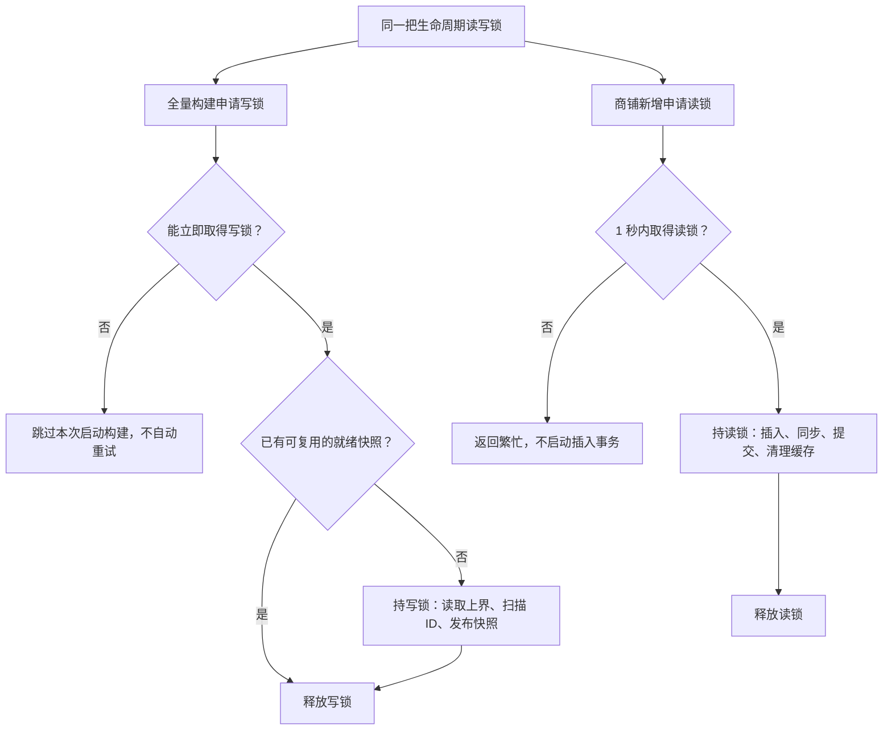
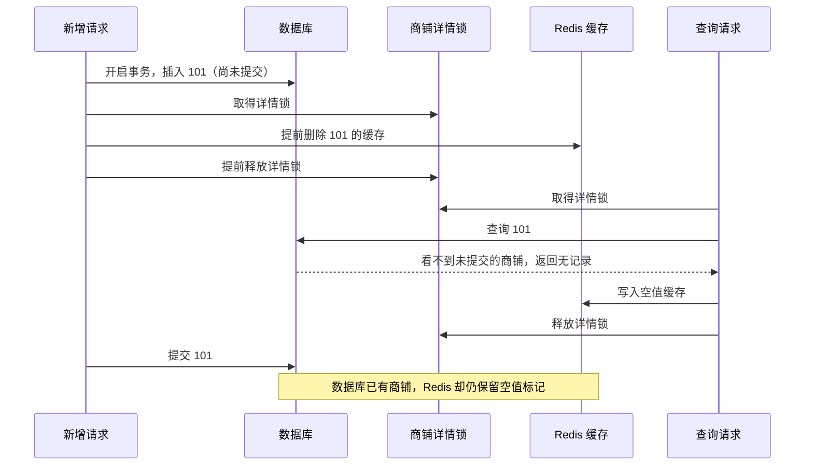
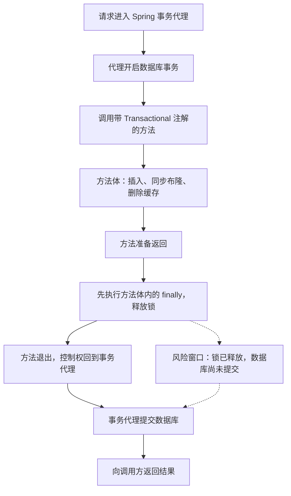
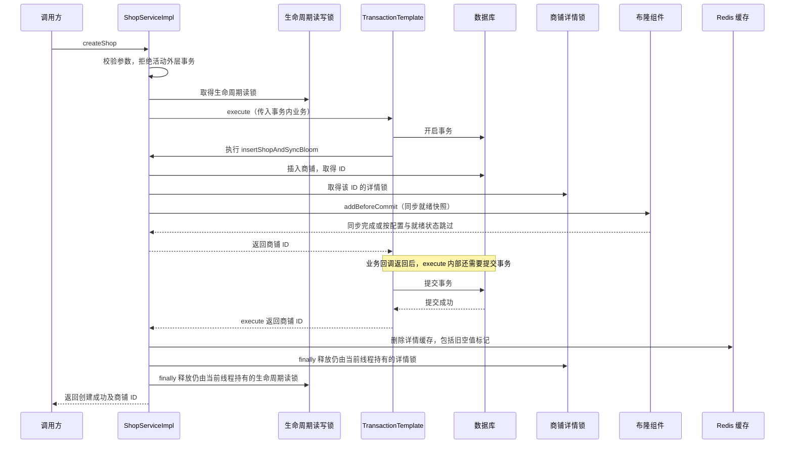

# 商铺布隆过滤器第二阶段：新增同步和空值缓存清理

## 本阶段要解决什么业务问题

第一阶段只在启动时构建商铺 ID 快照，查询时观察布隆结果，不根据结果拦截。
第二阶段解决的是经 `POST /shop` 新增商铺时，数据库、布隆快照和空值缓存之间的配合问题。
当前仍不启用负向拦截，也不处理 Redis 故障补偿。

### 问题一：新增商铺没有进入已就绪快照

例如启动时数据库只有 1～100 号商铺，快照导入这些 ID。之后通过原新增接口保存
101 号商铺，原接口只调用 `shopService.save(shop)`，没有同步布隆过滤器。
过滤器可能判断不包含 101。当前观察模式仍查库，不会因此拒绝真实商铺；
如果以后直接启用负向拦截，就可能错误拒绝它。

这属于数据源没有同步造成的遗漏，不能用“布隆过滤器算法没有假阴性”来证明没有问题。

### 问题二：新增商铺仍被已有空值缓存遮挡

假设某请求在 101 号商铺创建之前访问它，查库无记录并写入
`hmdp:cache:shop:101 = ""`。之后数据库新增成功，如果没有清理空值缓存，
查询会先命中空值标记，继续返回不存在，直到空值 TTL 到期。

仅仅增加缓存删除还不充分：另一个查库请求可能在新增提交之前读到无记录，
又在删除之后写回空值。因此新增与详情回源必须协调使用同一把锁。

### 问题三：构建新快照时并发新增，候选快照可能漏数据

构建先读取最大 ID 为 100，随后新增 101。如果新增只同步旧 READY 过滤器，
或看到 BUILDING 就跳过同步，那么只扫描到 100 的候选快照发布后仍可能漏掉 101。
因此要协调全量构建和新增，而不能只补一条 `filter.add(id)`。

### 问题四：解锁早于事务提交，查询仍可能写入空值

普通代理式 `@Transactional` 方法中，方法体内的 `finally` 在代理提交数据库之前执行。
如果此时释放详情锁，等待中的查询可能先取得锁、读到尚未提交的数据对应的无记录结果，
再次写入空值。第二阶段必须明确保证提交和缓存清理都结束之后才解锁。

## 本次基于的新改动

在第一阶段之后，项目新增了构建日志与注释，以及锁租期、归属释放和
`buildStarted` 保护。第二阶段保留这些改动：预检查异常不会覆盖其他快照状态，
锁继续使用看门狗续期，仅由当前持有线程释放。

## 文件与职责

| 文件 | 改动 |
| --- | --- |
| `ShopConstants` | 增加跨版本生命周期锁名和同步协议号 |
| `CacheConstants` / `LockConstants` | 提取缓存命名空间和缓存互斥锁前缀，保留现有缓存键取值 |
| `RedisCacheClient` | 提供统一的缓存互斥锁入口，查询与新增共享锁键命名 |
| `ShopBloomFilter` | 全量构建取写锁、新增取读锁；增加提交前同步；READY 发布协议号 |
| `ShopBloomInitializer` | 保留原有保护逻辑，使用组件提供的全局生命周期写锁 |
| `IShopService` | 声明 `createShop` 统一业务入口及其调用约定 |
| `ShopServiceImpl` | 实现 `createShop`，控制两种锁、数据库提交、布隆同步和缓存清理顺序 |
| `ShopController` | POST 接口由直接 `save` 改为调用 `createShop` |
| `ShopBloomProperties` | 更新说明，当前仍无拦截开关 |

## 按代码文件说明修改与作用

### 1. ShopController：把新增请求交给统一业务入口

文件：`backend/src/main/java/com/hmdp/controller/ShopController.java`。

修改前：

```java
shopService.save(shop);
return Result.ok(shop.getId());
```

修改后：

```java
return shopService.createShop(shop);
```

原方法只插入数据库。新入口统一维护事务、布隆过滤器和缓存，避免控制器漏做同步。
HTTP 路径仍为 `POST /shop`，成功返回值仍包含商铺 ID。

### 2. IShopService：声明新增业务契约

文件：`backend/src/main/java/com/hmdp/service/IShopService.java`。

新增 `Result createShop(Shop shop)`，明确参数、成功结果和异常含义。
它表达“创建商铺并维护相关状态”的业务行为；继承的 `save` 仍保留，
但并没有自动获得此业务逻辑。实际新增入口需要调用 `createShop`。

### 3. ShopServiceImpl：控制事务和两种锁的完整生命周期

文件：`backend/src/main/java/com/hmdp/service/impl/ShopServiceImpl.java`。

原先没有专门的新增同步方法。本次新增 `createShop` 和私有方法
`insertShopAndSyncBloom`，不额外建立单独的商铺新增 Service。

入口先校验商铺及编号，再检查 `TransactionSynchronizationManager.isActualTransactionActive()`。
拒绝活动外层事务，是因为事务模板默认可以加入已有事务；加入后模板返回并不代表外层事务
已经提交，外层锁就可能提早释放。

外层先取得生命周期读锁，再执行事务模板。核心代码：

```java
Long id = transactionTemplate.execute(status -> insertShopAndSyncBloom(shop, detailLock));
stringRedisTemplate.delete(CACHE_SHOP_KEY + id);
return Result.ok(id);
```

这里的先后顺序有业务含义：私有方法正常返回后由事务模板提交，模板返回后才删除缓存。
两个锁的释放都在外层 `finally`，覆盖整个提交与缓存清理过程。
私有方法不依赖 `@Transactional` 注解，不存在同类私有方法调用绕过事务代理的问题。

事务内的核心步骤：

```java
if (baseMapper.insert(shop) != 1 || shop.getId() == null || shop.getId() <= 0) {
    throw new IllegalStateException("新增商铺失败");
}
detailLock.lock = redisCacheClient.getCacheMutexLock(CACHE_SHOP_KEY + shop.getId());
```

插入后才能取得数据库生成的 ID，因此在事务内先插入，再按该 ID 取得详情锁。
此时数据库尚未提交，取得详情锁超时或布隆同步抛出异常，插入会回滚。
等待详情锁成功后才执行 `shopBloomFilter.addBeforeCommit(shop.getId())` 并返回 ID。

`DetailCacheLock` 是本次调用私有的状态记录对象，保存事务内拿到的锁和获取结果，
方便外层在提交或回滚之后释放；它本身不是额外的一把分布式锁。
释放时同时检查是否获取成功以及是否仍由当前线程持有。
详情锁和生命周期锁使用嵌套 `finally`，即使前者释放抛异常，也会尝试释放后者。

`tryLock(1, TimeUnit.SECONDS)` 中的 1 秒是最大等待时间，不是固定持锁租期；
当前调用未指定租期，沿用 Redisson 看门狗续期。
等待中断时恢复中断标记并抛出业务繁忙异常，不会自动重试。

### 4. ShopBloomFilter：提供同步能力并协调全量构建

文件：`backend/src/main/java/com/hmdp/infrastructure/cache/bloom/ShopBloomFilter.java`。

第一阶段只有初始化锁与观察。本次初始化锁改为全局读写锁的写锁，
并新增 `creationLock()` 返回同一个读写锁的读锁：

```java
return redisson.getReadWriteLock(SHOP_BLOOM_LIFECYCLE_LOCK).writeLock();
```

```java
return redisson.getReadWriteLock(SHOP_BLOOM_LIFECYCLE_LOCK).readLock();
```

写锁阻止构建期间新增；多个新增可以同时持读锁，避免把所有商铺创建串行执行。
这些“读写”名称指锁的兼容关系，新增业务本身仍会写数据库。

新增 `addBeforeCommit(Long id)`：关闭布隆时返回；没有第二阶段就绪快照时返回；
存在就绪快照时检查实际过滤器存在，再执行 `current.add(id)`。
有 READY 元数据但实际过滤器缺失时抛异常，不能把同步当成成功。
`add` 返回 `false` 只表示没有新增位，可能由已有元素或碰撞造成，不能据此回滚。

发布 READY 时新增 `syncProtocol: 2`，读取 READY 时也检查此协议号。
第一阶段快照可能漏掉过去新增的数据，不能仅因为名称和配置一致就直接复用。
协议号不匹配时作为未就绪处理，由启动初始化重新构建。

### 5. ShopBloomInitializer：沿用构建流程，改变互斥范围

文件：`backend/src/main/java/com/hmdp/infrastructure/cache/bloom/ShopBloomInitializer.java`。

本文件在第二阶段仅调整类说明，原有批量扫描、容量检查、游标校验、异常处理和
`buildStarted` 保护继续保留。行为变化来自它调用的 `bloom.initializationLock()`
现在返回全局写锁，因而构建既与其他构建互斥，也与新增互斥。

仍使用 `tryLock(0, TimeUnit.SECONDS)`：拿不到锁就跳过本次启动构建，不等待或自动重试。
因此不能把“新增时无快照”描述成“本次请求结束后必定立即完成构建”。

### 6. 常量文件：共享锁协议和命名空间

- `backend/src/main/java/com/hmdp/constants/ShopConstants.java`：新增全局生命周期锁名
  `SHOP_BLOOM_LIFECYCLE_LOCK` 和 `SHOP_BLOOM_SYNC_PROTOCOL = 2`。锁名不带版本，
  用来协调不同版本配置的构建和新增操作；这不意味着不同版本能自动互相同步数据。
- `backend/src/main/java/com/hmdp/constants/CacheConstants.java`：提取 `CACHE_KEY_PREFIX`，
  保持原有缓存键取值不变。
- `backend/src/main/java/com/hmdp/constants/LockConstants.java`：新增 `LOCK_CACHE_MUTEX_KEY`，
  统一重建互斥锁前缀，避免业务代码重复拼接。

### 7. RedisCacheClient：让新增与查询取得同一把详情锁

文件：`backend/src/main/java/com/hmdp/infrastructure/cache/RedisCacheClient.java`。

新增 `getCacheMutexLock(String cacheKey)`，将标准完整缓存键转换为统一锁键并返回锁对象；
`queryWithMutex` 和商铺新增都使用该方法。具体前后对照见后面的“缓存锁键命名”。
原有缓存命中、空值命中、锁内二次检查、回源限流、TTL 和观察流程继续保留。
原本的回源并发限制属于前阶段成果，本阶段没有重新实现。

### 8. ShopBloomProperties：只更新配置用途说明

文件：`backend/src/main/java/com/hmdp/config/ShopBloomProperties.java`。

将类注释由第一阶段“构建和观察”更新为“构建、观察和新增同步”。
没有新增配置字段或负向拦截开关，没有修改 YAML，也不需要手工传入配置值。

### 9. 测试文件与说明文档

- `ShopServiceImplTest`：新增验证提交前同步、提交后清理、锁释放顺序、回滚、超时、中断和外层事务限制。
- `ShopControllerTest`：新增验证接口调用 `createShop`，不绕过同步入口直接保存。
- `ShopBloomFilterTest`：补充同步成功、同步异常、未就绪、旧协议失效及读写锁共用名称的验证。
- `RedisCacheClientTest`：调整新锁名预期，验证资源内容保留、自定义键兼容和非法输入。
- 根目录 `README.md` 更新当前阶段入口；本文件保存完整业务说明，`../../../AGENTS.md` 固化阶段讲解要求。

## 新增顺序

```text
在事务外进入统一新增入口
  → 获取生命周期读锁（最多等1秒）
  → 开始数据库事务并插入商铺，取得生成的正数ID
  → 获取该ID的详情缓存重建锁（最多等1秒）
  → 若存在第二阶段就绪快照，将ID加入过滤器
  → 提交数据库事务
  → 删除该ID的详情缓存（包括旧空值标记）
  → 释放详情锁
  → 释放生命周期读锁
```

新增逻辑统一放在 `ShopServiceImpl` 中，事务内的插入与布隆同步封装为私有方法，
不再通过单独的商铺新增 Service 转调。注入 Spring Boot 自动配置的
`TransactionTemplate`，调用 `execute` 返回时数据库提交已完成。因此锁的 finally
位于事务模板外，不会出现普通 `@Transactional` 方法体的 finally 先解锁、
Spring 代理随后才提交的问题。入口拒绝在已有活动事务中调用，避免意外加入外层未提交事务。

详情锁名与 `RedisCacheClient.queryWithMutex` 完全一致。查询若先获取锁并写入空值，
新增会等它释放，再在提交后清理该空值；查询若后获取锁，则提交和清理已经完成，
不会在新增提交之前再次重建空值。缓存命中的读取可能仍在提交/清理窗口读到旧值，
本阶段没有为所有缓存读取加锁，不承诺所有并发读取都线性一致。

## 缓存锁键命名

此前直接把完整缓存键拼到锁前缀后面，会重复出现项目命名空间：

```text
修改前：hmdp:lock:cache:mutex:hmdp:cache:shop:42
修改后：hmdp:lock:cache:mutex:shop:42
```

`CacheConstants.CACHE_KEY_PREFIX` 统一声明 `hmdp:cache:`；
`LockConstants.LOCK_CACHE_MUTEX_KEY` 统一声明 `hmdp:lock:cache:mutex:`。
现有商铺缓存键依旧为 `hmdp:cache:shop:<id>`。

新增流程由直接拼接改为调用缓存客户端：

```java
// 修改前
detailLock.lock = redissonClient.getLock(LOCK_KEY + "cache:mutex:" + CACHE_SHOP_KEY + shop.getId());
// 修改后
detailLock.lock = redisCacheClient.getCacheMutexLock(CACHE_SHOP_KEY + shop.getId());
```

查询流程也调用 `getCacheMutexLock`。该方法只移除完整缓存键开头的项目缓存命名空间，
保留资源标识中出现的相同文本，并兼容不以该命名空间开头的自定义缓存键。
它只返回锁对象，等待、加锁与释放仍由调用方控制。

锁键名称已经改变，部署时应先停止旧实例，再启动使用新锁键的实例，
避免新旧实例因使用不同名称而失去互斥。无需清空业务缓存。

## 为什么提交前加入布隆

若加入失败，异常穿出事务模板，数据库插入回滚；不把“数据已提交但布隆遗漏”的窗口
作为正常新增流程。若布隆加入成功而数据库随后回滚或提交失败，最多多放行一个不存在的ID，
原有数据库查询和空值缓存仍可兜底。`RBloomFilter.add` 返回false可能仅表示相关位已设置，
不能把它当作同步失败；运行时异常才使新增事务失败。

## 为什么还需要生命周期读写锁

仅同步当前 READY 过滤器还不够：全量扫描可能已读取最大ID，新商铺此时插入，
新的候选过滤器就可能漏掉它。构建持全局写锁，新增持同一把锁的读锁：

- 构建先取得写锁：新增等待或返回繁忙，完成后新增会同步新发布的快照。
- 新增先取得读锁：构建本次不等待写锁并跳过；下一次构建会扫描已提交的商铺。
- 不同商铺新增可同时持有读锁，不把所有新增串行化。

未就绪时新增允许提交，不强行创建或发布空过滤器。后续全量扫描会在写锁保护下纳入这些ID。
初始化未拿到写锁仍按第一阶段逻辑跳过，不新增后台重试；需要时重启后端以再次尝试构建。

## 旧快照与部署

READY 元数据新增 `syncProtocol: 2`。旧元数据无此字段，不再被当作可复用快照；
启动初始化会在新锁保护下重新扫描，过滤器仍使用独立UUID候选Key。
所有提供新增能力的实例必须升级，并使用一致的版本、容量、误判率与启用配置。
旧代码、不同配置或直接SQL导入不会自动遵守新增锁协议。

## 当前限制

- 仍为观察模式，没有增加负向拦截开关。
- 当前已接入 `POST /shop`；继承的 `save`、`saveBatch` 与手工SQL没有改成隐藏拦截器，
  保留原接口和代码。正式启用负向拦截前，应把实际导入和批量写入入口也统一收口。
- `loadedCount` 仍表示全量扫描时导入的数量，不冒充实时数据库行数；新增容量监控和版本回收留待后续。
- 数据库提交成功后若Redis缓存清理失败，数据库不能再回滚，接口会报告失败；
  本阶段未扩展Redis故障补偿或新增幂等机制。
- 本次没有修改表结构、Lua、前端或忽略规则。

## 关键业务分支

| 情况 | 数据库及后续行为 |
| --- | --- |
| 两把锁均取得、同步完成 | 提交数据库，清理详情缓存，再依次释放详情锁和生命周期读锁 |
| 生命周期读锁等待超时 | 尚未启动插入事务，返回繁忙 |
| 插入后详情锁等待超时 | 回滚插入，不执行布隆同步，不删除详情缓存 |
| 已就绪过滤器同步抛异常 | 异常穿出事务模板，回滚插入，释放持有的锁 |
| 布隆加入成功，数据库随后回滚或提交失败 | 布隆中可能保留多余标记；未成功提交时不执行后续缓存清理 |
| 布隆关闭或没有第二阶段 READY 快照 | 不执行增量加入；数据库仍可提交并清理详情缓存，后续成功的全量构建会纳入数据 |
| 等待锁时中断 | 恢复中断标记，抛出繁忙异常；若事务已启动则回滚，不自动重试 |
| 入口已存在活动事务 | 拒绝执行，防止解锁早于外层事务提交 |

## 验证

测试验证提交前同步、提交后清理、锁释放顺序、同步异常回滚、锁超时、中断标记恢复、
提交失败后的处理、拒绝外层事务、旧快照失效和控制器正确路由；同时验证新锁键、
资源标识内容保留、自定义缓存键兼容以及无效缓存键校验。
事务顺序测试使用 Spring 事务模板和测试事务管理器，Redisson/Mapper 使用模拟对象；
未将单元测试结果视为真实MySQL/Redis并发联调或压测结果。

最近一次相关测试为 67 项，失败 0、错误 0，Maven 构建成功。
本次完善说明未修改运行代码，因此没有重复运行同一批测试。

## 拆分流程图

### 流程一：生命周期锁如何协调构建和新增

两条分支分别表示构建与新增对同一把读写锁的竞争。
多个新增可以同时持读锁；构建持写锁时，新增不能同时持读锁。



### 流程二：提交之前删缓存并解锁会发生什么

这是错误顺序示例。查询使用正常的数据库隔离方式，读不到另一事务尚未提交的新商铺。



### 流程三：普通事务注解中 finally 与提交的先后

这是普通代理式 `@Transactional` 在方法正常返回路径上的时序，
假设锁在该方法体内的 `finally` 释放。



### 流程四：当前事务模板如何保证先提交再解锁

下图展示两种锁均取得、业务正常完成的路径；同步、等锁和提交异常的处理见前面的关键业务分支表。
同步节点在布隆关闭或没有就绪快照时直接返回，不执行增量加入。


