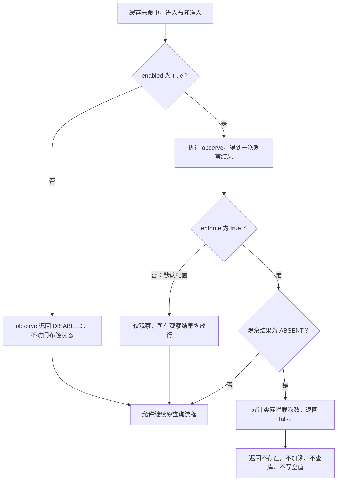
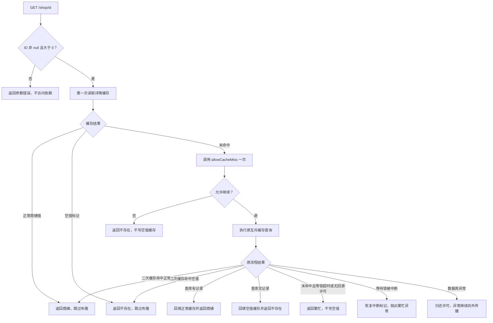
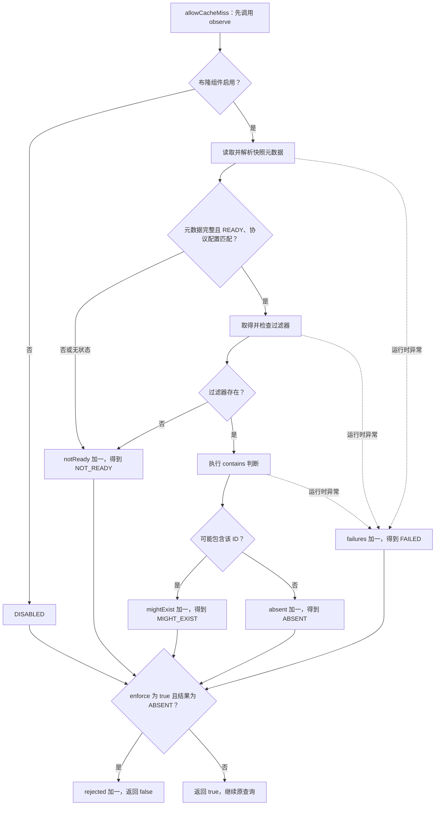
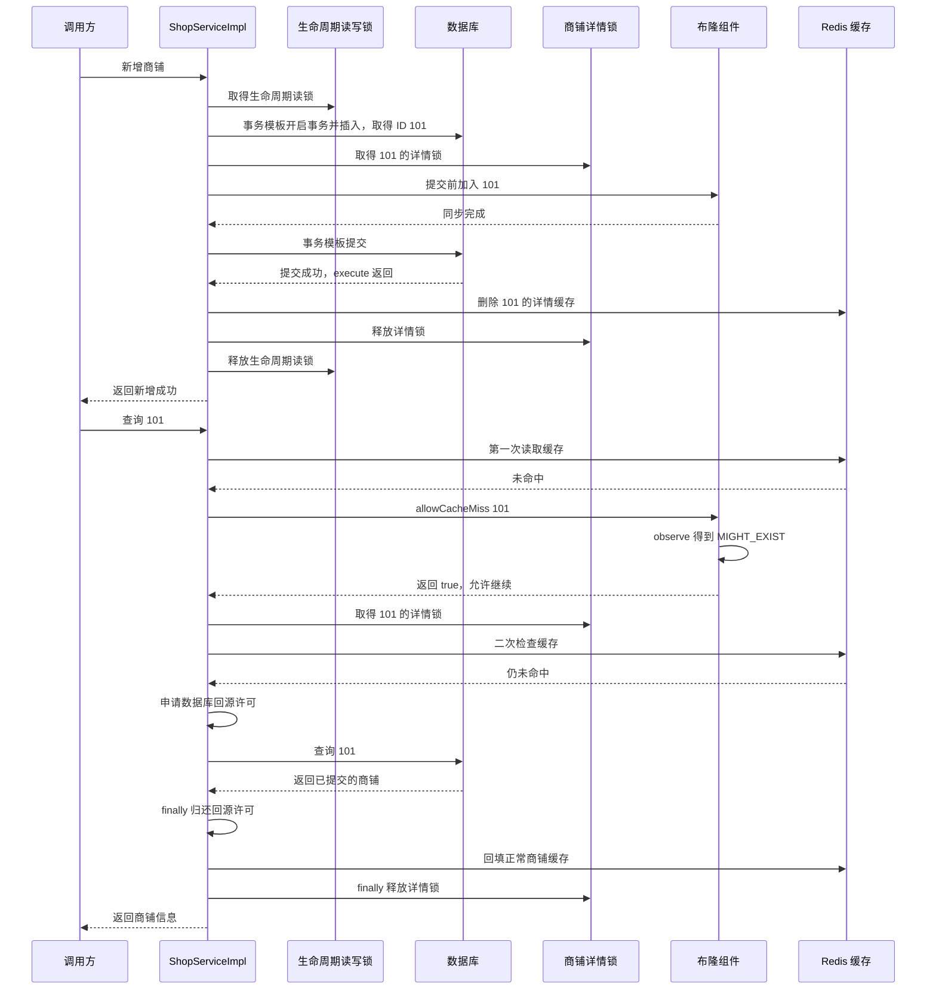

# 商铺布隆过滤器第三阶段：可配置负向拦截与空值兜底

## 本阶段要解决的问题

第二阶段已经协调新增事务、布隆同步和缓存清理，但查询仍只观察布隆结果。
假设正常商铺 ID 只有 1～100，请求依次访问 900001、900002、900003：
每个新 ID 都没有缓存，即使布隆快照明确判断不包含，仍要获取详情锁、申请回源许可、
查数据库，然后分别写入空值缓存。空值缓存能保护同一个 ID 的重复请求，
不能阻止第一次访问大量不同 ID 所产生的数据库查询。

本阶段在缓存未命中时增加可配置准入：只有开启拦截，并且就绪布隆快照明确判断不包含，
才直接返回不存在。正常缓存、空值缓存、可能存在与未就绪等分支继续沿用原流程。
默认配置保持只观察，避免代码升级时未经检查就启用拦截。

## 本次范围与写入入口审计

基于第二阶段提交 `89ed321f` 检查当前生产源码：

| 入口 | 当前行为与拦截边界 |
| --- | --- |
| `POST /shop` | 已调用 `createShop`，受第二阶段生命周期锁和提交前同步保护 |
| `PUT /shop` | 使用 `updateById` 更新已有行，没有实现插入不存在商铺的逻辑 |
| 商铺列表、搜索、分类和 GEO 查询 | 查询入口，本阶段不接入详情布隆拦截 |
| 启动时导入示例 SQL | 数据库初始化发生在应用扫描之前，后续由全量构建纳入；复用旧快照时仍需考虑数据库是否被重新导入 |
| 继承的 `save`、`saveBatch`、`saveOrUpdate` | API 继续保留，未发现当前生产源码中其他商铺新增调用；未来使用时必须另行接入同步，不能直接视为安全 |
| 手工 SQL、外部脚本和其他服务 | 不受 Java 生命周期锁保护，开启拦截前必须明确维护方式 |

此次不覆盖全部继承保存接口、不增加导入接口，也不修改表结构。
当前审计不能保证未来代码和外部操作自动遵守同步协议，因此 `enforce` 默认关闭。

## 按文件说明改动

### 1. ShopBloomProperties.java：将组件启用与实际拦截分开

文件：`backend/src/main/java/com/hmdp/config/ShopBloomProperties.java`。

原先只有 `enabled`，控制是否构建、观察和同步布隆。新增：

```java
private boolean enforce = false;
```

`enabled=true, enforce=false` 仍是观察模式；两个开关均为 true 才可能拦截。
`enabled=false` 时观察返回 DISABLED，即使 enforce 为 true 也不会拒绝查询。
新增 setter 供 Spring 配置绑定，并说明启用前的数据同步要求。

### 2. application.yaml：提供配置与环境变量入口

文件：`backend/src/main/resources/application.yaml`。

```yaml
hmdp:
  cache:
    shop-bloom:
      enabled: ${SHOP_BLOOM_ENABLED:true}
      enforce: ${SHOP_BLOOM_ENFORCE:false}
```

配置启动时绑定，修改后需要重启。本次没有替用户将拦截设为 true。

### 3. ShopBloomFilter.java：一次观察形成明确准入结果

文件：`backend/src/main/java/com/hmdp/infrastructure/cache/bloom/ShopBloomFilter.java`。

保留 `observe` 及原有四字段 `Statistics`，新增 `allowCacheMiss`：

```java
public boolean allowCacheMiss(Long id) {
    Observation observation = observe(id);
    if (properties.isEnforce() && observation == Observation.ABSENT) {
        rejected.increment();
        return false;
    }
    return true;
}
```

每次缓存未命中只观察一次。返回 false 的条件严格限定为“开启拦截且 ABSENT”。
MIGHT_EXIST 只代表可能存在，仍然需要查库；NOT_READY、DISABLED 和 FAILED
都不能作为不存在的证据。FAILED 沿用第一阶段已有的观察异常处理，本阶段没有扩展
Redis 故障补偿、熔断或数据库降级机制。

新增 `rejectedCount()`，只统计当前实例实际发生的拦截次数。
原有 `statistics().absent()` 是负向观察次数，观察模式下也可能增长，不能拿它冒充拦截数。
计数不持久化，没有新增管理 HTTP 接口。

快照就绪日志同时输出 enforce，避免开启后日志还写“仅观察”。
READY 协议仍为第二阶段的 `syncProtocol=2`，本阶段没有改变快照数据格式。

### 4. RedisCacheClient.java：在首次缓存未命中后、获取锁之前执行准入

文件：`backend/src/main/java/com/hmdp/infrastructure/cache/RedisCacheClient.java`。

原先缓存未命中后只执行：

```java
missObserver.accept(id);
```

新增 `queryWithMutexAndGuard`，接收 `Predicate<ID>`：

```java
if (!missGuard.test(id)) {
    return null;
}
```

准入前已经完成第一次缓存读取：正常缓存命中直接返回对象，空值标记命中直接返回 null，
这两种请求都不访问布隆状态。

准入拒绝发生在 `getCacheMutexLock` 之前，因此不会加锁，不会申请数据库回源许可，
不会访问数据库，也不会调用 `setNull`。随机不存在 ID 不会因为这条分支逐个生成空值键。

准入通过后继续原有逻辑：有界等待、锁内二次缓存检查、回源并发限制、查库、随机 TTL
回填及锁归属检查均保留。数据库确实无记录时，仍然写入原有空值缓存。

原来的两个 `queryWithMutex` 重载继续保留。带 Consumer 的旧重载通过包装回调委托新方法：

```java
return queryWithMutexAndGuard(keyPrefix, id, type, dbFallback, time, timeUnit, missedId -> {
    missObserver.accept(missedId);
    return true;
});
```

原回调仍没有准入决定权，不会因为增加新接口而改变旧调用方的查询语义。
通用缓存客户端没有直接依赖商铺布隆组件，业务层负责传入准入策略。

### 5. ShopServiceImpl.java 和 IShopService.java：业务查询接入准入

文件分别位于 `backend/src/main/java/com/hmdp/service/impl/` 和
`backend/src/main/java/com/hmdp/service/`。

先校验编号：null、0 和负数直接返回参数错误，不访问缓存、布隆、锁或数据库。
这与“不存在的合法正数 ID”分开处理。

第二阶段代码：

```java
Shop shop = redisCacheClient.queryWithMutex(CACHE_SHOP_KEY, id, Shop.class, this::getById,
        CACHE_SHOP_TTL, TimeUnit.MINUTES, shopBloomFilter::observe);
```

第三阶段代码：

```java
Shop shop = redisCacheClient.queryWithMutexAndGuard(CACHE_SHOP_KEY, id, Shop.class, this::getById,
        CACHE_SHOP_TTL, TimeUnit.MINUTES, shopBloomFilter::allowCacheMiss);
```

Consumer 只能观察；Predicate 可以决定是否继续。通过方法引用将策略接入现有实现类，
没有新建单独的查询 Service。
最终得到 null 时仍返回原有“店铺不存在！”业务结果，不新增 HTTP 状态或响应结构。
接口和实现的 Javadoc 同步说明参数与结果含义。

第二阶段的新增事务、生命周期读写锁、提交前同步、提交后删除缓存和最终解锁顺序均未改动。

### 6. ShopBloomInitializer.java：只修正文案

文件：`backend/src/main/java/com/hmdp/infrastructure/cache/bloom/ShopBloomInitializer.java`。

类说明改成“是否拦截由查询配置决定”。批次扫描、锁、构建失败和候选清理逻辑没有改变，
构建成功本身不会把 enforce 自动改成 true。

### 7. 测试与文档

| 文件 | 本阶段验证内容 |
| --- | --- |
| `ShopBloomPropertiesTest` | 拦截默认关闭，配置可以绑定为 true |
| `ShopBloomFilterTest` | 观察放行、负向拦截、可能存在放行、关闭和未就绪放行、原有观察异常放行、真实拦截计数 |
| `RedisCacheClientTest` | 准入拒绝不加锁、不回源、不写空值；缓存命中跳过准入；允许请求保留空值兜底 |
| `ShopServiceImplTest` | 非法编号、真实缓存链路路由、误判回源、正常回填，以及第二阶段新增后通过第三阶段布隆准入 |
| 根 `README.md` / `docs/README.md` | 更新当前阶段行为、配置入口和文档索引 |

## 关键业务流程和分支

```text
GET /shop/{id}
  → 编号无效：返回参数错误
  → 读取缓存
      → 正常值：返回商铺
      → 空值标记：返回不存在
      → 未命中：观察布隆并形成准入结果
          → enforce=true 且 ABSENT：返回不存在，不写空值
          → 其他情况：继续原互斥缓存查询
              → 等锁后再次检查缓存
              → 未命中且等锁超时：返回繁忙
              → 持锁且仍未命中：申请回源许可
                  → 无许可：返回繁忙
                  → 查到商铺：回填正常缓存并返回
                  → 无记录：回填空值缓存并返回不存在
              → 归还回源许可，释放当前线程持有的锁
```

回源许可在原来的数据库调用 `finally` 中归还，不需要等待缓存写入完成。
布隆明确拒绝之前没有取得详情锁，因此没有额外解锁操作。
等待详情锁被中断、数据库抛异常以及锁归属释放继续使用前阶段实现。

| 业务情况 | 是否访问数据库 | 是否写空值缓存 |
| --- | --- | --- |
| 缓存已有正常值或空值标记 | 否 | 否 |
| 观察模式负向结果，后续确需回源 | 是，仍受二次检查及许可限制 | 数据库无记录时写入 |
| 拦截开启且就绪快照明确不包含 | 否 | 否 |
| 布隆误判为可能存在 | 缓存二次检查后仍未命中才查 | 数据库无记录时写入 |
| 未就绪、协议不匹配或组件关闭 | 继续原查询，不能据此拒绝 | 原查询查库无记录时写入 |
| 第二阶段新增商铺已同步并提交 | 可正常回源查到商铺 | 正常情况下回填业务缓存 |

## 开启与回退

1. 保持所有提供新增能力的实例使用一致的 enabled、version、容量和误判率配置，并升级至相同同步协议代码。
2. 确认当前数据已被完整构建，并确认没有绕过统一业务入口的新增操作。
3. 如有直接 SQL 导入或数据库恢复，先在提供查询的实例上关闭拦截并重启，再操作数据；随后修改布隆版本，重启构建完整快照。
4. 确认新快照 READY 后，才设置 `SHOP_BLOOM_ENFORCE=true` 并重启提供查询的实例。
5. 回退时设置 `SHOP_BLOOM_ENFORCE=false` 并重启，即恢复观察模式，不必清空缓存或布隆数据。

READY 只表示对应构建完成及配置匹配，不是对外部写入同步情况的自动证明。
当前没有自动审计 SQL 写入或运行时动态刷新配置的能力。

## 剩余限制

- 只保护商铺详情的缓存未命中路径，不保护列表、搜索和其他业务的直接查库入口。
- 未覆盖全部继承写入 API、外部导入、不同版本实例同时提供新增等情况，开启条件必须持续成立。
- 布隆误判仍会回源，因此不能代替空值缓存、商铺互斥锁和回源并发限制。
- 开启前数据库已有但快照遗漏的商铺，在缓存失效后可能被误拒绝，必须通过重建与入口规范解决。
- 当前没有增加容量监控、旧版本回收、Redis 故障补偿或新的后台重试任务。
- 本阶段沿用已同步的位集合；新增后可能超过预期容量并提高误判率，后续仍需监控与重建。

## 验证说明

使用项目已有的定向单元测试，覆盖新行为并回归前阶段缓存、初始化和新增事务逻辑。
相关测试共 84 项，失败 0、错误 0，Maven 构建成功。
事务顺序使用 Spring 事务模板和测试事务管理器验证；数据库、Redis、Redisson 与布隆位集合
使用模拟对象，不将其结果视为真实 MySQL / Redis 并发联调或性能压测。

## 拆分流程图

### 流程一：两个配置开关如何配合

下图说明配置模式。实际每次缓存未命中的调用顺序始终是先 observe，再根据 enforce 和结果判断，
因此观察模式仍然记录观察次数。配置修改后需重启生效。



### 流程二：商铺详情查询主流程

此图中“原互斥缓存查询”包括有限等待、二次缓存检查、回源许可和数据库查询，
准入通过不代表一定查库。该过程取得的详情锁在退出时按归属释放，
回源许可在数据库调用结束时归还。



### 流程三：allowCacheMiss 为什么只拒绝一种结果

下面以已通过业务层正数校验的 ID 为例。读取状态、解析元数据、取得和检查过滤器、
执行 contains 期间的运行时异常沿用 observe 的捕获逻辑，返回 FAILED。
观察结果和实际拦截结果分别计数。



### 流程四：第二阶段新增如何配合第三阶段查询

下图为快照已就绪、拦截已开启、创建与查询均成功的示例，查询发生在新增成功返回之后。
示例假设第一次和锁后二次读取缓存都未命中，且回源许可可用。


