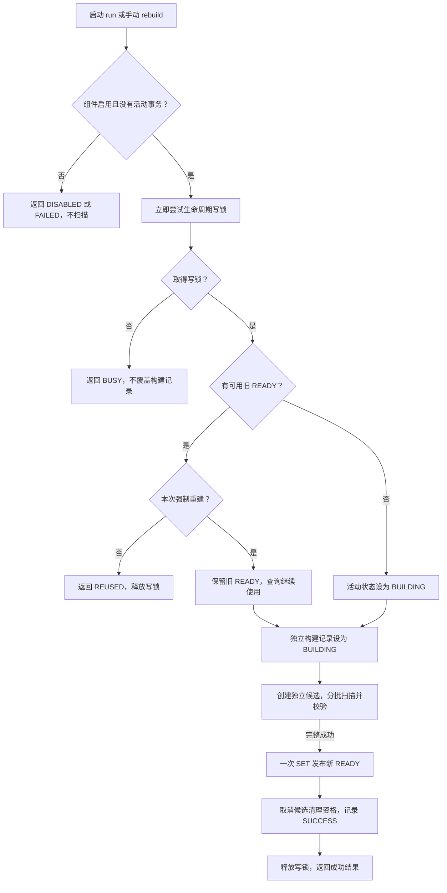
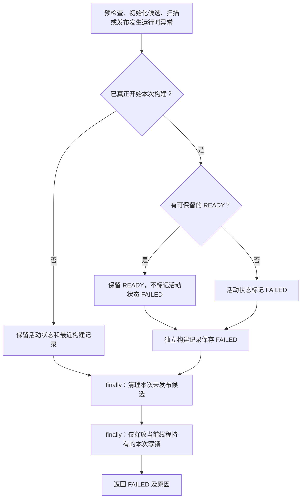

# 商铺布隆过滤器第四阶段：受控重建与构建状态维护

## 本阶段要解决什么问题

第三阶段已经提供默认关闭的负向拦截，但快照维护依赖启动初始化：
已有 READY 时直接复用，拿不到构建锁时跳过。用户无法在应用持续运行时主动重建当前版本。

例如，外部导入了新商铺，或需要在相同配置下重新核对全量 ID，旧快照不再能代表数据库。
第三阶段能够拦截查询，却不能自动识别外部写入造成的遗漏；需要明确的维护入口重新构建。

另一个问题是，之前构建开始时直接将查询状态改成 BUILDING，失败后改成 FAILED。
对首次构建这样处理没有问题，但手动重建时可能已经有可用旧快照，不能为了记录进度而覆盖它。

本阶段以第三阶段提交 `699b307c` 为基线，实现本地 JMX 手动重建、成功后切换和独立构建记录。
重建过程不会自动开启 enforce，也不会自动证明外部写入已遵守同步要求。

## 为什么采用本地 JMX

项目已经使用 Spring Boot，可以复用现有 JMX 自动配置和初始化组件。
当前项目没有管理端角色分层，因此本阶段选择由本机维护人员通过 JConsole 操作。
当前 YAML 默认启用维护导出，可通过环境变量关闭；同一应用进程中可以反复重建。

没有新建额外业务 Service，核心流程仍位于 `ShopBloomInitializer`，
`ShopBloomFilter` 负责 Redisson 对象及元数据读写。

## 按文件说明改动

### 1. ShopBloomInitializer.java：复用扫描，区分启动与强制重建

文件：`backend/src/main/java/com/hmdp/infrastructure/cache/bloom/ShopBloomInitializer.java`。

修改前，完整扫描与清理过程写在 `run` 内，启动后没有可调用的强制重建入口。
修改后保留 `run`，将原扫描与清理逻辑迁入私有方法，新增 `rebuild`：

```java
@Override
public void run(ApplicationArguments args) {
    build(false);
}

@ManagedOperation(description = "强制重建当前版本快照，返回 JSON 结果")
public String rebuild() {
    return build(true);
}
```

两者共用 `build`，区别在于是否复用已有 READY：

```java
preserveReady = bloom.hasReadySnapshot();
if (preserveReady && !force) {
    return result(BuildStatus.REUSED, "复用已有就绪快照", null, null);
}
```

- 启动时 `force=false`：已有可用快照则返回 REUSED，不再扫描。
- 手动调用 `force=true`：即使已有可用快照，也构建独立候选。

构建前拒绝活动数据库事务，避免在外层事务中扫描未提交的数据。
生命周期写锁继续使用 `tryLock(0, TimeUnit.SECONDS)`，拿不到就返回 BUSY，
不会把多个维护请求排队堆积，也不会覆盖其他正在构建的任务记录。

### 2. ShopBloomInitializer.java：已有 READY 时不覆盖活动元数据

修改前启动构建时直接调用：

```java
bloom.markBuilding();
```

现在按旧快照是否可用处理：

```java
if (!preserveReady) {
    bloom.markBuilding();
}
buildStarted = true;
recordBuildResult(result(BuildStatus.BUILDING, "正在构建候选快照", null, null));
```

如果已有可用 READY，查询仍能读取它。BUILDING 写入的是新的构建记录键，
不再占用活动快照状态。
如果没有可用快照，活动状态仍标记 BUILDING，查询按第三阶段原逻辑放行到缓存回源流程。

### 3. ShopBloomInitializer.java：完整扫描成功后发布

原有批量扫描迁入 `fillCandidate`，继续复用第一阶段的 Mapper SQL、批量大小、固定上界、
游标检查和容量校验，没有重写数据库扫描协议。

```java
candidate = bloom.newCandidate();
ScanResult scan = fillCandidate(candidate);
String candidateName = candidate.getName();
bloom.publishReady(candidate, scan.loadedCount(), scan.upperBound());
candidate = null;
preserveReady = true;
```

这些语句分别保证：

1. `newCandidate` 为本次调用创建 UUID 名称的独立过滤器，不清空旧过滤器。
2. `fillCandidate` 完成全部正常批次并校验容量，异常会进入统一失败处理。
3. `publishReady` 仍使用一次 SET 原子切换完整元数据，不提前暴露半成品。
4. 发布后立即将 `candidate` 设为 null，避免最终清理误删已经使用的新快照。
5. 将 `preserveReady` 设为 true，后续记录处理不能再把这个已发布快照标记 FAILED。

`ScanResult` 是本类私有的不可变统计对象，只包含已完成扫描的 ID 数量和固定上界。
它不是新的业务服务。

### 4. ShopBloomInitializer.java：失败、记录和清理边界

失败分支的关键条件由“开始构建即可标记 FAILED”调整为：

```java
if (locked && buildStarted && !preserveReady) {
    markFailedSafely();
}
```

有可用旧 READY 时，扫描或候选初始化失败不修改它；只在独立构建记录中保存 FAILED，
然后清理未发布候选并释放当前线程持有的写锁。
没有旧快照且已开始构建时，仍保留活动状态 FAILED 的原有含义。
预检查失败或未取得锁时，不覆盖其他构建的记录。

原有中断恢复、候选清理和锁归属检查保留，分别封装为私有方法。
等待写锁被中断返回 INTERRUPTED，恢复线程中断标记，不自动重试。

记录结果只用于观察，记录失败会写日志，不能使已发布的过滤器被清理或标记失败。
没有增加 Redis 故障补偿、重试队列或熔断机制。

### 5. ShopBloomFilter.java：活动状态与构建记录分开

文件：`backend/src/main/java/com/hmdp/infrastructure/cache/bloom/ShopBloomFilter.java`。

保留第三阶段的 observe、allowCacheMiss、新增同步与 READY 发布，新增：

```java
void recordBuildStatus(String json)
String lastBuildStatus()
```

两个方法使用独立的 StringCodec Bucket 读写构建记录，不改变查询使用的活动元数据。

| Redis 键 | 职责 |
| --- | --- |
| `hmdp:bloom:shop:state:v1` | 查询和新增同步使用的活动快照元数据 |
| `hmdp:bloom:shop:build:state:v1` | 最近一次实际构建的进度或最终结果 |

BUSY、DISABLED、REUSED 不是新扫描，不写入最近构建记录。
构建中的记录只标记 BUILDING，不假装提供实时扫描进度；批次数量继续看原 DEBUG 日志。
失败时不提供 loadedCount、upperBound，避免把未完成统计误写为零；空数据库成功构建才是零。

### 6. ShopConstants.java：维护名称集中管理

文件：`backend/src/main/java/com/hmdp/constants/ShopConstants.java`。

新增构建状态键前缀 `SHOP_BLOOM_BUILD_STATE_KEY_PREFIX`，
以及维护对象名称 `SHOP_BLOOM_MBEAN_NAME`。
生命周期锁、快照版本和同步协议号沿用第二阶段，不另建一套构建锁。

### 7. application.yaml：配置维护对象导出

文件：`backend/src/main/resources/application.yaml`。

```yaml
spring:
  jmx:
    enabled: ${SHOP_BLOOM_JMX_ENABLED:true}
```

这是 Spring JMX 导出总开关，修改后需启动应用使其生效。
没有设置远程 JMX 端口或连接器；本阶段使用本机 JVM 的 JConsole 连接。
当前 YAML 也将 `SHOP_BLOOM_ENFORCE` 默认值配置为 true；两个开关独立，
可分别通过环境变量覆盖为 false。Java 属性类的 enforce 默认值仍为 false，YAML 绑定后覆盖它。

### 8. 测试与文档

| 文件 | 改动和作用 |
| --- | --- |
| `ShopBloomInitializerTest` | 保留原初始化测试，增加强制重建、旧 READY 保留、失败清理、忙碌、中断、活动事务限制和状态查询 |
| `ShopBloomFilterTest` | 验证独立构建记录不会覆盖查询 READY |
| `ShopBloomManagementTest` | 使用真实本地 MBeanServer 和 Spring JMX 自动配置，验证关闭时不导出、实际 rebuild 调用、属性读取及 run 不导出 |
| 根 `README.md` / `docs/README.md` | 更新使用入口与第四阶段导航 |

没有修改商铺新增业务、查询准入、HTTP 控制器、表结构、Lua 或 `.gitignore`。

## 本地实际操作步骤

1. 在 IDEA 后端运行配置的环境变量中设置 `SHOP_BLOOM_JMX_ENABLED=true`，确认布隆组件仍为 enabled=true。
2. 启动后端。这次启用配置需要启动一次，之后同一进程中的多次重建不必重启。
3. 终端运行 `jconsole`，使用同一系统用户连接本地 `HmDianPingApplication` 的 JVM。
4. 在 MBeans 中找到 `com.hmdp:type=ShopBloom,name=Maintenance`。
5. 在 Operations 中调用无参数的 `rebuild`，等待同步操作返回 JSON。
6. 检查结果 status；成功必须为 SUCCESS。可在 Attributes 中刷新 `LastBuildStatus` 查看最近实际构建记录。

成功结果示例：

```json
{
  "status": "SUCCESS",
  "version": "v1",
  "updatedAt": "<UTC时间>",
  "message": "候选快照已完整发布",
  "loadedCount": 123,
  "upperBound": 150,
  "filterName": "hmdp:bloom:shop:v1:<本次UUID>"
}
```

| status | 含义和处理 |
| --- | --- |
| SUCCESS | 本次候选完整发布 |
| FAILED | 本次调用或构建失败；查看返回原因和日志，确认数据与容量后再重试 |
| BUSY | 存在构建或新增持有生命周期锁；稍后手动重试，不覆盖其他任务记录 |
| INTERRUPTED | 等待锁时被中断，本次不自动重试 |
| DISABLED | 组件关闭，未发起构建 |
| REUSED | 启动初始化复用旧快照；强制 rebuild 正常不会返回此状态 |
| BUILDING | 最近实际构建尚在执行，或进程退出后遗留的记录，不是后台自动重试承诺 |
| NEVER | 当前版本没有保存构建记录，不等价于数据库从未有过快照 |

同步重建耗时取决于商铺数量、批量大小以及数据库与 Redis 的处理能力。
MBean 调用方等待返回时，另一管理连接仍可读取构建属性。

## 外部数据导入的业务顺序

保留旧 READY 只适合旧快照本身可信的日常重建。它不能让绕过同步入口的新数据自动进入旧快照。

```text
先关闭所有查询实例的负向拦截并重启生效
→ 执行外部导入并提交
→ 确认没有并发的外部 ID 写入
→ 通过本地 JMX 触发 rebuild
→ 检查 SUCCESS 和构建统计
→ 恢复负向拦截配置并重启查询实例
```

即使重建成功，也不会主动删除导入商铺原先已有的空值缓存。
统一 createShop 已有提交后清理能力，但外部导入不经过它；导入流程还需清理受影响 ID 的缓存，
或在确认空值 TTL 已过期后再恢复业务预期。重建只维护布隆快照，不能代替缓存同步。

## 流程一：重建成功如何切换



## 流程二：构建失败如何退出

以下从已经取得写锁的构建调用开始；等待锁中断时只恢复中断标记并返回 INTERRUPTED，
不会进入这张运行时异常图。所有路径最终执行清理与归属解锁。



## 验证结果和剩余边界

相关测试共 96 项，失败 0、错误 0，Maven 构建成功。
JMX 测试实际创建了隔离的本地 MBeanServer，通过其 invoke 和 getAttribute 调用维护操作，
并非仅验证 Java 方法被调用。数据库、Redis、Redisson 和候选过滤器仍使用模拟对象，
没有对用户真实业务数据执行重建、导入或清理，也没有进行真实依赖压测。

- 写锁覆盖整个扫描和发布期间；新增获取读锁最多等待 1 秒，长重建期间可能返回繁忙，应安排维护时段。
- 日常重建期间查询继续使用可用旧快照；没有可用旧快照时查询按原规则回源，仍受既有并发许可保护。
- 仅重建当前版本及当前配置，不通过 JMX 动态修改容量、误判率或 enforce。
- 不删除已发布的旧过滤器，避免在途查询还持有旧句柄时读到已删除的数据；多次成功重建会累积旧 Key，自动回收留待后续。
- 外部 SQL 和其他实例的不同配置仍需遵守前阶段的数据同步约定，生命周期写锁不能阻止不使用该锁的写入。
- 未新增定时重建、自动重试、容量告警或进程异常退出后的孤儿候选回收。
- 本阶段不扩展 Redis 故障处理；独立构建记录异常只记录日志，不改变已经成功发布的 READY。

## 已知问题记录

排查中确认：位图仍存在但 Redisson 配套的 `:config` Hash 缺失时，当前就绪判断
可能仍通过，contains 可能返回 false 并误拦截真实商铺。手动强制重建已恢复本次快照，
但配置完整性检查尚未修复，本次提交不将此问题视为已解决。
