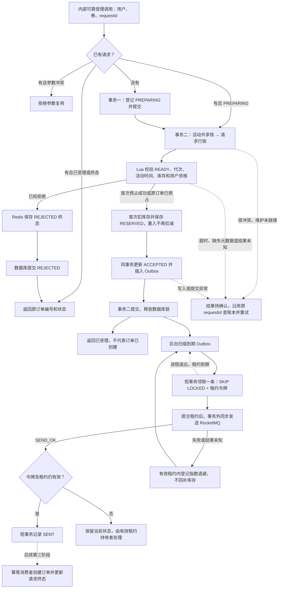

# 订单 RocketMQ 第二阶段：可靠受理、Redis 预占与 MySQL Outbox

日期：2026-10-24。第一阶段提交：`5ab2f390`。

阅读补充：[第二阶段架构、数据库表职责与复盘](ROCKETMQ_PHASE2_REVIEW.md)。
该文包含 hmdp-plus 来源对照、架构图、表关联图、逐字段说明、受理/投递流程、事务时序、状态图及故障数据快照。
当前仍为三表实现；单表简化只是待评估方案，本次文档完善没有改写业务代码。
数据类型、RC/RR、REQUIRES_NEW、锁与超时配置的解释见 [数据设定与事务级别](ROCKETMQ_PHASE2_TRANSACTIONS.md)。

## 1. 解决的问题与实施边界

第一阶段只有生产者和发送入口。如果直接在旧 Lua 后调用 `publisher.publish()`：

1. Redis 从 10 扣到 9，应用还没发送消息就退出，会留下没有消息驱动的预占。
2. Broker 已收到消息，客户端等待回执超时。如果此时把库存加回 10，消息随后建单就会重复放出额度。
3. 多实例扫描同一消息，或进程发送成功后未保存回执就退出，会重复投递。

第二阶段实现独立请求账本、按订单预占、受理与 Outbox 同事务提交、租约投递及退避重试。
发生网络结果未知时留下可追踪的数据库状态，不依据发送结果直接释放库存。

**本阶段没有把新服务接入 HTTP 入口，也没有注册正式订单消费者。**
原 `POST /voucher-order/seckill/{id}`、`VoucherOrderServiceImpl`、旧 `seckill.lua` 和 Stream 消费器保持原流程。
新受理组件、Outbox 扫描均默认关闭，没有在业务库自动执行 DDL 或初始化 READY 活动。
隔离集成测试会显式组装新链路，并且只向 `hmdp-order-smoke` 发送探针。

本阶段的“已受理”表示请求和待发消息已提交，不表示订单创建、支付或 Redis 预占已确认完成。
支付、退款、博客、点赞、评论、关注和消息通知均不在本轮范围。

## 2. 按文件说明

路径均相对于项目根目录。

| 文件 | 原有职责 / 本次改动 | 原因与业务作用 |
|---|---|---|
| `backend/src/main/resources/db/migration/V20261024_02__seckill_request_outbox.sql` | 新增三表及索引、状态检查；可重复执行 | 请求结果、原始事件及租约持久化，不依赖内存队列 |
| `backend/src/main/java/com/hmdp/entity/SeckillRequest.java` | 新增请求账本实体 | 保存固定订单号、请求参数摘要、状态、预占代次和受理时间 |
| `backend/src/main/java/com/hmdp/entity/SeckillCampaignControl.java` | 新增独立活动控制实体 | 共享维护锁与未来重建排他锁共用独立资源，避免在真实库存行上锁升级 |
| `backend/src/main/java/com/hmdp/entity/MqOutbox.java` | 新增待发消息实体 | 保存消息体、租约、尝试次数、重试时间和 Broker 回执 |
| `backend/src/main/java/com/hmdp/constants/SeckillRequestStatus.java` | 新增请求状态枚举 | 与订单支付状态分离，防止混淆“处理中”和“未支付” |
| `backend/src/main/java/com/hmdp/constants/SeckillReservationResult.java` | 新增 Lua 返回码枚举 | 已知拒绝与执行结果未知分别处理，未知结果抛异常 |
| `backend/src/main/java/com/hmdp/constants/SeckillConstants.java` | 保留旧常量，增加新键前缀与事件类型 | 不覆盖旧库存、不重复拼接项目命名空间 |
| `backend/src/main/java/com/hmdp/mapper/SeckillRequestMapper.java` | 新增登记、按请求读取、请求行锁、条件状态更新 | 同用户同 requestId 唯一；重复登记不覆盖原业务参数 |
| `backend/src/main/java/com/hmdp/mapper/SeckillCampaignControlMapper.java` | 新增共享维护锁 | 使用 `FOR SHARE NOWAIT`，维护冲突立即失败并保留原请求 |
| `backend/src/main/java/com/hmdp/mapper/MqOutboxMapper.java` | 新增消息登记、领取、回执与重试 SQL | `SKIP LOCKED` 协调多实例，数据库时间与租约令牌防止旧发布者覆盖新状态 |
| `backend/src/main/java/com/hmdp/dto/SeckillAcceptance.java` | 新增受理结果 DTO | 返回原订单号、账本状态和稳定拒绝原因 |
| `backend/src/main/java/com/hmdp/service/ISeckillRequestService.java` | 新增可靠受理协议 | 可信用户身份由未来鉴权入口提供，不直接信任 HTTP 用户编号 |
| `backend/src/main/java/com/hmdp/service/impl/SeckillRequestServiceImpl.java` | 新增可靠受理实现 | 组织两个独立事务、参数绑定校验、Lua 预占和 Outbox 登记，不直接发送 MQ |
| `backend/src/main/java/com/hmdp/infrastructure/seckill/SeckillReservationStore.java` | 新增 Redis 预占适配器 | 脚本键全部通过 KEYS 传入，同一券使用共同 hash tag |
| `backend/src/main/java/com/hmdp/infrastructure/redis/RedisIdGenerator.java` | 改用 Lombok 构造器注入，Redis 字段设为 final | 保持编号规则，避免移除字段注入后 Redis 依赖为空 |
| `backend/src/main/resources/lua/seckill/reserve-order.lua` | 新增预占脚本 | 校验时间、库存、READY、代次、用户资格及订单终态；重复命令不重复扣减 |
| `backend/src/main/java/com/hmdp/exception/SeckillAcceptancePendingException.java` | 新增结果未知异常 | 保留订单号，要求沿用原 requestId，不将超时当成失败 |
| `backend/src/main/java/com/hmdp/config/SeckillOrderProperties.java` | 新增组件开关及事务超时 | 默认不启用新受理组件，避免半成品接入旧链路 |
| `backend/src/main/java/com/hmdp/config/OrderOutboxProperties.java` | 新增扫描配置 | 限制每轮工作量、扫描频率和租约时间 |
| `backend/src/main/java/com/hmdp/config/OrderOutboxSchedulingConfiguration.java` | 新增条件调度配置 | MQ 和 Outbox 都启用才开启任务调度 |
| `backend/src/main/java/com/hmdp/infrastructure/mq/OrderOutboxDispatcher.java` | 新增租约投递器 | 逐条短事务领取，事务外同步发送，再以有效令牌更新 SENT 或重试 |
| `backend/src/main/java/com/hmdp/infrastructure/mq/OrderOutboxJob.java` | 新增定时任务 | 随原应用运行，数据库故障后下一轮重试，无需新增 Tomcat |
| `backend/src/main/java/com/hmdp/exception/OrderMessagePublishException.java` | 从第一阶段的 `infrastructure/mq` 包迁移至 `exception` | 按 AGENTS.md 统一异常分层；保留原异常语义与构造方法 |
| `backend/src/main/java/com/hmdp/infrastructure/mq/RocketMqOrderPublisher.java` | 仅更新异常 import，沿用第一阶段同步发送和日志 | 本阶段未重复实现客户端与发送器 |
| `backend/src/main/resources/application.yaml` | 新增关闭状态的开关和扫描参数；Redis 连接 2s、命令 3s | 限制持请求锁期间的 Redis 等待；命令超时给旧 Stream `BLOCK 2000ms` 留出余量 |
| `backend/src/test/java/com/hmdp/config/OrderPipelineConfigurationTest.java` | 新增 3 项组件条件测试 | 确认默认关闭、独立受理和投递条件一致 |
| `backend/src/test/java/com/hmdp/infrastructure/redis/RedisIdGeneratorTest.java` | 新增 1 项注入回归测试 | 使用模拟 Redis 验证 Spring 注入及连续生成不同正数编号 |
| `backend/src/test/java/com/hmdp/infrastructure/mq/OrderOutboxDispatcherTest.java` | 新增 7 项单元测试 | 验证发送位于事务外、重试、中断、非法消息保留和退避上限 |
| `backend/src/test/java/com/hmdp/infrastructure/mq/SeckillOutboxIT.java` | 新增 16 项真实依赖测试 | 真实 MySQL/Redis 验证并发和事务；另串联虚拟机 MQ 验证一次完整投递 |
| `backend/src/test/java/com/hmdp/infrastructure/mq/RocketMqOrderPublisherTest.java` | 仅调整迁移后的异常 import | 保留第一阶段发送行为验证 |
| `README.md`、`docs/README.md`、两份订单计划和第一阶段说明 | 更新进度、链接与实际边界 | 保留历史规划，明确哪些能力已完成、哪些尚未接流量 |

独立服务的拆分理由：它具有请求重试、预占、持久化和后续恢复等独立职责，并非单方法转调。
将其直接塞进已有 Stream 服务，会把旧启动线程、旧库存键和新可靠性协议混在一起，增加提前切换风险。
自有组件使用 `@Service` / `@Component`、`private final`、`@RequiredArgsConstructor`；
配置属性使用 `@Component + @ConfigurationProperties`；实体、DTO、消息和异常不注册为组件。
新增 Java 方法按规范补充中文 Javadoc；本阶段不改变布隆过滤器或商铺缓存流程。

## 3. 关键代码前后对比

### 3.1 受理协议：新增，不替换旧 HTTP 方法

原链路仍保留：

```java
Long result = stringRedisTemplate.execute(SECKILL_SCRIPT, ...); // 校验、预扣、XADD 在旧脚本内
return Result.ok(orderId);
```

新增链路先独立提交账本，再开始受理事务：

```java
transaction().execute(status -> {
    requests.insertPreparing(candidate);
    return requests.findByRequest(userId, requestId);
}); // 事务一已提交，才允许后续 Lua 预占

return transaction().execute(status -> acceptLocked(orderId, userId, voucherId, hash));
// 事务二提交成功后，execute 才返回 ACCEPTED
```

`UNIQUE(user_id, request_id)` 负责并发重试归并，已有记录的 orderId、traceId 和业务参数不被新请求覆盖。
SHA-256 参数摘要覆盖 userId、voucherId、固定数量 1；相同 requestId 改券会被拒绝。
默认使用 READ_COMMITTED 独立事务，避免自调用绕过代理，也不将 PREPARING 的提交延迟到受理结束。

### 3.2 受理事务：新增

```java
campaigns.lockShared(voucherId);                    // 先锁独立活动控制行
SeckillRequest request = requests.lockByOrderId(orderId); // 再锁请求行
reservations.reserve(voucherId, userId, orderId, epoch);  // 事务内有界 Redis 调用
requests.markAccepted(request);
outbox.insertEvent(createEvent(request));           // 和 ACCEPTED 同一个 MySQL 事务
```

实际方法还会核对原参数、当前请求状态和预占结果。
共享锁允许普通受理并发执行；未来维护使用同一控制行的排他锁。真实库存行不承担维护共享锁。
活动和请求锁都使用 NOWAIT，竞争失败保留原请求供重试；SQL 超时为 5 秒，受理事务默认 5 秒。

如果插入 Outbox 失败，ACCEPTED 更新回滚，而事务一的 PREPARING 已提交，仍可以找到原请求。
Redis 不能随 MySQL 回滚，已预占的库存会保留；相同 requestId 重试通过原 orderId 找到 RESERVED，
继续完成 ACCEPTED 与 Outbox，不再次扣减。进程长期不再重试的情况交由第四阶段周期恢复处理。

### 3.3 预占脚本：新增独立键，不修改旧脚本

新键示例：

```text
hmdp:seckill:{123}:stock
hmdp:seckill:{123}:meta
hmdp:seckill:{123}:users
hmdp:seckill:{123}:reservation:456
```

完整的键值快照、字段字典、成功/拒绝/重试的数据变化及只读调试命令，见
[图解与复盘第 7 节：Redis 数据](ROCKETMQ_PHASE2_REVIEW.md#7-redis-数据及三种状态的区别)。

元数据含 `ready=1`、`epoch`、`beginAt`、`endAt`，时间为 Unix 毫秒；脚本用 Redis TIME 判断活动窗口。
userId 映射到 orderId，而非只有用户 Set；后续补偿才能判断资格归属。
RESERVED 记录包含用户、券、订单、代次和数量，库存、用户映射、预占在一次 Lua 执行中写入。

脚本先检查类型和数值，再进行首次写入，因为 Lua 发生运行错误时不会撤销之前已经执行的 Redis 写入。
已有 RESERVED 返回成功；已拒绝的订单返回原拒绝码；RELEASED/CONFIRMED 不能重新预占。
未开始、已结束、库存不足和重复用户都会写 REJECTED 终态，阻止旧超时命令迟到后重新预占。
已拒绝后想重新尝试，必须使用新的 requestId；原请求的业务结果不会因库存或时间变化被改写。

元数据缺失、代次冲突或活动维护状态不是安全的“没有预占”证据，保留 PREPARING，不能直接删资格或回补库存。
本阶段只验证 RELEASED 墓碑能阻止预占，释放、确认及墓碑写入任务尚属于第四阶段。

### 3.4 Outbox 投递：从无持久化重试到数据库领取

第一阶段沿用的发送方法：

```java
SendResult result = producer.send(message, timeoutMillis); // 同步等待 Broker
```

新增投递流程：

```java
MqOutbox event = claimNext();     // 短事务：SKIP LOCKED 选一条、写令牌和到期时间、提交
publisher.publish(message);      // 事务外发送，不持有数据库行锁
outbox.markSent(eventId, token, messageId); // 新短事务，检查令牌和租约仍有效
```

`dispatchDue()` 拒绝从已有数据库事务的线程调用，避免独立领取事务结束后恢复到外层事务再等待 MQ。
每轮最多 20 条，但每次只领取一条；不会一次领取 20 条，再让后面的租约在等待发送时提前过期。
领取时尝试次数递增，重试间隔从 1 秒指数增长，最多 5 分钟，不设“超过次数就删除”的路径。
消息重投复用持久化的 eventId、orderId、用户、券、traceId 和受理时间，不生成新的业务事件。

发送异常、超时、非 SEND_OK、消息格式异常都保留 Outbox；仅登记重试时间与异常类型，不回补库存。
记录 SENT 和安排重试都要求 `status=SENDING AND lease_token=当前令牌 AND lease_until>数据库当前时间`。
旧进程恢复后不能覆盖已接管任务；租约过期未确认的记录会被重新领取。
Broker 已收消息但应用未写 SENT 时会重复发送，消费者幂等由第三阶段补齐，不能宣称这里实现了只投递一次。

## 4. 完整流程与异常分支

1. 校验可信用户、券、requestId 和 traceId；不合法不预占。
2. 按用户和 requestId 查询原请求；存在时校验参数，已终结或已受理直接返回原结果。
3. 不存在时使用现有编号生成器生成候选编号，独立事务登记 PREPARING；并发登记由唯一键归并。
4. 受理事务先取得活动共享锁，再取得请求行锁，重新检查状态；锁由数据库在提交或回滚时释放。
5. 在事务内调用有界 Lua。已知拒绝提交 REJECTED；RESERVED 则同时登记 ACCEPTED 和 CREATE_ORDER Outbox。
6. 受理事务提交后才返回 ACCEPTED。Redis 异常、提交失败或响应丢失返回结果待确认异常，沿用原 requestId 恢复。
7. 后台任务短事务领取并提交租约，事务外等待 MQ；成功后短事务记录 SENT，未知则短事务安排重试。
8. 已中断的线程不再领取新消息；发送中断保留中断标记及持久化任务，租约过期仍可恢复。

本阶段没有缓存删除、商铺布隆同步或新订单数据库库存扣减，因此不存在这些操作的新增事务顺序。
Redis 预占记录不设置短 TTL，也不因发送成功清理；后续确认、补偿和维护协议必须尊重这些终态及代次。



图中受理调用为本阶段新增的内部服务，正式 HTTP 入口目前仍走旧 Stream。
若提交响应丢失但数据库实际已提交，下次按 requestId 会查到 ACCEPTED，而不是创建新订单。

上图保留为阶段概览。分开的 [受理流程与事务时序](ROCKETMQ_PHASE2_REVIEW.md#8-受理流程与事务时序)、
[后台投递与租约流程](ROCKETMQ_PHASE2_REVIEW.md#9-后台投递租约与重试) 进一步标明每张表在哪个事务读写，避免将 SENT 误认为建单成功。

## 5. 配置、迁移与执行

配置入口：

| 环境变量 | 默认值 | 作用 |
|---|---|---|
| SECKILL_RELIABLE_COMPONENTS_ENABLED | false | 注册新受理组件，不改变 HTTP 入口 |
| SECKILL_TRANSACTION_TIMEOUT_SECONDS | 5 | 受理短事务超时，范围 1～30 秒 |
| ORDER_OUTBOX_ENABLED | false | 和 ROCKETMQ_ENABLED 同时为 true 才启动投递任务 |
| ORDER_OUTBOX_BATCH_SIZE | 20 | 每轮最多处理数，范围 1～100 |
| ORDER_OUTBOX_POLL_INTERVAL_MS | 1000 | 扫描固定延迟，范围 100～60000 毫秒 |
| ORDER_OUTBOX_LEASE_MS | 30000 | 每条任务租约，范围 1000～300000 毫秒 |

租约应大于正常发送耗时；配置过短可能增加重复发送，令牌检查仍防止旧实例覆盖新状态。
关闭扫描只停止新投递，不删除持久化任务；不能将这些开关当作新旧链路热切换开关。

迁移脚本没有自动启动执行器，也没有修改已有初始化 SQL 的历史内容。
需要扩展业务库时，在项目根目录执行（以下命令用于当前 Compose 环境）：

```bash
docker exec -i hm-dp-dev-mysql-1 sh -c \
  'MYSQL_PWD="$MYSQL_ROOT_PASSWORD" exec mysql -uroot "$MYSQL_DATABASE"' \
  < backend/src/main/resources/db/migration/V20261024_02__seckill_request_outbox.sql
```

本阶段没有执行这条业务库迁移命令。脚本已在隔离测试库执行两次，验证可重复执行。
不自动插入 READY 控制行；旧 Stream 排空、活动代次及用户资格初始化须在迁移阶段实施。
历史订单 `UNIQUE(user_id, voucher_id)` 在第三阶段检查重复数据后增加，本阶段尚未改旧订单表。

## 6. 验证记录

在项目根目录执行：

```bash
# 普通单元测试，不访问真实中间件。
mvn -f backend/pom.xml '-Dtest=*Test' test

# 真实 MySQL/Redis；真实 MQ 用例没有开启时会跳过该单个用例。
SECKILL_OUTBOX_IT=true mvn -f backend/pom.xml -Dtest=SeckillOutboxIT test

# 串联当前虚拟机 MQ，只使用 hmdp-order-smoke 测试 Topic。
SECKILL_OUTBOX_IT=true ROCKETMQ_SMOKE_TEST=true \
  mvn -f backend/pom.xml '-Dtest=*Test,SeckillOutboxIT' test
```

执行环境使用 Maven 离线缓存，额外添加 `-o` 和 `-Drocketmq.log.root=.../backend/target/rocketmq-logs`。
Mockito JVM 附加和本地中间件访问需要受限环境之外的执行权限，与业务代码行为无关。
集成测试会创建并清理随机 `hmdp_mq_it_` 数据库，使用随机券编号及新 Redis 键；
数据库用户需要创建/删除这个隔离测试库的权限，测试不读取 MYSQL_DATABASE 作为目标库。
MQ 用例拒绝使用非 `hmdp-order-smoke` 前缀 Topic，使用独立临时组，测试完关闭客户端。
本阶段没有启动完整应用，也没有运行含业务数据准备的 `HmDianPingApplicationTests`。

验证内容：

- 正常受理及原 requestId 重试，保留首次 traceId；复用请求更换券被拒绝。
- 20 用户并发争抢 5 份库存，只有 5 条 ACCEPTED 和 5 条 Outbox，库存不为负。
- 同一 requestId 并发只生成一条有效账本与事件。
- Outbox 写失败回滚 ACCEPTED，Redis 已预占不回补，原请求重试不再扣减。
- Lua 已执行但响应超时，PREPARING 保留，原请求恢复成功。
- 同用户换 requestId 不能重复预占；未开始、已结束、库存不足不产生待发消息。
- 缺失元数据、活动维护、旧代次、错误 Redis 类型、RELEASED 墓碑不触发新扣减。
- REJECTED 终态阻止库存恢复后迟到的同订单命令重新预占。
- 发送超时保留原消息、退避时间和预占；成功只更新 SENT，不把请求直接改成 SUCCEEDED。
- 租约过期可接管，旧令牌不能更新新回执；真实行锁下 SKIP LOCKED 不重复领取。
- 受理提交响应丢失、发送后数据库断开均可用稳定业务标识恢复。
- 真实 MySQL → Redis 预占 → Outbox → 虚拟机 RocketMQ → 隔离消费者消息内容一致。
- 默认组件关闭、启用条件一致、中断停止领取、非法消息保留、退避封顶均有单元验证。

2026-10-24 阶段联调记录：**129 项单元测试 + 16 项集成测试，共 145 项通过，失败 0、错误 0、跳过 0**。
其中真实 MQ 用例也已运行；其余故障用例使用真实 MySQL/Redis 配合指定故障替身。

同日提交前补充：修复订单号生成器构造器注入缺少 final 字段的问题，新增 1 项回归测试，
**当前 130 项单元测试全部通过**。集成测试复跑在初始化时因本机 MySQL 连接被拒绝而失败，Docker 服务也未运行，
未进入 16 项集成用例，不能把此前的联调结果计为本次重新通过。
代码和 Markdown 文档的 `git diff --check` 通过；生成的 HTML 保留工具原始空白，不修改其产物溯源内容。
没有执行完整应用数据准备测试或业务库迁移，也没有进行正式订单压测。

## 7. 仍未覆盖及下一阶段

- 第二阶段提交边界止于可靠受理和消息投递，不代表订单迁移已经完成。
- 第三阶段实现账本驱动的幂等建单、条件扣减数据库库存、订单业务唯一索引、鉴权结果查询及前端展示。
- 第四阶段实现周期 PREPARING 恢复、明确关闭、释放/确认任务、死信与非法消息隔离、对账及 Redis 受控重建。
  当前请求自行重试可以恢复正常预占；没有客户端重试的孤立 PREPARING 不会在本阶段自动扫描推进。
- 第五阶段执行真实故障压测、旧 Stream 未读及 pending 排空、停止旧写入口、安全切换和回滚演练。
- 当前没有业务级关闭入口、完整订单消费者、支付、退款或支付超时关单。
- MQ 至少一次投递要求下游幂等；当前单机开发 Broker 和 Redis/MySQL 持久化策略不等同于生产高可用。
- 20 用户的隔离预占测试不是完整订单并发压测，不替代 1000 用户、宕机、重启及迁移验收。

### 第三阶段实施计划（待执行）

目标：在第二阶段“可靠受理并发出建单消息”的基础上，完成“幂等创建订单并查询结果”。

1. **注册正式订单消费者**：使用独立 Topic/消费者组，校验消息版本、字段及账本绑定关系；在原 Spring Boot 应用内运行，无需另建 Tomcat。
2. **同事务完成建单**：统一按活动控制行、请求行、库存/订单的顺序加锁；仅 ACCEPTED 可推进。
   条件扣减数据库库存、插入订单、请求更新 SUCCEEDED 同时提交；同时登记后续 Redis 确认任务，具体执行器在第四阶段补齐。
   数据库提交成功后才向 MQ 确认；异常回滚，重复消息查询原结果，不能再次扣库存。
3. **增加数据库唯一约束**：先检查历史重复订单，再提供 `UNIQUE(user_id, voucher_id)` 迁移脚本，保留订单主键兜底。
   不自动删除历史冲突数据；唯一键冲突必须回滚原建单事务，再读取已有订单核对结果。
4. **提供鉴权结果查询**：支持当前用户按 orderId/requestId 查询受理进度、建单结果及中文拒绝原因，禁止查询他人的订单。
5. **完善前端结果展示**：同一次抢购重试复用 requestId，区分处理中、建单成功、已拒绝；查询超时提示继续确认，不能直接显示抢购失败或自动发起新请求。
   先在受控开发入口联调，现有 HTTP/Stream 正式链路的切换仍属于第五阶段。
6. **验收关键故障**：重复和并发消费只建一单；库存不为负；插单失败整笔回滚；提交成功但 MQ 确认丢失后重投不重复扣库；
   校验越权查询、消息与账本不符、旧终态消息及数据库临时故障。分别记录模拟测试与真实 MySQL/Redis/RocketMQ 联调结果。

PREPARING 自动恢复、关闭补偿、Redis 确认/释放任务执行、死信与非法消息可靠隔离、对账重建属于第四阶段；
第三阶段必须明确暴露这些尚未完成的情况，不把消费失败等同于可以无条件回补库存。完成第三阶段后仍保持新链路默认关闭，等待完整恢复与切换验收。
