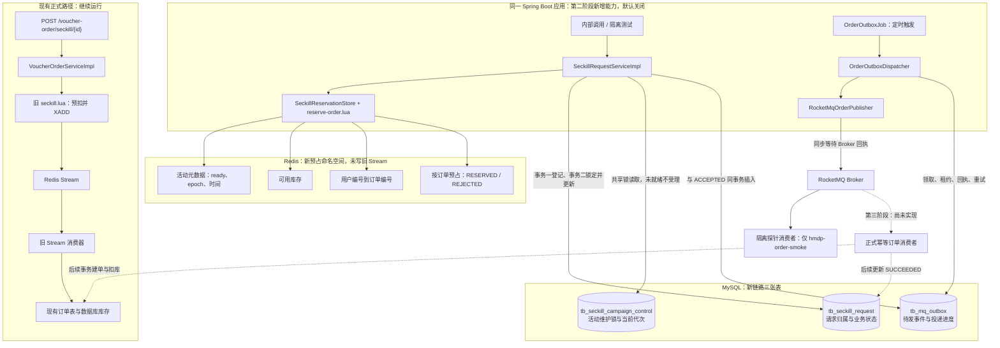
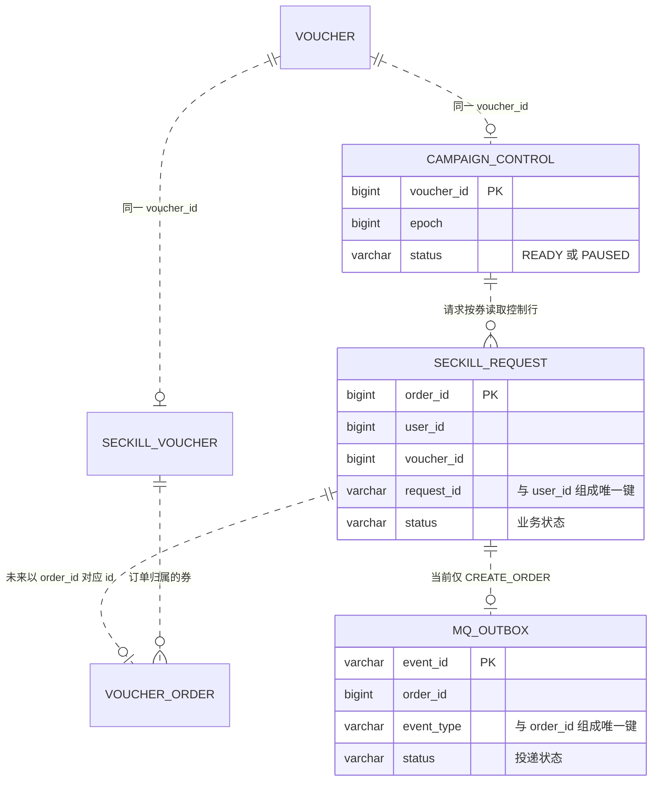
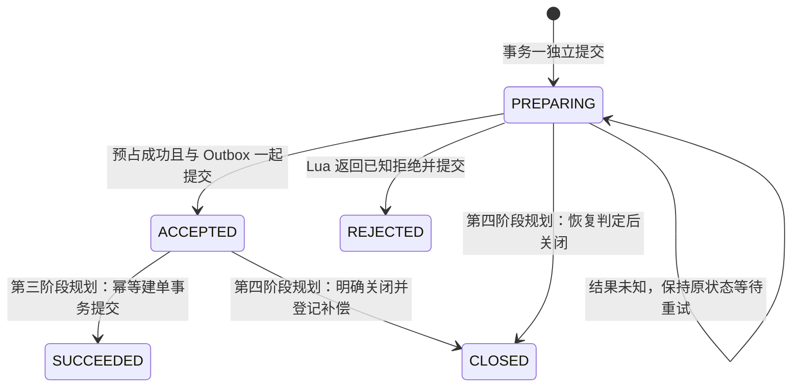
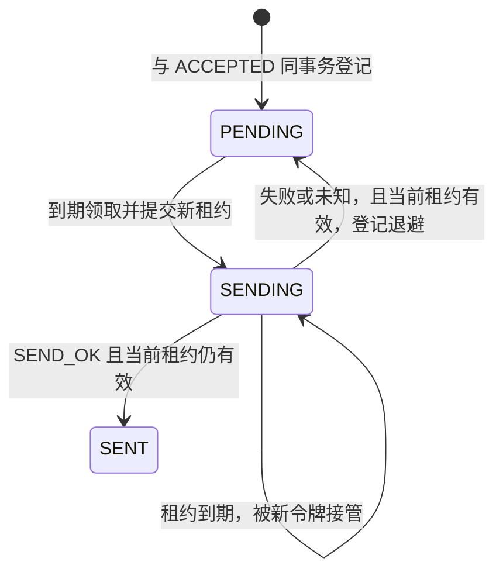
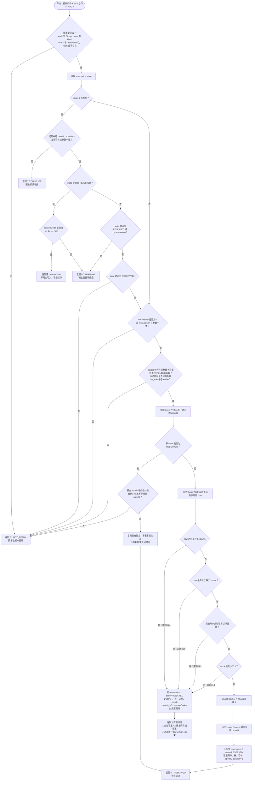
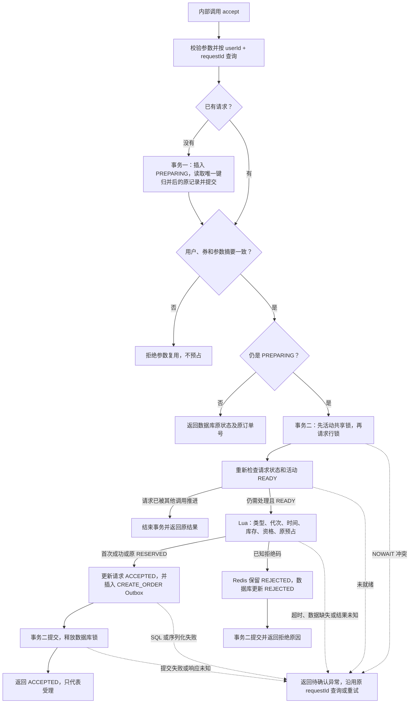
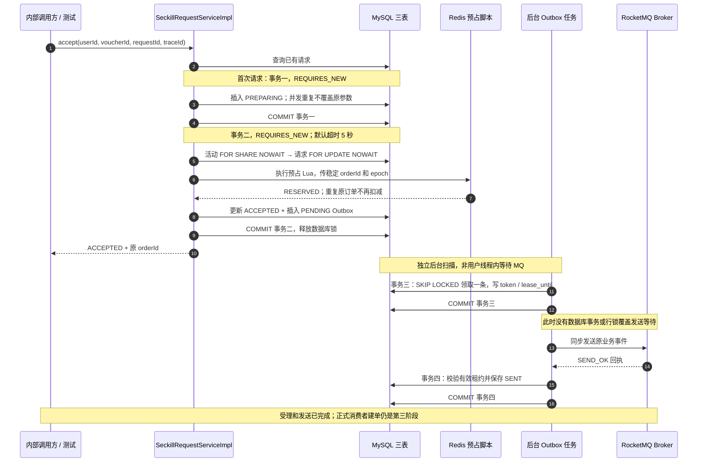
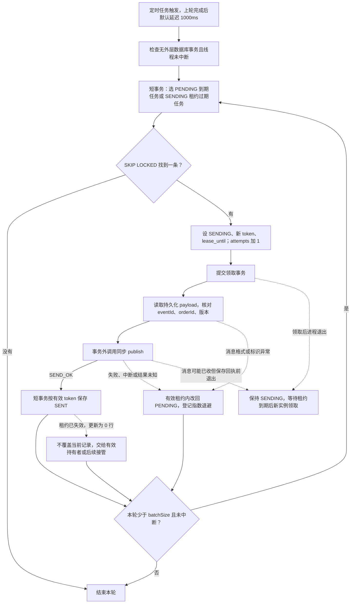

# 订单 RocketMQ 第二阶段：架构、表职责与复盘

核对日期：2026-10-24。本文解释当前三表实现，不代表已经按“单表简化方案”改写代码。

本文配合 [第二阶段实现与验证记录](ROCKETMQ_PHASE2.md) 阅读。先看本页的范围、架构和数据职责，再结合原文逐文件核对代码。
隔离级别、传播行为、各层超时和数据类型的深入说明见 [数据设定与事务级别](ROCKETMQ_PHASE2_TRANSACTIONS.md)。

## 阅读导航

1. [实现边界与参考来源](#1-实现边界与参考来源)
2. [架构图：调用方、数据库、Redis 和 RocketMQ](#2-架构图调用方数据库redis-和-rocketmq)
3. [数据库表总览与逻辑关联](#3-数据库表总览与逻辑关联)
4. [请求账本 tb_seckill_request](#4-请求账本-tb_seckill_request)
5. [待发事件 tb_mq_outbox](#5-待发事件-tb_mq_outbox)
6. [活动控制 tb_seckill_campaign_control](#6-活动控制-tb_seckill_campaign_control)
7. [Redis 数据及三种状态的区别](#7-redis-数据及三种状态的区别)
8. [受理流程与事务时序](#8-受理流程与事务时序)
9. [后台投递、租约与重试](#9-后台投递租约与重试)
10. [故障复盘：每个断点留下什么](#10-故障复盘每个断点留下什么)
11. [调试与数据核对](#11-调试与数据核对)
12. [设计取舍与可简化部分](#12-设计取舍与可简化部分)
13. [代码证据与验收边界](#13-代码证据与验收边界)

## 1. 实现边界与参考来源

### 1.1 当前运行状态

| 范围 | 实际状态 | 图中应该怎样理解 |
|---|---|---|
| 现有 HTTP 秒杀 | 仍调用旧 VoucherOrderServiceImpl，Lua 预扣并写 Redis Stream | 当前正式入口，不能连到新受理服务冒充已切换 |
| 新请求受理 | 已实现，组件默认关闭；内部服务及隔离测试可调用 | 本页的第二阶段主要路径 |
| Outbox 调度 | 已实现，默认关闭；同时满足 MQ 和 Outbox 开关才注册任务 | 同一个 Spring Boot 应用内的后台任务，不是新增 Tomcat |
| 正式 RocketMQ 订单消费者 | 尚未实现 | 第三阶段规划，不能画成当前完成的建单路径 |
| 周期 PREPARING 恢复、确认、释放、重建 | 尚未实现 | 第四阶段规划；当前原请求主动重试可恢复部分中间状态 |
| 业务库迁移、真实活动 READY 初始化 | 本次没有执行 | 三张表的验证在隔离测试库完成 |
| 消息联调 | 已用虚拟机 RocketMQ 和 hmdp-order-smoke 验证 | 探针消费者不是正式订单消费者 |

### 1.2 哪些来自 hmdp-plus，哪些是本项目新增

参考工程位于同级目录 `hmdp-plus`。核对到的 HEAD 为 `4c003dbda5d38b9c01d7533f6caf2f45ddba2f27`，本次核对时其工作区无改动。
当前项目基线 HEAD 为 `5ab2f390521409356aaceb43368ca6abc5f24a27`，第二阶段代码尚未提交；本文按工作区代码说明。

| 主题 | hmdp-plus 已核对的实现 | 当前项目的处理 | 来源判断 |
|---|---|---|---|
| 库存前置判断 | Lua 检查时间、状态、库存、用户 Set，并预扣库存 | 保留 Lua 预占方向，增加订单归属、代次和终态 | 借鉴总体思路，重新实现协议 |
| 库存流水 | Lua 写 Redis Hash 流水，记录 before/change/after 数量 | 使用 MySQL 请求账本及按订单 Redis 预占状态 | 不能把两者称为同一个实现 |
| 异步建单 | 秒杀 V2 调用 Kafka Producer；生产框架通过 CompletableFuture 处理回调 | 后台 Outbox 使用 RocketMQ 同步发送，订单消费尚待第三阶段 | 替换中间件，同时改变投递方案 |
| 发送失败 | SeckillVoucherProducer.afterSendFailure 调用 Redis 回滚组件 | 保留待发记录，退避重试；未知结果不回补 | 本项目刻意采用不同处理 |
| 超时消息 | Consumer 的 beforeConsume 对超过 10 秒的消息执行回滚并跳过建单 | 不实现“消息年龄超过 10 秒就取消”的规则 | 未照搬该策略 |
| Redis 回滚 | 回滚 Lua 删除整张券的库存键，按标志删除用户资格，并写流水 | 当前未实现释放任务；后续设计为按订单幂等释放 | 当前三表设计不是这段 Lua 的移植 |
| 对账 | 有 ReconciliationTaskServiceImpl 和控制器手动调用入口 | 周期恢复及对账计划放在第四阶段 | 借鉴对账目标，当前未宣称已经实现 |
| MySQL Outbox、PREPARING、租约与维护控制行 | 已核对的秒杀 V2 调用链未见这三张表及相应同事务登记 | 当前新增三表、两个受理事务、租约令牌及控制行 | 属于本项目额外设计，复杂度由本项目承担 |

参考代码主要位于：

- `hmdp-plus/hmdp-core-service/src/main/java/org/javaup/service/impl/VoucherOrderServiceImpl.java` 的 `doSeckillVoucherV2`、`createVoucherOrderV2`。
- 同模块 `kafka/producer/SeckillVoucherProducer.java`、`kafka/consumer/SeckillVoucherConsumer.java`。
- 同模块 `src/main/resources/lua/seckillVoucher.lua`、`seckillVoucherRollBack.lua`。
- `hmdp-plus/hmdp-mq-framework/hmdp-mq-producer-framework/src/main/java/org/javaup/AbstractProducerHandler.java` 的异步发送回调。
- `ReconciliationTaskServiceImpl` 及 `VoucherOrderController.reconciliationTaskAll`。

参考项目 README 提到了 Outbox；但 README 的描述不能证明当前秒杀 V2 已执行了“数据库受理状态与 Outbox 同事务提交”。
本文只对已追踪的秒杀调用链作判断，不据此推断参考项目其他全部模块都没有类似机制。

本项目改变失败处理方式的两个原因：

1. 发送回执超时只能说明应用没有确认成功，不能证明 Broker 没收到消息；此时直接释放预占，迟到消息仍可能建单。
2. 数据库库存还没有扣除所有在途预占，不能直接用它覆盖 Redis。举例：DB 库存 10、两笔在途预占后 Redis 为 8，
   其中一笔明确取消时应恢复到 9；如果删库存键后直接加载 DB 的 10，会额外放出另一笔仍有效的预占额度。

这些是对方案边界的分析，不代表本阶段已经实现了完整补偿闭环，也不代表对参考工程所有业务场景作了完整审计。

## 2. 架构图：调用方、数据库、Redis 和 RocketMQ

图中的实线表示当前代码已经具备的调用能力，并不意味着默认已经启用；虚线且标明“后续”的部分尚未落地。
Mapper 归并到所属服务的数据库访问箭头中，不表示 Controller 直接访问表。

另有 [可查看的架构图](diagrams/rocketmq-phase2-architecture.html) 和 [图的 JSON 源文件](diagrams/rocketmq-phase2-architecture.json)。
HTML 聚焦第二阶段新增职责；下方 Mermaid 同时展示旧入口与后续边界，可直接复制到支持 Mermaid 的文档工具中。



两条链路现在没有业务流量切换关系。打开新组件开关也不会让原 Controller 自动调用新服务。
图中新预占的实际测试数据与旧业务数据隔离，不能把旧库存数字直接复制成新 READY 活动。

## 3. 数据库表总览与逻辑关联

### 3.1 每张表回答的问题

| 表 | 一条记录代表什么 | 谁负责读写 | 第二阶段对它的实际操作 |
|---|---|---|---|
| tb_voucher（既有） | 一张优惠券的基本定义、店铺与使用规则 | 既有优惠券业务 | 新受理服务不直接查询它 |
| tb_seckill_voucher（既有） | 一张秒杀券的数据库库存与活动时间 | 既有发布业务、旧订单服务；新消费者后续接管 | 新受理服务不直接扣减它；Redis 预占不等于这里已扣库 |
| tb_voucher_order（既有） | 一张真正创建的订单及支付相关状态 | 当前旧 Stream 服务；未来正式 MQ 消费者 | 新链路本阶段没有插入订单 |
| tb_seckill_request（新增） | 用户的一次可重试下单请求 | 新受理服务，未来消费者及恢复服务 | 登记 PREPARING，读取原请求，推进 ACCEPTED 或 REJECTED |
| tb_mq_outbox（新增） | 必须投递的一次业务事件 | 受理服务插入，后台投递器更新 | 记录 CREATE_ORDER，领取、重试和保存 SENT |
| tb_seckill_campaign_control（新增） | 一张券的维护控制资源 | 本阶段读取；初始化由隔离测试准备，未来维护服务更新 | FOR SHARE NOWAIT 读取 READY 与 epoch，不自动创建或重建 |

因此三张新增表分别管理请求、投递、维护，不是三套消息队列。Broker 才负责主题、消息分发、消费位点等队列能力。

### 3.2 逻辑关联图

以下为业务关联，**迁移 SQL 没有为这些关联建立物理外键**。新请求和新订单之间的关联是后续消费设计，当前还未执行。



对当前 CREATE_ORDER 而言，请求可能有 0 条事件（PREPARING 或 REJECTED），受理成功后应有 1 条。
表结构允许同一订单不同 event_type 各有一条事件，但当前没有实现其他类型的投递执行器。
PREPARING 可能尚未找到有效活动控制行，ER 图不代表所有历史/异常请求都已经满足 READY 关联。

## 4. 请求账本 tb_seckill_request

### 4.1 为什么需要

它保存应用对请求的处理事实。即使 Redis 已预占、数据库受理事务回滚，仍能沿用原 requestId 找到订单编号并恢复。
它也允许“订单还没创建，但请求已受理”的中间状态存在，而不把这个状态塞进订单支付状态中。

| 字段 | 数据类型 | 作用与填写时机 |
|---|---|---|
| order_id | BIGINT，主键 | 首次登记绑定的订单编号；并发同请求以数据库已有记录为准，候选编号可能未被采用 |
| user_id | BIGINT | 可信调用方提供的请求归属，参与请求唯一键 |
| voucher_id | BIGINT | 本次抢购的券；相同 requestId 换券会被拒绝 |
| request_id | VARCHAR(128) | 同一操作重试时不变，与 user_id 共同识别原请求 |
| payload_hash | CHAR(64) | userId、voucherId、固定数量 1 的 SHA-256 摘要；复用请求时核对参数 |
| trace_id | VARCHAR(128) | 保留首次请求跟踪标识，后续重试不覆盖 |
| status | VARCHAR(16) | 请求业务状态，不是 MQ 投递或支付状态 |
| failure_reason | VARCHAR(64)，可空 | 当前存 SOLD_OUT、DUPLICATE_USER、NOT_STARTED、ENDED 等已知拒绝码 |
| reservation_epoch | BIGINT，可空 | 受理成功时保存活动代次；PREPARING 未必有值 |
| accepted_at | DATETIME(3)，可空 | 确认受理的时间，成功事务中与 Outbox 消息对应 |
| created_at / updated_at | DATETIME(3) | UTC 毫秒时间，登记及状态变化时写入；为恢复查询提供依据 |

唯一键 `UNIQUE(user_id, request_id)` 防的是同一次操作重复登记，**不能替代同用户同券的订单业务唯一约束**。
索引 `(status, updated_at, order_id)` 为未来恢复扫描准备；`(voucher_id, status, order_id)` 为按券核对准备。
这些索引存在不等于当前已有周期恢复任务，也不等于已经完成高并发查询计划验证。

### 4.2 业务状态图



当前方法只写 PREPARING、ACCEPTED、REJECTED；SUCCEEDED、CLOSED 虽在约束中允许，但推进它们的服务尚未实现。
“结果未知”不是当前额外新增的数据库状态，也不是把已提交的 ACCEPTED 强行改回 PREPARING。

## 5. 待发事件 tb_mq_outbox

### 5.1 为什么业务记录之外还要一张事件表

当前设计将“请求有没有受理”和“消息有没有发送”分开管理。ACCEPTED 与 CREATE_ORDER 记录同事务提交，
保证不会确认受理成功却完全没有待发事件。后台发送不依赖用户 HTTP 线程继续存活。

| 字段 | 数据类型 | 作用与填写时机 |
|---|---|---|
| event_id | VARCHAR(128)，主键 | 当前为 order-加订单号；重试不重新生成 |
| order_id | BIGINT | 对应账本订单号，帮助核对和定位 |
| event_type | VARCHAR(32) | 当前仅 CREATE_ORDER，领取 SQL 也仅领取这一类型 |
| schema_version | INT | 消息结构版本，反序列化后还要与记录核对 |
| payload | MEDIUMTEXT | 已持久化的业务消息字段，避免重试重新生成用户、券、编号或受理时间 |
| status | VARCHAR(16) | PENDING、SENDING、SENT 三种投递状态 |
| attempts | INT | 每次领取递增，含租约过期后的重新领取；不是消费次数 |
| next_retry_at | DATETIME(3) | PENDING 任务的下次可领取时间，使用数据库当前时间计算 |
| lease_token | VARCHAR(64)，可空 | 本次领取生成的 UUID，只作为所有权凭证，不替代 eventId |
| lease_until | DATETIME(3)，可空 | 当前领取权到期时间；发送中进程退出后允许接管 |
| broker_message_id | VARCHAR(256)，可空 | 成功发送的 Broker 回执编号，不作为业务幂等键 |
| last_error | VARCHAR(128)，可空 | 最后一次失败的异常类型；不保存密钥或完整异常正文 |
| created_at / updated_at | DATETIME(3) | UTC 创建与变更时间 |

`UNIQUE(order_id, event_type)` 防止同一订单的同类事件重复登记；它不阻止同一事件被多次发送。
投递重试会读取 payload 并重新构造消息对象，保证业务字段不变；不承诺 ObjectMapper 配置变化后发送字节一定逐字节相同。
当前没有实现归档/清理任务，已发送记录也会保留，后续需要定义保留窗口和清理规则。

### 5.2 投递状态图



SENT 不是订单成功；ACCEPTED + SENT + Redis RESERVED 是本阶段真实联调结束时的正常组合。
没有常驻正式消费者，因此本阶段不会自动把该请求推进成 SUCCEEDED。

## 6. 活动控制 tb_seckill_campaign_control

| 字段 | 数据类型 | 作用 |
|---|---|---|
| voucher_id | BIGINT，主键 | 每张券一行，也是维护锁保护的数据库资源 |
| epoch | BIGINT，必须大于 0 | 当前预占代次；受理时传给 Lua，与 Redis 元数据进行比较 |
| status | VARCHAR(16) | READY 或 PAUSED；非 READY 时不继续预占，保留待确认请求 |
| updated_at | DATETIME(3) | 记录控制信息变化时间；本阶段没有业务维护写入口 |

共享锁由 `SeckillCampaignControlMapper.lockShared()` 的 `FOR SHARE NOWAIT` 获取，事务提交或回滚后释放。
多个正常受理共享锁可同时存在；未来维护服务需要同一行的排他锁，使维护与受理互斥。
不直接在 `tb_seckill_voucher` 上加维护共享锁，是为了将维护协调与真实库存写入分开。

例子：将来从 epoch=1 重建为 epoch=2 后，仍携带 epoch=1 的迟到命令不能修改新代次库存。
但“当前有 epoch 检查”不意味着“完整 Redis 重建已经实现”；本阶段没有排他维护操作、epoch 递增服务或 READY 发布服务。
这张表及共享锁是当前方案中最明显的前置设计之一，可以在简化评估中优先讨论，但不能在原代码继续依赖它时直接删表。

## 7. Redis 数据及三种状态的区别

同一张券的脚本键都使用相同 hash tag，例如券 30、订单 1001：

| 键 | 类型 | 保存内容 | 当前读写位置 |
|---|---|---|---|
| hmdp:seckill:{30}:stock | String | 尚可预占数量 | Lua 检查并在首次成功时减 1 |
| hmdp:seckill:{30}:meta | Hash | ready、epoch、beginAt、endAt | Lua 读取；真实初始化/重建后续实现，测试手动准备 |
| hmdp:seckill:{30}:users | Hash | userId → orderId | Lua 首次预占时写入；本阶段不执行释放删除 |
| hmdp:seckill:{30}:reservation:1001 | Hash | state、用户、券、订单、代次、数量；拒绝记录另含 reasonCode | Lua 写 RESERVED 或 REJECTED，并识别已有终态 |

脚本识别 CONFIRMED、RELEASED，拒绝再次预占，但本阶段没有正式写入这两类终态的确认/释放执行器。
预占记录没有短 TTL；否则重试时可能失去“原订单已扣过”的依据。长期保留如何清理，仍需要后续策略。

### 7.1 键名规则及旧链路对照

以下例子统一使用 `voucherId=30`、`userId=1`、`orderId=1001`、`epoch=1`，初始可预占库存为 10。
这些是说明代码结构的数据示例，不是对当前 Redis 实例的实时查询结果。

键由 `SeckillReservationStore.keys(30L, 1001L)` 生成。`{30}` 中的花括号是键名的一部分，
是 Redis Cluster 的 hash tag：同一券的四个键进入同一槽，方便在一个 Lua 脚本中共同操作。
它不表示按订单拆分库存；stock、meta、users 都是同一张券共享，reservation 才是每笔订单一份。

| 作用 | 旧 HTTP / Stream 链路 | 新可靠受理链路 |
|---|---|---|
| 可预占库存 | String：`hmdp:seckill:stock:30` | String：`hmdp:seckill:{30}:stock` |
| 用户购买资格 | Set：`hmdp:seckill:order:30`，成员是 userId | Hash：`hmdp:seckill:{30}:users`，字段 userId、值 orderId |
| 消息排队 | Stream：`hmdp:stream:orders` | MySQL Outbox 登记，再投递 RocketMQ；不新增订单消息 Stream |
| 活动元数据 / 按订单预占 | 没有对应的新协议记录 | meta Hash / reservation Hash |

当前 HTTP 仍使用旧链路。新组件开关默认关闭，也未实现新活动的正式初始化服务，不能因为文档有样例就认为这些键已在业务 Redis 中生成。
集成测试会准备隔离的库存、元数据和数据库 READY 控制行，并在测试结束后清理。

### 7.2 预占之前：库存与元数据

库存是一个 String，保存十进制整数文本，不是 Hash：

```text
键：hmdp:seckill:{30}:stock
类型：String
值："10"
```

元数据是 Hash。以下以北京时间 2026-10-24 18:00 至 20:00 为示例活动窗口：

```text
键：hmdp:seckill:{30}:meta
类型：Hash
字段                 值
ready                "1"
epoch                "1"
beginAt              "1792836000000"
endAt                "1792843200000"
```

| 字段 | 业务含义与读取规则 |
|---|---|
| ready | `"1"` 表示 Redis 元数据就绪；不存在或其他值返回 NOT_READY |
| epoch | 当前预占代次，必须等于本次受理从数据库活动控制行读取并传入的 epoch |
| beginAt | 活动开始 Unix 毫秒时间戳；Redis 当前时间达到它才允许首次预占 |
| endAt | 活动结束 Unix 毫秒时间戳；Redis 当前时间达到它就拒绝首次预占，即窗口为 `[beginAt, endAt)` |

数据库 `tb_seckill_campaign_control` 也必须有券 30 的 `status=READY、epoch=1` 控制行，
只准备 Redis 不足以完成服务受理。当前 Lua 读取 meta，不负责创建、发布 READY 或递增 epoch。
未发生任何预占、拒绝且没有其他用户记录时，users 和本订单 reservation 键可以不存在，脚本允许首次创建。

### 7.3 首次预占成功：三个写入同时发生

假设在示例活动窗口内首次执行 `reserve(30L, 1L, 1001L, 1L)`，Lua 返回 `0 / RESERVED`，写入结果为：

```text
键：hmdp:seckill:{30}:stock
类型：String
值："9"                       # 10 减 1

键：hmdp:seckill:{30}:users
类型：Hash
字段                 值
1                    "1001"    # 用户 1 的资格归订单 1001 所有

键：hmdp:seckill:{30}:reservation:1001
类型：Hash
字段                 值
state                "RESERVED"
userId               "1"
voucherId            "30"
orderId              "1001"
epoch                "1"
quantity             "1"
```

meta 保持原值。Hash 的字段值均按字符串保存，上面是展开显示，实际没有存成一整段 JSON。
`quantity=1` 表示本订单占用一份库存；当前一张券一次购买一份，没有多件购买逻辑。
成功记录不写 reasonCode；reasonCode 属于下面的业务拒绝记录。

users 保存订单归属，而非仅记录“这个用户买过”。例如后续按订单释放时，可以判断资格当前是否仍归订单 1001 所有，
避免错误删除其他订单的资格；具体释放执行器尚未实现。

相同 requestId 重试会复用原 orderId。服务若已读到 ACCEPTED，直接返回账本结果，不再执行预占；
若因受理事务回滚仍为 PREPARING，再次执行上述 reserve，在元数据、代次与用户归属一致时仍返回 0，
stock 保持 9，不新增资格，也不会重复扣减。已有合法 RESERVED 的重试不重新按活动窗口拒绝。

### 7.4 业务拒绝：保留一条不占库存的记录

接上例，用户 1 使用新的 requestId 获得订单号 1002，再次抢券 30。在活动仍有效时，Lua 发现 users 中
用户 1 已归订单 1001 所有，返回 `2 / DUPLICATE_USER`，留下：

```text
键：hmdp:seckill:{30}:reservation:1002
类型：Hash
字段                 值
state                "REJECTED"
userId               "1"
voucherId            "30"
orderId              "1002"
epoch                "1"
quantity             "0"
reasonCode           "2"
```

stock 仍为 9，users 中 `1 → 1001` 保持不变，reservation:1001 也不变。
保留这条 REJECTED 记录后，同一订单 1002 的迟到预占命令可以返回原拒绝码，而不会因之后资格、库存或活动时间变化再次扣库。
脚本会先检查 Redis 键类型及记录中的用户、券绑定，异常数据仍可能返回未就绪或冲突，不能一律当作正常重放。

| 已知业务拒绝 | reasonCode 字符串 | 预占数量 | 本次是否扣库存、写用户归属 |
|---|---|---|---|
| SOLD_OUT，库存不足 | `"1"` | `"0"` | 否 |
| DUPLICATE_USER，重复购买或预占 | `"2"` | `"0"` | 否 |
| NOT_STARTED，活动未开始 | `"4"` | `"0"` | 否 |
| ENDED，活动已结束 | `"5"` | `"0"` | 否 |

`3 / NOT_READY`、`6 / TERMINAL`、`7 / CONFLICT` 不会由当前脚本新写上述 REJECTED 记录；
服务把它们视为需要核对的情况，保留请求账本 PREPARING，而不是直接回补库存。
CONFIRMED、RELEASED 是脚本已经识别的预占终态，本阶段没有正式确认、释放流程写入它们。

### 7.5 消息发送后、过期策略及辅助键

Outbox 从 PENDING 变为 SENT，只改变数据库待发记录；当前发送器不修改上述 Redis 数据。
因此“stock=9、reservation:1001.state=RESERVED、请求 ACCEPTED、Outbox SENT”是当前阶段可能出现的正常组合，
不能从 SENT 推断已经建单或释放库存，也不能因为数据库受理事务失败就认为 Redis 的 9 会自动回到 10。

本阶段代码没有给上述键设置过期时间，正常初始化或首次创建且未被外部设置 TTL 时，`TTL` 为 -1；
不存在的键返回 -2。当前也没有按活动结束时间自动清理的任务，结束活动不会自动删除预占或拒绝记录。
后续清理必须覆盖消息重试、请求恢复和迟到命令的保留窗口，不能直接给所有键加短 TTL。

此外，新请求复用了既有 `RedisIdGenerator`，可能递增一个 String 计数键：

```text
键：hmdp:icr:voucher_order:2026:10:24
类型：String
值示例："7"
```

这是按 UTC 日期分桶的订单号序列，7 是计数值，不是最终 orderId，也不是消息队列长度。
完整订单号由时间差与序列拼接生成。本次没有修改此生成器；已存在请求通常不会重新申请编号，
并发首次请求仍可能各申请候选编号，再通过数据库唯一键归并，因此计数不等于最终订单数量。

### 7.6 调试时怎样查看

以下是在已连接到正确 Redis 实例和数据库的 Redis CLI 中执行的只读命令，与项目文件目录无关。
30、1001、1002 都是示例，实际请从调试变量读取 voucherId、orderId；不要把 RocketMQ 地址直接当作 Redis 地址。

```text
GET hmdp:seckill:{30}:stock
HGETALL hmdp:seckill:{30}:meta
HGETALL hmdp:seckill:{30}:users
HGET hmdp:seckill:{30}:users 1
HGETALL hmdp:seckill:{30}:reservation:1001
HGETALL hmdp:seckill:{30}:reservation:1002
TTL hmdp:seckill:{30}:reservation:1001
```

如果 Hash 很大，实际排查优先用 `HGET` 或 `HSCAN`，按目标用户和订单定位；不要把 HGETALL 当作长期全量巡检方式。

### 7.7 Redis、请求账本与 Outbox 状态不能混用

| 观察到的字段 | 它回答的问题 | 不代表什么 |
|---|---|---|
| Redis state=RESERVED | 此订单是否占用了一份 Redis 可用库存 | 不代表数据库真实库存已扣，也不代表订单已建 |
| 请求 status=ACCEPTED | 系统是否已提交受理结果和待发事件 | 不代表消息已发送或已消费 |
| Outbox status=SENT | 是否收到过成功发送回执并保存 | 不代表订单成功、支付成功或不会重复投递 |

### 7.8 Lua 预占脚本完整执行流程

对应 [reserve-order.lua](../../../backend/src/main/resources/lua/seckill/reserve-order.lua)。下图遵循脚本实际执行顺序，
只表示 Redis 内部流程；请求账本更新和 Outbox 插入发生在 Java 服务中，不在 Lua 内执行。



读图要点：

- 先识别已有预占/拒绝结果，再处理首次预占。已合法预占的订单重试不会再次扣库存，也不会因为活动刚结束而改判拒绝。
- REJECTED 重放仅认可原因码 1、2、4、5，不包含 3；无法识别的拒绝原因返回 6。
- 首次预占按“未开始 → 已结束 → 用户资格 → 库存”顺序检查；同一请求同时满足多个拒绝条件时，返回先命中的原因。
- 新写 REJECTED 只写本订单预占记录，quantity 为 0，不修改库存和用户归属；已有 REJECTED 重放则不再次写入。
- Java 服务将 3、6、7 视为需核对的结果，保留 PREPARING；不能由这些返回码推断库存一定未扣，也不能据此直接补库存。
- Lua 执行期间不会被其他客户端命令穿插；但运行时错误不会撤销此前写入。图中返回码是正常返回路径，
  脚本异常或客户端超时另由调用方作为结果待确认处理，不能等同于业务拒绝。

## 8. 受理流程与事务时序

### 8.1 受理流程图



图中的错误边界针对事务二。事务一如果失败不会执行后续预占；如果事务一提交响应丢失，原 requestId 仍可用来核查是否已登记。
已知拒绝与未知结果必须分开：SOLD_OUT 等可提交拒绝；Redis 超时不能证明库存没有被预占。

### 8.2 正常路径的事务时序图

本节展示调用顺序；为何使用 RC、REQUIRES_NEW、NOWAIT，以及 5 秒预算的真实含义，见 [事务与并发边界详解](ROCKETMQ_PHASE2_TRANSACTIONS.md)。



Redis 不参与 MySQL 回滚。事务二失败时数据库保持事务一已提交的 PREPARING，但 Redis 可能已经是 RESERVED。
原请求重试会通过固定 orderId 识别已预占，继续提交；无人重试时的自动推进尚依赖第四阶段恢复任务。
隔离测试把事务提交响应丢失注入到真实提交之后，因此异常返回不代表数据库一定未提交；重试必须先查账本。

## 9. 后台投递、租约与重试



上图是逻辑分支：只有正常发送或状态登记结束才继续本轮。数据库故障使领取/回执/重试事务抛异常时，
异常向上交给 OrderOutboxJob 记录，下一轮重新扫描；不能保证本轮一定把记录改回 PENDING。

每轮上限默认 20 条，但逐条领取、逐条发送；没有一次锁定 20 条等待网络发送。
租约默认 30 秒，状态更新使用数据库 UTC 时间，避免不同应用机器时钟参与租约判断。
租约过期不会撤销已经发往 Broker 的网络请求；因此即使令牌检查正确，仍然需要消费者幂等。

退避为 1s、2s、4s 等，最多 5 分钟。任务通过 next_retry_at 等待下一轮，不是占着线程 sleep。
非法消息也会保留并重试，可靠隔离和告警处理尚未完成，不能声称已经具备完整死信治理。

## 10. 故障复盘：每个断点留下什么

以下示例数字都是说明用数据：库存初始 10，用户 20，券 30，订单 1001；不是实际业务数据库快照。

| 停止/故障位置 | 请求表 | Outbox 表 | Redis | 当前处理与尚缺能力 |
|---|---|---|---|---|
| 事务一提交前失败 | 没登记或回滚 | 无 | 未预占 | 不会返回已受理；提交响应丢失需按原 requestId 查库 |
| 事务一成功、执行 Lua 前退出 | PREPARING | 无 | 未预占 | 原请求重试可继续；周期恢复后续实现 |
| Lua 成功、Outbox 写失败 | PREPARING，ACCEPTED 更新已回滚 | 无 | RESERVED，库存 9 | 原请求复用预占，不再次扣减 |
| Lua 已执行但响应超时 | PREPARING | 无 | 可能 RESERVED，也可能尚未执行 | 保留未知结果，沿用原请求；不直接回补 |
| Lua 明确拒绝、数据库更新失败 | PREPARING | 无 | REJECTED，不扣库存 | 脚本重试返回原拒绝码，可补全数据库拒绝状态 |
| 受理事务已提交、HTTP 或提交响应丢失 | 实际为 ACCEPTED | PENDING | RESERVED，库存 9 | 重试返回原订单和状态，不能另建新请求 |
| Broker 不可达 | ACCEPTED | PENDING 退避，或失败保存后等待租约接管 | 仍 RESERVED | 重试发送，不回补库存 |
| Broker 已收、SENT 更新前退出 | ACCEPTED | SENDING | 仍 RESERVED | 租约到期重发同 eventId，可能重复消息 |
| 旧发布者在接管后恢复 | ACCEPTED | 以新令牌持有者状态为准 | 不因发送操作变化 | 旧 token 更新为 0 行，不能覆盖新回执 |
| 消息已 SENT，但没有正式订单 | ACCEPTED | SENT | 仍 RESERVED | 在当前阶段可能正常；消费者和长期无结果恢复尚未完成 |
| Redis 元数据缺失、代次冲突或活动维护 | PREPARING 保留 | 尚未登记事件 | 不能据此判断原预占不存在 | 返回待确认；完整恢复/重建尚未完成 |

### 一条正常请求的数据演变

| 时刻 | tb_seckill_request | tb_mq_outbox | Redis stock / reservation | tb_voucher_order |
|---|---|---|---|---|
| 初始 | 无 | 无 | 10 / 无 | 无 |
| 事务一提交后 | PREPARING | 无 | 10 / 无 | 无 |
| Lua 成功、事务二未提交 | 外部连接仍看到 PREPARING | 外部尚看不到新事件 | 9 / RESERVED | 无 |
| 事务二提交后 | ACCEPTED | PENDING | 9 / RESERVED | 无 |
| 领取提交后 | ACCEPTED | SENDING + token | 9 / RESERVED | 无 |
| 发送回执保存后 | ACCEPTED | SENT | 9 / RESERVED | 无；第三阶段才建单 |

这也说明数据库为何没有和 Redis 一起回滚，以及为什么外部数据库客户端未必看到调试线程刚执行的未提交 SQL。

## 11. 调试与数据核对

优先 Debug `SeckillOutboxIT.acceptsAndReusesOriginalRequest`，JUnit 环境变量设 `SECKILL_OUTBOX_IT=true`。
真实 MQ 再运行 `deliversAcceptedOutboxToRealBrokerOnIsolatedTopic`，同时设置 `ROCKETMQ_SMOKE_TEST=true`。
测试的编号生成器是替身，MySQL/Redis 是真实连接；发送故障用替身注入，真实 MQ 单独验证。

在测试第一次 accept 返回后暂停，从测试对象的 database 字段读取随机库名，切换到该库后查询：

```sql
SELECT order_id, user_id, voucher_id, request_id, status,
       failure_reason, reservation_epoch, accepted_at
FROM tb_seckill_request;

SELECT event_id, order_id, event_type, status, attempts,
       next_retry_at, lease_token, lease_until, broker_message_id, last_error
FROM tb_mq_outbox;

SELECT voucher_id, epoch, status FROM tb_seckill_campaign_control;
```

在 acceptLocked 调试栈 Evaluate `SeckillReservationStore.keys(voucherId, orderId)`，取得准确的四个 Redis 键。
测试结束会清理随机库和测试键，不能把清理后的“查不到记录”当作消息丢失。
受理默认事务超时 5 秒、租约 30 秒；长时间暂停会改变超时结果，慢读流程优先使用 Mock 单元测试。

## 12. 设计取舍与可简化部分

### 12.1 这版设计付出的成本

新请求在 Redis 售罄判断之前就可能写入 MySQL；正常新受理包括 PREPARING 插入、ACCEPTED 更新和 Outbox 插入，
投递又增加领取和回执更新。持请求锁期间仍然需要一次有界 Redis 调用，不能按原纯 Redis 入口估算吞吐。
目前只证明隔离功能与指定故障场景符合断言，没有证明整体吞吐提高或已达到生产高可用。

拆成两张请求/事件表的收益是职责清楚、投递可以独立扩展；代价是更多记录、事务写入、类和维护规则。
控制表与代次是为未来维护提前设计；租约和 SKIP LOCKED 则为多实例领取准备。对当前单实例学习项目而言确实偏重。

### 12.2 可讨论的简化，不代表已执行

| 部分 | 当前实现 | 若限定单实例，可评估怎样简化 | 必须保留的边界 |
|---|---|---|---|
| 请求与事件 | 两张表独立状态 | 合并到一张请求表，业务状态与投递状态仍用不同字段 | 受理成功必须有持久化待发依据 |
| 活动维护控制 | 独立表、共享锁、epoch | 暂缓受控重建能力，在明确停机维护边界下调整 | 不能在保留原依赖代码时直接删表，也不能开放无保护的在线重建 |
| 多实例领取 | SKIP LOCKED、租约和令牌 | 单实例、单任务线程场景可减少协调机制 | 不能再声称支持多实例安全领取；重复消息仍要幂等 |
| 异常恢复 | 原请求重试已实现，周期任务未实现 | 优先补常见中间状态恢复，减少通用任务抽象 | 不能删掉 PREPARING 恢复依据、把发送超时当成未预占 |
| 消费建单 | 第三阶段尚未实现 | 优先完成条件扣库、订单唯一约束及事务幂等 | 重复消息不能重复扣库或创建重复订单 |

用户当前要求是完善文档与复盘，因此本次没有按上述表格改写 Java、Lua、SQL 或配置。
以后若简化，应保留本页作为三表版本记录，另写简化后的版本和迁移差异，不能用简化图覆盖当前实现而不说明。

### 12.3 复盘时可以检查的几个判断

1. 当时的目标主要是可靠性，还是吞吐优化？是否有压测数据支持性能结论？
2. 为什么原 Lua 写 Stream 的边界在替换为独立 MQ 调用后发生变化？
3. 为什么 PREPARING 必须先提交？为什么 ACCEPTED 和待发事件必须一起提交？
4. 哪些复杂度来自订单一致性，哪些来自提前支持多实例和在线维护？
5. 哪些状态确实有代码推进，哪些只是 schema 允许或未来规划？
6. 如果只保留一张请求表，如何分别表示业务成功和发送成功，怎样恢复预占但未受理的请求？
7. 如果取消租约，支持范围是否明确限定为单实例？若重新扩容，需要补回什么？
8. 测试证明的是正常重试、故障注入还是完整宕机恢复？是否把隔离探针误当成业务消费者验收？

## 13. 代码证据与验收边界

当前项目代码索引（从本文所在目录解析，依据本次未提交工作区，不把第二阶段字节冒充第一阶段 HEAD 内容）：

核对文件的仓库身份、方法范围及 SHA-256 存放在 [源码核对记录](diagrams/rocketmq-phase2-source-evidence.json)。
它用于以后判断代码是否已变化，不替代完整 Git 提交，也不把 HTML 的布局检查当成代码正确性证明。

| 要核对的结论 | 代码入口 |
|---|---|
| 两个独立受理事务、请求参数绑定、ACCEPTED 与事件同事务 | [SeckillRequestServiceImpl](../../../backend/src/main/java/com/hmdp/service/impl/SeckillRequestServiceImpl.java) 的 accept、acceptLocked、transaction |
| 默认不启用新入口组件 | [SeckillOrderProperties](../../../backend/src/main/java/com/hmdp/config/SeckillOrderProperties.java)、[application.yaml](../../../backend/src/main/resources/application.yaml) |
| 三张表、约束、索引及未初始化 READY | [迁移 SQL](../../../backend/src/main/resources/db/migration/V20261024_02__seckill_request_outbox.sql) |
| 活动共享锁与请求行锁 | [SeckillCampaignControlMapper](../../../backend/src/main/java/com/hmdp/mapper/SeckillCampaignControlMapper.java)、[SeckillRequestMapper](../../../backend/src/main/java/com/hmdp/mapper/SeckillRequestMapper.java) |
| 预占、拒绝终态、代次及重复命令 | [reserve-order.lua](../../../backend/src/main/resources/lua/seckill/reserve-order.lua) |
| 租约领取、事务外发送与退避 | [OrderOutboxDispatcher](../../../backend/src/main/java/com/hmdp/infrastructure/mq/OrderOutboxDispatcher.java) |
| 数据库 UTC 时间、SKIP LOCKED、token 条件更新 | [MqOutboxMapper](../../../backend/src/main/java/com/hmdp/mapper/MqOutboxMapper.java) |
| 定时扫描与启用条件 | [OrderOutboxJob](../../../backend/src/main/java/com/hmdp/infrastructure/mq/OrderOutboxJob.java)、[调度配置](../../../backend/src/main/java/com/hmdp/config/OrderOutboxSchedulingConfiguration.java) |
| SDK 同步发送、非 SEND_OK、中断语义 | [RocketMqOrderPublisher](../../../backend/src/main/java/com/hmdp/infrastructure/mq/RocketMqOrderPublisher.java) |
| HTTP 仍走旧 Stream | [VoucherOrderController](../../../backend/src/main/java/com/hmdp/controller/VoucherOrderController.java)、[VoucherOrderServiceImpl](../../../backend/src/main/java/com/hmdp/service/impl/VoucherOrderServiceImpl.java) |
| 隔离真实中间件与故障注入 | [SeckillOutboxIT](../../../backend/src/test/java/com/hmdp/infrastructure/mq/SeckillOutboxIT.java) |

此前阶段验收为 129 项单元测试、16 项集成测试通过，其中包含一项真实 MQ 串联用例。
提交前修复订单号生成器依赖注入并新增回归测试后，130 项单元测试通过；集成复跑因本机 MySQL 不可达在初始化时失败，
不计为本次集成验收通过。详细记录及待执行的第三阶段计划见 [第二阶段说明](ROCKETMQ_PHASE2.md)。
文档检查不等于新增业务能力或重新完成迁移验收。
正式订单幂等、支付、关闭补偿、周期恢复、受控重建、积压治理和旧链路切换不能计入本阶段已完成成果。

本次文档检查：代码索引和相对文件链接有效；8 段 Mermaid 源码覆盖架构、表关联、两类状态、Lua 预占、受理、事务时序和投递。
HTML 架构图通过结构、产物及真实浏览器检查，并查看了浅色/深色截图；该检查针对 HTML 图，不等于对 Mermaid 源码运行了渲染器。
HTML 是按本文工作区说明生成的职责示意，未绑定提交级自动源码溯源；人工核对依据及内容哈希见源码核对记录。
