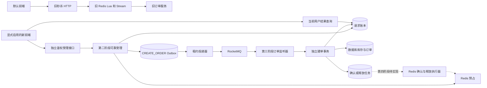
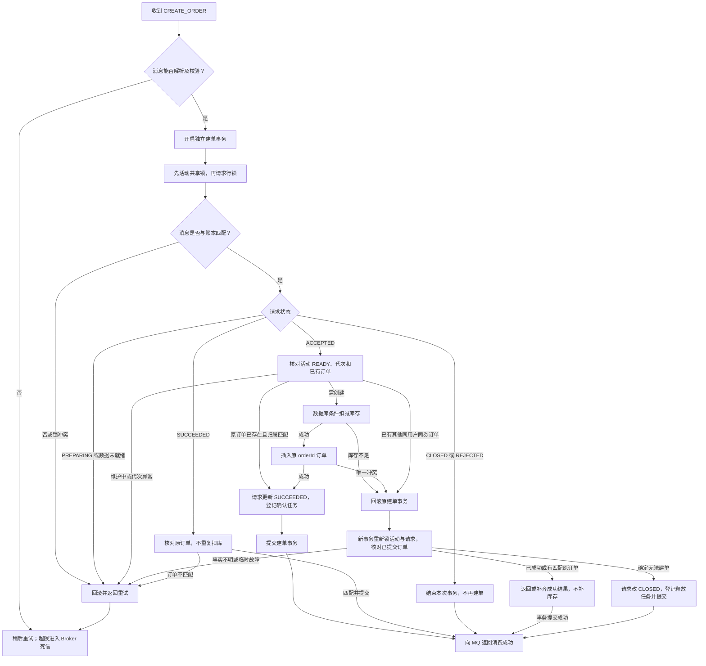
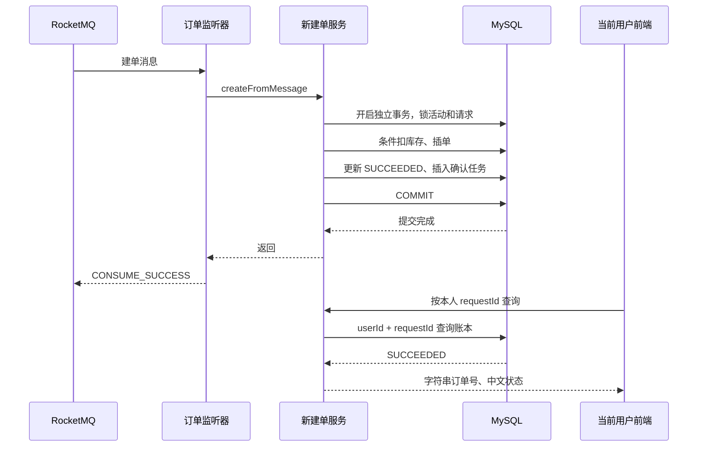
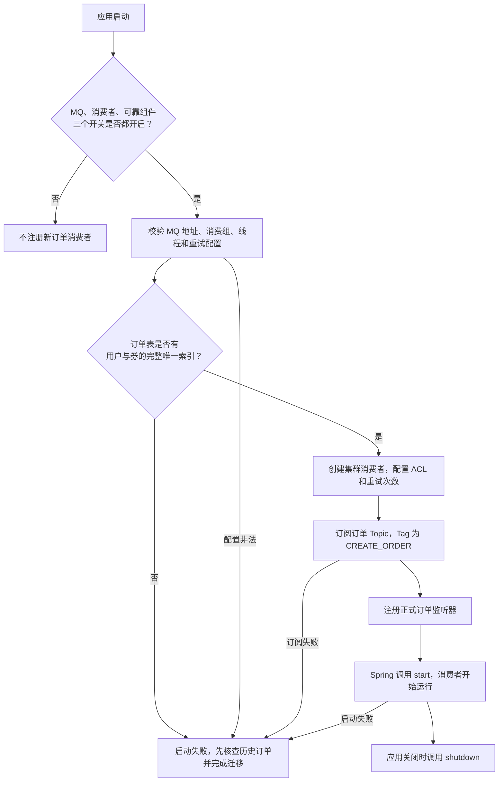
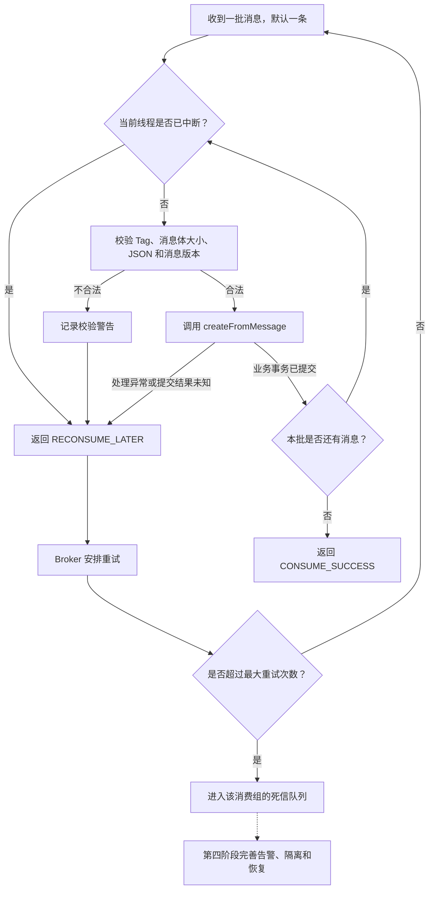
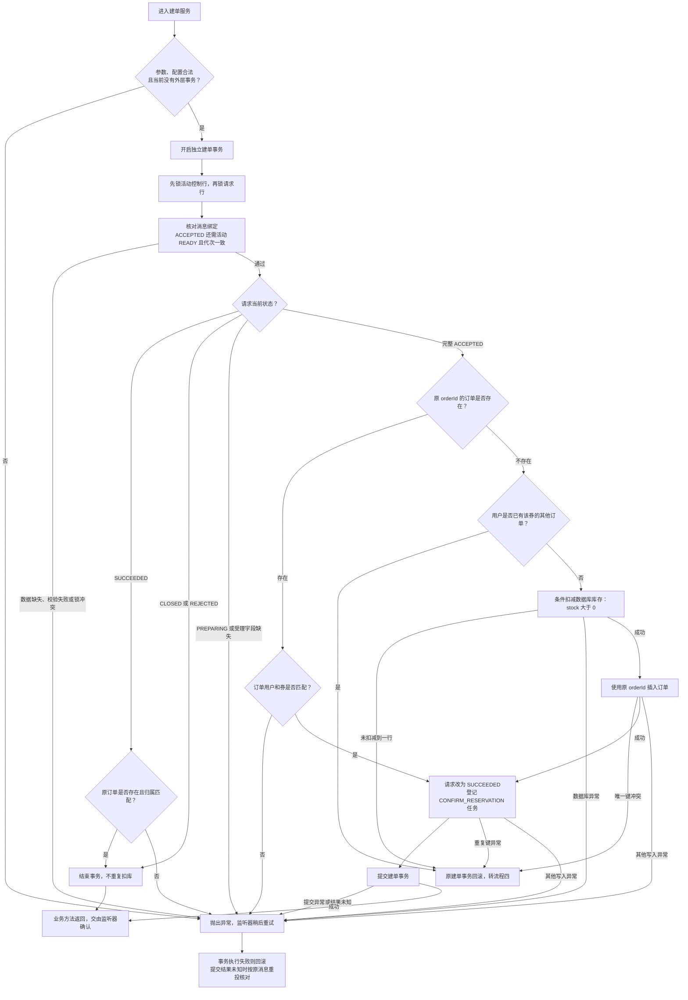
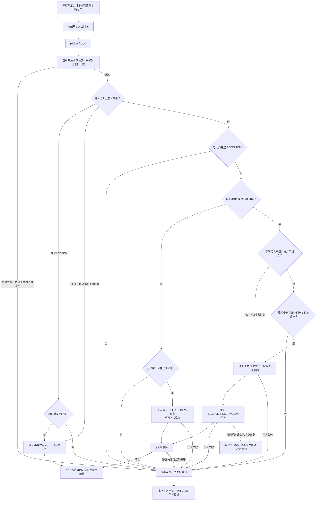
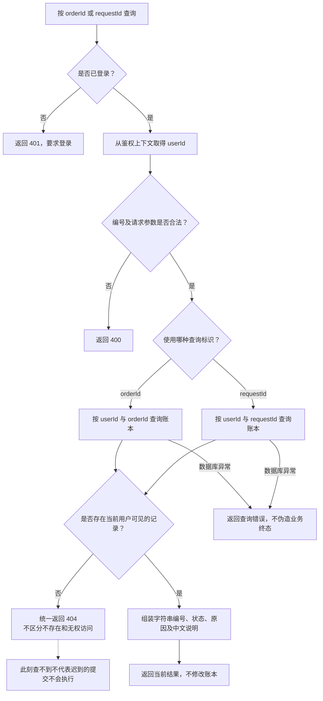
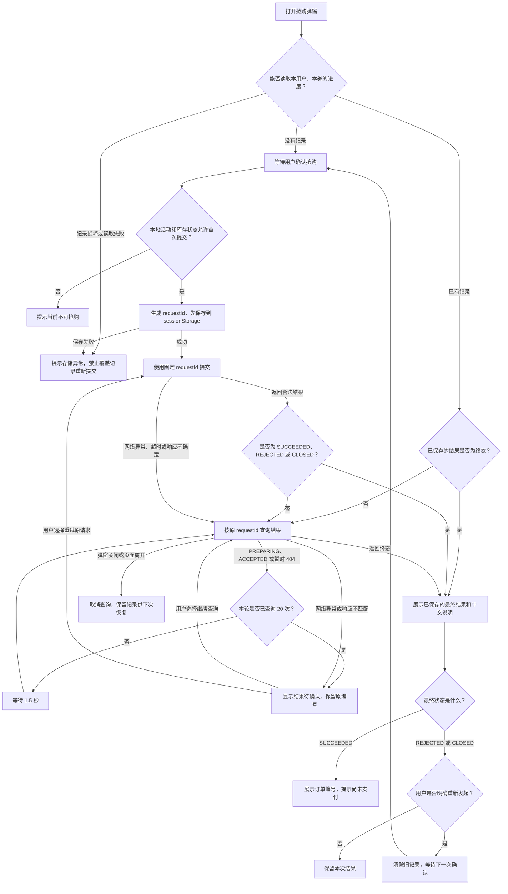

# 订单 RocketMQ 第三阶段：幂等建单与结果查询

> **第五阶段衔接**：当前前端固定走新路径，旧入口和旧消费者停止注册，不再维护旧 Stream。最新运行方式见 [第五阶段说明](ROCKETMQ_PHASE5.md)，下文保留第三阶段历史。

后续实现：2026-10-25 已完成 [第四阶段完整实现](ROCKETMQ_PHASE4.md)，按用户追加要求统一验收；
[第 4.1 步记录](ROCKETMQ_PHASE4_1.md) 保留首次交付细节。
下文保留第三阶段交付时的行为和联调记录；新接口发券当前可自动准备活动，不再要求手动初始化。
确认/释放执行器、周期恢复和死信隔离已在第四阶段补齐；正式切换仍属于第五阶段。

日期：2026-10-24。基于第二阶段提交 `38f65a88` 实施。2026-10-25 整理第三阶段交付提交，正式流量尚未切换。
验证进度更新于 2026-10-25：真实前后端已打通；提交前完整后端回归 181 项全部通过，包含两项真实虚拟机 RocketMQ 用例。

## 1. 本阶段解决什么问题

第二阶段可以可靠登记请求、预占 Redis 库存并投递 CREATE_ORDER，但没有正式消费者。
所以“请求 ACCEPTED、Outbox SENT、Redis RESERVED”并不意味着数据库里已有订单。

本阶段增加正式监听器、账本驱动建单和当前用户结果查询。例子：用户 1 抢券 30，订单号为 1001；
即使建单消息重复到达，数据库只扣一份库存、只插入订单 1001；前端可以查询到 SUCCEEDED，而非一直停留在“已受理”。

并发风险有两种：

1. 同一订单的两条消息同时处理：请求行锁使它们串行，后到者读到 SUCCEEDED 后核对已有订单，不再次扣库存。
2. 同一用户、同一张券出现两个不同订单号：两个请求行互不相同，仅锁请求不够。
   两个事务都可能先查到“没有订单”，再竞争库存和插单；数据库 `(user_id, voucher_id)` 唯一约束必须兜底。
   失败事务的扣库回滚，再另开事务核对已提交订单，关闭冲突请求并登记它自己的释放任务。

范围保持为订单功能，博客、点赞、评论、通知和支付不在本阶段实施。

## 2. 当前交付边界

| 内容 | 本阶段状态 |
|---|---|
| 正式 MQ 监听器及客户端生命周期 | 已实现，当前开发 YAML 默认开启消费者；无需新增 Tomcat |
| 库存、插单、成功账本、确认任务同事务提交 | 已实现并通过真实 MySQL 验证 |
| 建单确定失败后的关闭和释放任务登记 | 已实现并验证；不等于已经回补 Redis |
| 历史订单唯一约束 | 提供独立、可重复执行的手动迁移脚本；不自动删除重复数据 |
| 当前用户结果查询、新链路提交接口 | 已实现，当前开发 YAML 默认开启独立接口；保留旧 HTTP 入口 |
| 前端结果展示和原请求重试 | 已实现，前端开关默认关闭；模拟接口测试和真实前后端联调均已验证 |
| 真实虚拟机 MQ 串联建单 | 2026-10-25 已通过隔离联调；使用正式监听器和建单服务，Topic 与消费组为测试用途 |
| Redis 确认、释放执行器；周期恢复与对账 | 留在第四阶段，当前仅持久化处理任务 |
| 旧 Stream 排空及正式切换 | 留在第五阶段 |

## 3. 文件职责和修改原因

路径相对于项目根目录。

| 文件 | 原有职责 / 本次修改 | 原因与业务作用 |
|---|---|---|
| `backend/src/main/java/com/hmdp/service/ISeckillOrderService.java` | 新增建单协议与索引检查接口 | 消费入口不依赖 HTTP 用户上下文 |
| `backend/src/main/java/com/hmdp/service/impl/SeckillOrderServiceImpl.java` | 新增独立建单、重复核对、确定失败关闭事务 | 真正组织新链路业务，不是转调包装 |
| `backend/src/main/java/com/hmdp/infrastructure/mq/RocketMqOrderListener.java` | 新增消息解析与 MQ 确认适配 | 业务提交后才能返回消费成功 |
| `backend/src/main/java/com/hmdp/config/RocketMqConfiguration.java` | 原来只创建生产者；新增条件消费者 Bean | 第三方客户端仍由 Spring 管理启停，复用已有 ACL 配置 |
| `backend/src/main/java/com/hmdp/config/OrderConsumerProperties.java` | 新增消费组、线程数、最大重试次数 | 避免硬编码；线程数限制为 1～32，重试次数 1～64 |
| `backend/src/main/java/com/hmdp/mapper/VoucherOrderMapper.java` | 原为 BaseMapper；新增稳定编号插单、事实查询、索引检查 | 不复用旧服务“重复即失败”的语义 |
| `backend/src/main/resources/mapper/VoucherMapper.xml` | 补齐商铺券列表返回的 status 字段 | 真实联调发现的既有接口缺陷；前端依赖该字段判断上架和可抢购状态 |
| `backend/src/main/java/com/hmdp/mapper/SeckillVoucherMapper.java` | 原为 BaseMapper；新增条件扣减 | `stock > 0` 防止数据库超卖 |
| `backend/src/main/java/com/hmdp/mapper/SeckillRequestMapper.java` | 增加 SUCCEEDED/CLOSED 条件更新及用户归属查询 | 只有 ACCEPTED 能被建单流程推进；查询不泄露他人数据 |
| `backend/src/main/java/com/hmdp/service/ISeckillRequestService.java` | 沿用受理接口，增加两种结果查询 | 查询仍放在已有请求业务中 |
| `backend/src/main/java/com/hmdp/service/impl/SeckillRequestServiceImpl.java` | 受理事务未改；增加查询 DTO 和中文原因转换 | 不向接口返回完整数据库账本 |
| `backend/src/main/java/com/hmdp/controller/SeckillRequestController.java` | 新增受配置开关控制的独立接口 | Controller 调用 Service，不直接操作 Mapper |
| `backend/src/main/java/com/hmdp/dto/SeckillRequestResult.java` | 新增查询响应 | 大编号用字符串传输，状态与原因分别提供中文说明 |
| `backend/src/main/java/com/hmdp/constants/SeckillConstants.java` | 增加确认、释放任务类型 | 与 CREATE_ORDER 区分处理器 |
| `backend/src/main/java/com/hmdp/constants/SeckillOrderFailureReason.java` | 新增数据库建单关闭原因枚举 | 区分订单冲突和数据库库存不足 |
| `backend/src/main/java/com/hmdp/exception/OrderCreationRejectedException.java` | 新增业务回滚异常 | 先回滚建单，再另开事务关闭，异常放 exception 包 |
| `backend/src/main/java/com/hmdp/config/SeckillOrderProperties.java` | 增加新 API 开关属性 | 与已有可靠组件开关共同控制注册 |
| `backend/src/main/java/com/hmdp/entity/SeckillRequest.java` | 仅修正 reservationEpoch 字段说明 | 它是活动代次，不是预约时间 |
| `backend/src/main/resources/application.yaml` | 增加消费者和 API 配置；当前开发联调将新后端开关设为默认 true | 独立接口可用，原 HTTP 路由保留 Stream；启动前必须完成所需表与索引迁移 |
| `backend/src/main/resources/db/migration/V20261024_03__seckill_order_unique.sql` | 新增历史重复检查和唯一索引迁移 | 数据冲突时失败并保留历史数据 |
| `frontend/web/src/api/vouchers.ts` | 保留旧 API；增加新提交、查询与显式开关 | 不因查询失败自动回退或混用旧链路 |
| `frontend/web/src/components/seckill-dialog.tsx` | 新增抢购进度弹窗 | 保存原 requestId、查询终态、明确重试原请求 |
| `frontend/web/src/pages/shop-detail.tsx` | 按开关选择弹窗；有历史请求时允许查看进度 | 即使库存已为零或活动结束，也能找回原结果 |
| `frontend/web/.env.example` | 增加关闭状态的新前端开关 | 默认构建继续使用旧秒杀接口 |
| `backend/src/test/java/com/hmdp/service/impl/SeckillOrderServiceImplTest.java` | 新增 10 项模拟事务单元测试 | 检查状态分支、写入顺序及回滚调用；不冒充数据库回滚验证 |
| `backend/src/test/java/com/hmdp/infrastructure/mq/RocketMqOrderListenerTest.java` | 新增 3 项监听测试 | 检查成功确认、非法消息重试和中断 |
| `backend/src/test/java/com/hmdp/controller/SeckillRequestControllerTest.java` | 新增 5 项接口测试 | 检查可信用户来源、401/404、长编号及未知受理结果 |
| `backend/src/test/java/com/hmdp/config/OrderPipelineConfigurationTest.java` | 增加 1 项组合开关测试 | 核对开关缺省或关闭时不注册新接口和监听器；该测试不加载应用 YAML |
| `backend/src/test/java/com/hmdp/config/RocketMqConfigurationTest.java` | 增加 2 项消费者生命周期测试 | 索引检查必须发生在消费者构造前，关闭上下文会关闭客户端 |
| `backend/src/test/java/com/hmdp/infrastructure/mq/SeckillOutboxIT.java` | 原 16 项用例保留；增加 13 项集成用例 | 验证真实事务、唯一约束、并发、查询、券列表状态及正式监听器 MQ 串联 |
| `backend/src/test/resources/db/seckill-order-tables.sql` | 新增隔离测试用优惠券、订单、库存表 | 不导入全量业务数据，不修改业务表 |
| `frontend/web/tests/seckill-order.spec.ts` | 新增 7 项浏览器契约测试 | 覆盖成功、拒绝、响应丢失、刷新恢复、404、用户隔离、会话记录异常 |
| `frontend/web/playwright.seckill.config.ts` | 新增独立端口 5174 的测试配置 | 显式启用新 UI，默认旧入口测试仍运行在 5173 |
| 本文、文档索引、项目入口和设计方案 | 更新实现进度和边界 | 不把第二阶段图示或历史联调当作本阶段已验收成果 |

为什么单独增加建单 Service：旧 `VoucherOrderServiceImpl` 初始化时启动 Stream 线程，且重复订单返回失败。
新服务负责另一套完整事务协议，并直接组织锁、库存、订单和任务写入；与旧实现隔离，避免半迁移时混用库存和消费语义。
没有为每个数据库步骤再拆单方法转调服务，结果查询也继续放在已有请求 Service 中。

## 4. 核心代码逐步解释

### 4.1 消费确认：从探针收消息到提交后确认

修改前：第二阶段只有 smoke 探针，没有正式订单监听器。以下为本阶段新增逻辑：

```java
SeckillOrderMessage order = objectMapper.readValue(message.getBody(), SeckillOrderMessage.class);
orders.createFromMessage(order);
// 业务方法已经完成数据库提交，才允许返回消费成功。
return ConsumeConcurrentlyStatus.CONSUME_SUCCESS;
```

实际代码按消息列表循环，客户端每次交给监听器一条；任意一条异常返回 RECONSUME_LATER。
版本、必填字段由消息 record 校验，标签必须是 CREATE_ORDER，消息体不超过 64 KiB；还要在锁内核对账本身份。
事务已提交但进程未返回 MQ 确认时，Broker 可以重投；业务层处理原订单，不能重新生成订单号。

客户端使用集群消费。新消费组从最早可用消息位置开始；已有消费组仍使用其已提交位点，并非每次重启都重放全部历史。
非法消息当前不会静默确认，先重试，超过配置上限由 Broker 转入该消费组的死信队列。
死信告警、可靠隔离和人工处置入口仍待第四阶段，不声称已经具备完整治理能力。

### 4.2 库存和订单的事务边界

旧实现通过应用查询查重，数据库订单表没有用户/券唯一约束；旧逻辑本阶段保留。
新服务新增如下事务流程：

```java
if (vouchers.deductOne(request.getVoucherId()) != 1) {
    throw new OrderCreationRejectedException(SeckillOrderFailureReason.DB_STOCK_INSUFFICIENT);
}
requireOne(orders.insertSeckillOrder(order));
requireOne(requests.markSucceeded(request.getOrderId()));
insertReservationTask(request, CONFIRM_RESERVATION_EVENT_TYPE, "confirm-");
```

- deductOne 实际 SQL 带 `stock > 0`；数据库库存行被更新时取得排他锁，持有到提交或回滚。
- 插单使用消息对应的原 orderId，订单支付方式和未支付状态沿用表默认值。
- 请求只能从 ACCEPTED 更新为 SUCCEEDED，更新不是一行就报错回滚。
- 确认任务必须在同一事务插入；写任务失败，前面的扣库、插单和状态一起回滚。
- 已成功请求只核对原订单，不再次插单或登记任务；成功账本没有匹配订单时则报错，不能掩盖异常。

订单时间由既有表 TIMESTAMP 默认值生成；请求受理时间继续使用第二阶段持久化的 Instant。
库存判断依据是数据库当前剩余数量，不因消息消费时活动已经结束就否定此前合法受理的请求。

### 4.3 唯一冲突：先回滚，再核对和关闭

```java
try {
    transaction().executeWithoutResult(status -> createLocked(message));
} catch (OrderCreationRejectedException ex) {
    transaction().executeWithoutResult(status -> closeLocked(message, ex.getReason(), null));
} catch (DuplicateKeyException ex) {
    transaction().executeWithoutResult(status -> closeLocked(
            message, SeckillOrderFailureReason.ORDER_CONFLICT, ex));
}
```

异常离开第一个 execute 时，原建单事务已经回滚。新事务重新按同一顺序锁活动和请求：

1. 若另一消费者已提交 SUCCEEDED，核对原订单后结束，不登记释放。
2. 若稳定 orderId 已有归属一致的订单，补齐成功账本和确认任务，不再次扣库。
3. 重复键异常必须能查到同用户同券已有订单才判为订单冲突；查不到就继续抛异常，不能把 Outbox 键冲突误认为用户重复购买。
4. 仍需关闭时，ACCEPTED → CLOSED 和 RELEASE_RESERVATION 任务一起提交。

关闭不等于释放已经完成。本阶段只处理建单阶段确定的库存不足和订单冲突；主动关单入口、超时关闭、周期恢复留在第四阶段。
数据库临时不可用、NOWAIT 锁竞争、消息与账本不符、PREPARING、活动维护或代次不一致，都不走直接关闭/补库存分支。

### 4.4 结果查询：状态、原因和支付状态分别表达

```json
{
  "orderId": "856725678012345678",
  "requestId": "request-1",
  "voucherId": "30",
  "status": "CLOSED",
  "statusDescription": "已关闭",
  "reason": "DB_STOCK_INSUFFICIENT",
  "reasonDescription": "数据库库存不足"
}
```

编号使用字符串避免 JavaScript 大整数精度丢失。状态回答“处理到哪一步”，原因回答“为什么未能建单”；
SUCCEEDED 表示订单创建完成，订单本身默认仍是未支付，不表示支付成功。

按订单查询的 SQL 同时带 `user_id` 和 `order_id`；按请求查询继续使用 `(user_id, request_id)`。
Controller 从鉴权上下文获取 userId，不接受请求体中的用户编号。不存在和无权访问统一返回 404，不暴露其他用户是否下过单。
404 只表示此刻没有可见记录，不能证明一个已超时提交的请求以后不会到达。

### 4.5 前端不因超时更换请求编号

旧页面收到 orderId 后只展示“请求已受理”。新 UI 先保存 requestId，再提交并查询状态：

```text
sessionStorage 键：hmdp-seckill-request:1:30
值示例：{"requestId":"客户端生成的UUID","result":{"orderId":"1001", ...}}
```

- 同用户、同券在本标签页保留原请求；重新打开弹窗或刷新后先查原请求，不自动再次 POST。
- 一轮最多查询 20 次，间隔 1.5 秒；查询网络异常或次数耗尽，保留“结果待确认”，允许继续查询或重试原请求。
- 仅 REJECTED/CLOSED 后用户明确点击“重新发起抢购”，才清除旧记录并在下一次提交时生成新 requestId。
- 已有进度但库存变成零或活动结束时，仍提供“查看抢购进度”，不能禁用唯一恢复入口。
- 用户切换时存储键不同，服务端查询也再次验证身份。已有存储无法解析时禁止覆盖并发新单。
- 弹窗关闭或页面离开会取消查询；提交过程中防止重复点击。浏览器会话关闭、记录被手工删除后的跨会话恢复不在当前 UI 保证内。

## 5. 数据表、Redis 与锁

本阶段没有增加数据库表，沿用第二阶段三张表：

| 资源 | 本阶段作用 |
|---|---|
| tb_seckill_campaign_control | 消费先取共享锁；活动 READY、代次和账本一致才允许首次建单 |
| tb_seckill_request | 请求行锁与终态事实；只允许 ACCEPTED 转 SUCCEEDED/CLOSED |
| tb_mq_outbox | 继续承载 CREATE_ORDER，新增两类本地 Redis 处理任务 |
| tb_seckill_voucher | 条件扣减数据库真实库存 |
| tb_voucher_order | 原 orderId 主键及新增用户/券唯一约束保护订单唯一性 |

新增任务的数据例子：

| event_id | order_id | event_type | 初始 status | 当前处理者 |
|---|---|---|---|---|
| order-1001 | 1001 | CREATE_ORDER | PENDING | 第二阶段 MQ 投递器 |
| confirm-1001 | 1001 | CONFIRM_RESERVATION | PENDING | 第四阶段确认执行器，当前尚无执行器 |
| release-1002 | 1002 | RELEASE_RESERVATION | PENDING | 第四阶段释放执行器，当前尚无执行器 |

任务 payload 复用版本 1 的业务字段，eventId 使用各自稳定前缀，保留原受理时间和 traceId。
`UNIQUE(order_id, event_type)` 限制同订单同类型任务唯一。MQ 投递 SQL 仍只领取 CREATE_ORDER，测试已验证不会误发确认/释放任务。
因此确认、释放记录当前长期 PENDING 是未实施第四阶段的边界，不能解释为任务已经执行。

Redis 键结构及 Lua 未改。消费期间不连接 Redis、不再次预扣、不自动清理预占：

```text
建单前：Redis stock=9，reservation:1001.state=RESERVED，DB stock=10
建单后：Redis stock=9，reservation:1001.state=RESERVED，DB stock=9
        请求 SUCCEEDED，确认任务 PENDING，订单 1001 存在
```

第四阶段确认只会把预占变为 CONFIRMED，不应再减一次 Redis 库存。
建单失败关闭后的 Redis 预占同样保留，后续释放任务按订单和代次处理，不能看到 CLOSED 就直接手工加库存。

### 事务级别与锁顺序

- 使用独立的 REQUIRES_NEW、READ_COMMITTED 短事务，超时沿用 `hmdp.seckill.transaction-timeout-seconds`，默认 5 秒。
- 先活动控制行 `FOR SHARE NOWAIT`，再请求行 `FOR UPDATE NOWAIT`，最后访问库存/订单；数据库写锁持有到事务结束。
- NOWAIT 行锁竞争会让本次处理失败并交 MQ 重试，不返回成功；不是等待后绕过锁继续操作。
- 普通查询用于尽早发现重复，最终正确性依赖请求行锁、条件更新、唯一索引和事务，不依赖查重一定看见另一个未提交订单。
- 事务中没有 Redis、MQ 网络调用。调用方如果已有数据库事务，新建单入口直接拒绝，避免内层完成就提前确认外层工作。
- 库存不足和已确认订单冲突先回滚再关闭；临时故障回滚后保留 ACCEPTED，不登记释放。
- 监听线程已中断时返回稍后重试并保留中断标记，不再进入下一笔建单。

本阶段不涉及商铺布隆过滤器和缓存更新，无需新增缓存锁；不会为了订单幂等而再引入一层 Redis 分布式锁。

## 6. 架构与执行流程

### 6.1 当前架构



新旧入口不能在同一张实际活动券上并行扣减。此图展示代码并存，不表示已经支持混流迁移。

### 6.2 消费处理流程



图中所有数据库写入失败、提交异常也走回滚/结果未知重试分支；不能仅因执行过 INSERT 就返回消费成功。

### 6.3 成功路径时序



### 6.4 按职责拆分的六个流程

以下按当前代码划分为六个流程，便于逐段调试。它们不是六个微服务，也不是六个数据库事务。
流程一是启动配置；流程二调用流程三，流程三出现特定业务异常时才进入流程四；流程五、六供用户查询和恢复进度。
第二阶段的 Lua 预占和 Outbox 发送继续沿用，不重复算作第三阶段新增流程。

| 流程 | 主要代码入口 |
|---|---|
| 1. 消费者启动 | RocketMqConfiguration.rocketMqOrderConsumer |
| 2. 消息接收与消费确认 | RocketMqOrderListener.consumeMessage |
| 3. 幂等建单与成功提交 | SeckillOrderServiceImpl.createFromMessage / createLocked / succeed |
| 4. 建单失败后的核对与关闭 | SeckillOrderServiceImpl.closeLocked |
| 5. 当前用户结果查询 | SeckillRequestController.queryOrder / queryRequest；SeckillRequestServiceImpl.queryByOrder / queryByRequest |
| 6. 前端提交、轮询与原请求恢复 | frontend/web/src/components/seckill-dialog.tsx |

#### 流程1. 消费者启动

三个开关同时开启才注册新消费者；索引和配置检查通过后，由 Spring 启动客户端。



#### 流程2. 消息接收与消费确认

默认每批一条；整批处理成功后才确认，异常消息保留重试，不能静默丢弃。



#### 流程3. 幂等建单与成功提交

一个独立事务完成数据库库存、订单、请求状态与确认任务写入；重复请求通过账本和订单事实判断。



#### 流程4. 建单失败后的核对与关闭

仅库存不足、已知订单冲突或重复键进入此流程；临时故障不直接关闭。关闭状态和释放任务也必须一起提交。



#### 流程5. 当前用户结果查询

查询只读取当前状态，不触发建单、关闭或补库存；GET 返回 PREPARING 也不会自动完成请求恢复。



#### 流程6. 前端提交、轮询与原请求恢复

仅新前端开关开启时使用；同一用户、同一券的请求保存在 sessionStorage，超时不能自动换 requestId。



读图时注意：

- 请求 SUCCEEDED 是建单成功，订单默认仍未支付；Outbox SENT 只是投递成功，两者不能混用。
- 活动维护中、代次不符或 PREPARING 都只报错重试，不属于流程四的确定性业务关闭。
- SQL 执行失败会使对应事务回滚；提交响应丢失时不能断言事务未提交，必须沿用原消息核对账本。
- 只有确认/释放任务与请求状态一起提交后，后续执行器才能读取；第三阶段不直接确认或回补 Redis 库存。
- 结果查询不会主动修复 PREPARING；当前可重试原 POST 请求，周期恢复属于第四阶段。


## 7. 如何在开发环境启用

从创建新券开始联调可直接按 [购买联调指南](ROCKETMQ_PURCHASE_TEST.md) 操作，其中提供完整建券 SQL 和 Redis 初始化命令。

以下仅说明手工步骤，本次未对业务库执行。命令在项目根目录运行。

1. 选择隔离开发活动；先暂停相关下单写入并备份数据，确认旧 Stream 不会消费这批新活动请求。
2. 先执行第二阶段三表迁移，再检查第三阶段脚本输出的历史重复订单；有冲突时人工核对，不能自动删除。
3. 用 MySQL 客户端在目标开发库执行第三阶段脚本，DDL 会隐式提交，不能依赖事务回滚。

```bash
mysql -h 127.0.0.1 -u 开发用户 -p 开发库名 \
  < backend/src/main/resources/db/migration/V20261024_03__seckill_order_unique.sql
```

4. 受控准备活动 READY 控制行、新 Redis 元数据和库存。正式初始化/重建服务尚未实现，不可直接复制旧 Redis 库存。
5. 显式配置下列开关。消费者启动会检查唯一索引，缺失则启动失败；开关不是完整生产迁移步骤。

当前 YAML 已按开发联调改为下列默认值；环境变量可覆盖。Java 属性字段或不加载 YAML 的测试上下文仍按 false 初始化。
这些是本地联调设置，不代表已经完成生产切换。此前第 8 节早期联调记录中的“默认关闭”描述的是当时配置。

| 配置 / 环境变量 | 当前 YAML 默认值 | 开启作用 |
|---|---|---|
| hmdp.seckill.reliable-components-enabled / SECKILL_RELIABLE_COMPONENTS_ENABLED | true | 注册新受理、预占与建单服务 |
| hmdp.seckill.reliable-api-enabled / SECKILL_RELIABLE_API_ENABLED | true | 注册独立受理和结果查询接口 |
| hmdp.rocketmq.consumer.enabled / ORDER_CONSUMER_ENABLED | true | 与 MQ、可靠组件共同控制正式消费者注册 |
| hmdp.rocketmq.outbox.enabled / ORDER_OUTBOX_ENABLED | true | 开启 CREATE_ORDER 的投递扫描 |
| VITE_RELIABLE_SECKILL_ENABLED | 未设置，等价 false | 开启新前端抢购交互，需重新运行/构建前端 |

已有 `hmdp.rocketmq.enabled` 必须开启，NameServer 使用 `ROCKETMQ_NAMESERVER`。
消费者默认组 `hmdp-seckill-order-create-cg`，4 个消费线程，最多重试 16 次；生产者和 Outbox 的发送策略沿用第二阶段。
后端 `/voucher-order/seckill/{id}` 仍是旧 Stream 接口，新前端只使用下列独立接口：

| 方法 | 路径 | 参数与结果 |
|---|---|---|
| POST | /voucher-order/reliable/seckill/{voucherId} | JSON body 为 requestId，返回当前持久化结果 |
| GET | /voucher-order/reliable/orders/{orderId} | 查询当前用户的订单请求 |
| GET | /voucher-order/reliable/requests/{requestId} | 提交响应丢失后找回原请求 |

未登录返回 401；查询无匹配记录返回 404；非法正数编号或请求标识返回 400。
受理结果待确认但账本可读取时，返回 PREPARING 等当前事实；数据库故障无法读取时不能伪造终态。

## 8. 验证记录与调试入口

### 8.1 2026-10-24 实施当天记录

| 验证 | 结果 | 实际依赖 |
|---|---|---|
| 后端单元测试 | 151 项通过 | Mapper、MQ 和事务替身；含 21 项本阶段新增测试 |
| MySQL/Redis 集成 | 26 项通过 | 真实 MySQL 8.4、Redis 7.4；含本阶段 11 项新增非 MQ 场景 |
| MQ 串联用例 | 2 项待验收，本次最终回归显式跳过 | 原 Outbox 探针和新正式监听器用例；用户确认虚拟机已关闭 |
| 新链路浏览器契约 | 7 项通过 | 真实 Chrome、模拟后端接口，不等于浏览器到真实 MQ 的端到端测试 |
| 默认旧入口浏览器回归 | 2 项通过 | 真实 Chrome、模拟后端接口 |
| 前端 TypeScript / Vite 构建 | 通过 | 默认开关构建 |

集成测试建立随机 `hmdp_mq_it_` 测试库，新增测试库存/订单表，并用随机券编号准备 Redis 数据。
测试结束删除自己的测试库和精确记录的 Redis 键，不扫描清空业务键，不启动完整应用及旧 Stream 消费者。
唯一索引迁移在测试库执行两次，并单独验证“历史重复导致建索引失败，原数据保留”。

真实 MQ 第一次尝试报连接失败；随后只读探测 `10.211.55.9:9876`、`:10911`、`:8082` 均超时。
用户随后确认虚拟机已关闭，计划次日测试，并准备关闭 OrbStack，当天未再启动相关环境或重复探测。
当天最终后端回归总计 179 项：151 项单元和 26 项真实数据库/Redis 用例通过，2 项真实 MQ 用例显式跳过，失败与错误均为 0。
以上为历史记录，真实 MQ 的补验收结果见下一节。

### 8.2 2026-10-25 真实 MQ 补验收

用户确认可以继续测试后，检查项目 MySQL、Redis 容器均健康，NameServer `10.211.55.9:9876` 和 Broker `10.211.55.9:10911` 可连接。
使用未改变业务开关的完整测试命令，**179 项全部通过，失败 0、错误 0、跳过 0**：

| 类型 | 数量 | 本次结果 |
|---|---|---|
| 单元测试 | 151 | 通过，依赖使用测试替身 |
| 真实 MySQL / Redis 集成 | 26 | 通过，验证事务回滚、并发、唯一约束、查询归属和持久化任务 |
| 真实 RocketMQ 串联 | 2 | 通过，连接用户虚拟机 Broker |

两项真实 MQ 用例分别验证：

1. `deliversAcceptedOutboxToRealBrokerOnIsolatedTopic`：真实受理和 Redis 预占生成 Outbox，投递器把原消息发送到 Broker；
   探针消费者收到的内容与数据库 payload 一致，发送回执保存为 SENT，请求仍为 ACCEPTED，因为探针不建单。
2. `realBrokerCreatesOrderThroughProductionListener`：使用第三阶段消费者配置、正式监听器和真实 MySQL 建单服务。
   Outbox 投递一次，再将同一业务消息发送一次；两次消费均核对账本已经提交 SUCCEEDED。
   最终只有一张订单，数据库库存从 10 变为 9，验证重复消息不会再次扣库。

两项用例均使用 `hmdp-order-smoke` 前缀 Topic 和随机临时消费组；新用例的测试包装只将本用例事件交给正式监听器，
忽略其他测试历史事件。这是正式业务代码在隔离环境的验证，不代表正式业务 Topic 已接入流量，也不代表已经运行完整 Spring Boot 应用。
随机测试库及本轮精确登记的 Redis 键由测试清理，未对业务库执行迁移。
本次没有修改业务代码，没有开启新接口或新消费者，也没有进入第四阶段。

运行日志位于项目根目录下 `backend/target/phase3-real-mq-20261025.log`；Maven XML 报告位于 `backend/target/surefire-reports/`。
已按本轮实际运行的 20 个测试类核对 XML 汇总，避免把构建目录中历史报告重复计入。
前端 7 项新链路和 2 项旧入口浏览器测试仍是 2026-10-24 的验证记录，本次没有重复运行或计作真实端到端测试。

### 8.3 复跑命令与调试

项目根目录执行后端测试：

```bash
# 先启动项目 MySQL/Redis：151 项单元 + 27 项集成；2 项 MQ 用例显式跳过。
SECKILL_OUTBOX_IT=true mvn -o -f backend/pom.xml \
  '-Dtest=*Test,SeckillOutboxIT' test

# 同时启动 VM 中 NameServer/Broker 和本机项目 MySQL/Redis 后执行。
# 增加两项真实 MQ 用例；只使用 hmdp-order-smoke 前缀 Topic。
SECKILL_OUTBOX_IT=true ROCKETMQ_SMOKE_TEST=true \
  mvn -o -f backend/pom.xml '-Dtest=*Test,SeckillOutboxIT' test
```

本机受限环境运行 Mockito 附加、Docker 和真实网络需要对应执行权限；离线构建使用已有 Maven 缓存。
如需把 RocketMQ 日志放入构建目录，可加 `-Drocketmq.log.root=项目绝对路径/backend/target/rocketmq-logs`。

前端命令从 `frontend/web/` 目录执行：

```bash
npm run build
npx playwright test --config playwright.seckill.config.ts
npx playwright test tests/storefront.spec.ts --grep '秒杀|后端错误'
```

推荐断点：

1. `RocketMqOrderListener.consumeMessage`：检查消息解析、重试次数和最终确认结果。
2. `SeckillOrderServiceImpl.lockRequest`：观察活动共享锁、请求状态和消息绑定校验。
3. `createLocked` 中 deductOne、insertSeckillOrder、succeed：分别观察数据库库存、订单和任务写入。
4. `closeLocked`：观察原事务已经回滚、重新加锁，以及成功/关闭竞争的判断。
5. `SeckillRequestController.queryRequest`：核对当前用户和前端原 requestId。

在未提交事务中，其他数据库连接可能看不到调试线程刚写入的订单或状态；别在断点暂停时据此判为写入丢失。
调试时暂停超过事务超时、延迟 MQ 确认或重复投递均可能触发重试，这是需要观察的实际分支。

### 8.4 2026-10-25 真实前后端联调

本次完整启动 Spring Boot 和 Vite，使用真实 Chrome、真实登录、真实 HTTP 和虚拟机 MQ。
没有使用 page.route 拦截接口，没有伪造登录令牌，也没有将模拟接口结果算作本次联调通过。

#### 环境隔离

- 后端临时端口 18081，前端临时端口 5175，前端 `/api` 代理到该后端。
- 新建随机 `hmdp_live_it_` 测试库，按项目 SQL 提取原表结构，再执行第二、三阶段迁移；仅准备一间测试店铺和两张测试券。
- 使用独立临时 Redis 容器，端口 16379。完整应用仍会启动旧 Stream 消费线程，独立 Redis 可以防止该线程读取开发环境消息。
- 测试专用 Topic 为 `hmdp-order-smoke-live-` 加随机后缀，消费组同样随机；避免正式监听器读到其他 smoke 测试历史事件。
- 新组件、接口、Outbox、消费者和前端开关只在本次进程环境中开启，项目默认配置保持关闭。
- 使用独立临时 JWT 密钥和测试 OSS 占位配置，不加载本地 dev 凭据，不执行上传或外部短信发送。

当前发券接口仍只初始化旧 Redis 库存键，所以本次显式准备新活动的数据库 READY 控制行、epoch、Redis stock 和 meta。
这不是完整活动发布或自动重建服务；手动联调也必须先准备这些数据，不能仅打开开关抢已有券。

#### 发现并修复的接口问题

第一轮浏览器中，券已加载且有库存，但全部显示“暂不可用”。真实 SQL 虽然用 `WHERE v.status=1` 过滤，
却没有在 SELECT 中返回 status；前端 `voucherState` 收到 undefined，因不等于 1 而禁用抢购。
此前浏览器契约测试的模拟券自带 status，因此没有暴露这个既有接口缺陷。

修改前：

```sql
v.actual_value, v.type, sv.stock, sv.begin_time, sv.end_time
```

修改后：

```sql
v.actual_value, v.type, v.status, sv.stock, sv.begin_time, sv.end_time
```

新增真实 SQL 用例 `shopVoucherListIncludesSaleStatus`，加载项目实际 VoucherMapper XML，断言上架券返回 status=1 和库存，
下架后不再出现在列表。该修复只补充响应字段，沿用原上架过滤条件。

#### 真实浏览器与数据库结果

一次连续浏览器联调共完成 8 项检查：

| 检查 | 实际结果 |
|---|---|
| 真实店铺与券列表 | 页面加载测试店铺与两张可抢购券 |
| 验证码登录 | 页面调用真实验证码、登录和用户查询接口；测试从独立 Redis 读取验证码输入页面，不绕过鉴权 |
| 正常抢购 | 浏览器提交 → Redis 预占 → 请求/Outbox 提交 → MQ 发送与消费 → 数据库建单 → 前端查询 SUCCEEDED |
| 刷新恢复 | 页面刷新并重新打开进度后，订单号保持一致，没有额外提交 |
| 重复购买 | 在同一真实登录会话下以新 requestId 发真实 HTTP 请求，返回 REJECTED / DUPLICATE_USER 和中文原因 |
| 数据库库存不足 | 页面展示测试券后，把该测试券 DB 库存置零；真实抢购消费后返回 CLOSED，页面显示“数据库库存不足” |
| 移动端检查 | 390px 宽度下弹窗页面没有横向溢出 |
| 未登录查询 | 新建匿名浏览器会话查询已知订单，真实 HTTP 返回 401 |

随后读取同一测试库核对，而不只根据页面文字判定成功：

| 数据 | 最终事实 |
|---|---|
| tb_voucher_order | 只有正常请求的一张订单，默认未支付 |
| 正常券 DB 库存 | 2 → 1，没有因刷新或重复购买再扣减 |
| 故障券 DB 库存 | 故障注入后为 0，没有减为负数 |
| 请求账本 | SUCCEEDED、REJECTED、CLOSED 各一条 |
| CREATE_ORDER | 两条已受理请求的建单消息均为 SENT；直接拒绝的重复请求没有建单消息 |
| 确认任务 | 一条 CONFIRM_RESERVATION / PENDING，等待第四阶段执行器 |
| 释放任务 | 一条 RELEASE_RESERVATION / PENDING，等待第四阶段执行器 |

关闭测试的 Redis 预占尚未释放，这是第四阶段尚未实施的边界；不能把页面已显示 CLOSED 解释为库存补偿完成。
已查看成功和关闭结果截图，确认桌面弹窗内容可读；移动端仅做横向溢出检查，不宣称完成全部响应式或无障碍验收。

修复后重新执行完整后端测试：**151 项单元 + 27 项真实 MySQL/Redis + 2 项真实 MQ，共 180 项通过，失败 0、错误 0、跳过 0**。
这次真实联调是在前述模拟浏览器测试和后端隔离测试之外补充的验证，未进行并发压力、Broker 宕机或生产流量切换验收。

构建目录中保留的本次证据（不属于版本库源文件）：

- `backend/target/phase3-live-contract-regression-20261025.log`：修复后的完整后端回归日志。
- `backend/target/phase3-live-a5e87f70d33a/browser-result.json`：8 项检查、实际 API 路径和浏览器异常记录，不含登录令牌。
- `backend/target/phase3-live-a5e87f70d33a/database-result.json`：订单、库存、请求和 Outbox 的核对结果。
- 同目录的 `order-success.png`、`order-closed.png`：真实页面截图。

联调结束后停止临时前后端，清理本次测试库、Redis 容器、Topic、消费组及临时密钥，保留报告与截图。
用户原有 MySQL/Redis 容器及开发数据库不在清理范围。代码和文档本次仍未提交，正式默认端口与开关未改动。

### 8.5 手动打断点查看功能

建议先用真实 MySQL/Redis 测试理解建单，再调完整页面链路。之前真实联调的临时环境已经清理，不能直接访问当时的 5175/18081 端口。

#### 第一次：直接 Debug 一个已有测试

1. 启动项目 MySQL/Redis；在 IDEA 的 JUnit 运行配置中添加 `SECKILL_OUTBOX_IT=true`。
2. 找到 `SeckillOutboxIT.createsOrderOnceAndKeepsConfirmationTask`，对这个方法选择 Debug。
3. 在 `SeckillOrderServiceImpl.createLocked` 入口、deductOne、insertSeckillOrder、succeed 处打普通行断点。
4. 观察第一次调用：数据库库存 10 → 9、插入一张订单、请求变 SUCCEEDED、插入一条确认任务。
5. 同一个测试会再次调用 createFromMessage，观察它读到 SUCCEEDED 后只核对订单，没有再次扣库。
6. 若想用数据库客户端慢慢查看，在测试里两次 createFromMessage 之后、第一条库存断言之前暂停。
   此时业务事务已提交，没有业务行锁；在测试实例的 database 变量中获取本轮随机测试库名，再到数据库客户端选择该库。

此测试使用真实 MySQL/Redis，不启动完整应用，也不经过 HTTP 或真实 MQ。测试结束会清理自己的库和 Redis 键，
所以要在断言处暂停查看，而不是等测试结束后再寻找这些记录。

#### 第二次：从真实前端跟到 MQ 消费

先按第 7 节准备隔离开发库、唯一索引、新活动的 READY/epoch 和 Redis 元数据。在 IDEA 中 Debug 启动完整后端，
环境变量可按下面配置；地址和端口按自己的开发环境调整：

```text
ROCKETMQ_ENABLED=true
ROCKETMQ_NAMESERVER=10.211.55.9:9876
SECKILL_RELIABLE_COMPONENTS_ENABLED=true
SECKILL_RELIABLE_API_ENABLED=true
ORDER_OUTBOX_ENABLED=true
ORDER_CONSUMER_ENABLED=true
SECKILL_TRANSACTION_TIMEOUT_SECONDS=30
ORDER_OUTBOX_LEASE_MS=300000
```

最后两项仅用于调试：受理/建单事务最多延长到 30 秒，Outbox 租约延长到 5 分钟。
投递器领取和回执事务的超时仍固定为 5 秒；这些参数不是生产优化建议，也不代表事务内可以无限暂停。

前端从 `frontend/web/` 目录启动：

```bash
VITE_RELIABLE_SECKILL_ENABLED=true \
API_PROXY_TARGET=http://127.0.0.1:8081 npm run dev
```

确认浏览器 Network 中提交地址为 `/api/voucher-order/reliable/seckill/{voucherId}`，而不是旧接口 `/api/voucher-order/seckill/{id}`。
先只开下面的入口断点，避免一次停止所有流程；读完入口变量，再逐步加事务内部断点。

| 断点位置 | 观察什么 | 暂停注意事项 |
|---|---|---|
| SeckillRequestController.accept，调用 requests.accept 之前 | user、voucherId、body.requestId | 此时受理事务尚未开始，适合慢慢看参数 |
| SeckillRequestServiceImpl.acceptLocked，reserve 前后 | orderId、campaign.epoch、reserved | 已在短事务中，快速单步；失败或超时保留 PREPARING |
| OrderOutboxDispatcher.publishClaimed，publisher.publish 前后 | event.eventId、payload、leaseToken、receipt | MQ 调用在数据库事务外，但租约时间仍在流逝 |
| RocketMqOrderListener.consumeMessage，调用 orders.createFromMessage 之前 | 解析后的 order 及原消息 reconsumeTimes | 建单事务尚未开始，适合慢慢检查消息 |
| SeckillOrderServiceImpl.createLocked，条件扣库和插单处 | request.status、订单是否已存在、扣库返回行数 | 活动/请求锁已持有，长时间暂停会导致超时或其他消费重试 |
| SeckillOrderServiceImpl.succeed | SUCCEEDED 更新和 CONFIRM_RESERVATION 写入 | 两次写入在同一事务内，尚未提交 |
| RocketMqOrderListener.consumeMessage，CONSUME_SUCCESS 返回行 | 业务方法已返回，数据库事务已结束 | 此时适合检查已提交订单；尚未向 MQ 返回确认 |
| SeckillRequestController.queryRequest | 当前用户、原 requestId、最新状态 | 前端轮询会反复经过，按 requestId 设置条件断点即可 |

受理线程、Outbox 调度线程、MQ 消费线程和查询线程不同，不能从 Controller 一直按单步进入消费者。
受理方法结束后点击 Resume，让投递器和消费者各自在自己的断点停下。

在 IDEA 断点设置中优先选择 Suspend: Thread，避免冻结心跳和所有后台线程。
它只暂停当前线程，不会暂停数据库超时、Redis 时间、Outbox 租约或 Broker 重试计时。
事务内用快速 Step Over，事务外再慢慢查看变量；同一订单有重复消息时，其他消费线程遇到 NOWAIT 锁冲突属于可重试分支。

条件断点示例，放在 createLocked 内，1001 替换为本轮实际订单号：

```java
message.orderId() == 1001L
```

在监听器调用建单服务的那一行，局部变量名是 order，可使用 `order.orderId() == 1001L`。
Evaluate 优先读取变量或调用 getter，不重复执行 reserve、publish、deductOne 等带写入的方法。

#### 第三次：用现成用例查看失败与重试

以下仍是 Debug 单个 JUnit 方法，不必手工改开发库库存：

| 想观察的场景 | 测试方法 | 应看到的结果 |
|---|---|---|
| 确认任务写入失败 | confirmationFailureRollsBackStockAndOrder | 订单和扣库一起回滚，原请求仍 ACCEPTED；重试后可成功 |
| 并发争夺同用户同券 | uniqueConflictRollsBackLosingStockDeduction | 失败方的扣库回滚，再核对已有订单并关闭冲突请求 |
| 数据库库存不足 | databaseStockDoesNotGoNegativeUnderContention | 最多创建有库存数量的订单，其余 CLOSED 并登记释放任务 |
| 释放任务写失败 | releaseTaskFailureKeepsRequestAccepted | CLOSED 也回滚，不能丢失待释放依据 |
| 真实 MQ 重复投递 | realBrokerCreatesOrderThroughProductionListener | 两次消息只创建一单、只扣一份库存 |

最后一项还要加 `ROCKETMQ_SMOKE_TEST=true` 并启动虚拟机 MQ。其他故障用例使用真实 MySQL/Redis，故障点由测试替身注入。
并发测试适合先运行断言理解结果；逐个暂停所有工作线程可能改变竞争时序，不能用断点暂停后的耗时判断系统性能。

几个常见误解：

- 默认前端 HTTP 超时为 12 秒，事务默认 5 秒，Outbox 租约默认 30 秒；断点暂停也计入这些时间。
  页面进入“结果待确认”不等于后台失败，继续使用原 requestId 查询或重试即可。
- 在事务内部暂停时，其他数据库连接通常看不到未提交写入；等业务方法返回后再核对数据库。
- Outbox SENT 和请求 SUCCEEDED 来自不同线程/事务，不能假定一定先看到 SENT，再看到 SUCCEEDED。
- 第三阶段建单成功后 Redis 仍为 RESERVED、确认任务仍为 PENDING；关闭后的释放任务也还在等待第四阶段执行器。

### 8.6 2026-10-25 券 30 一直 PREPARING 的实测记录

#### 问题与结论

用户在 IDEA HTTP Client 中调用 `POST /voucher-order/reliable/seckill/30`，接口已经返回，
但反复查询仍显示 PREPARING。调试进入 acceptLocked 后，流程没有继续到 MQ 消费。

本次使用 HTTP Client 已有的登录凭据，沿用同一 requestId 重试本地 8081 服务；没有在文档或报告中保存令牌。
实际响应为 HTTP 200，耗时约 4998ms，订单号仍是 `562309762776039426`，状态仍为 PREPARING。
该耗时来自当时的调试进程，不能当作无断点时的接口性能，也不能据此认定存在锁等待。

**本次停留的直接原因是券 30 没有活动控制记录，acceptLocked 抛出“活动控制未就绪，保留请求等待恢复”。**
它还没有执行 Redis 预占，更没有产生 CREATE_ORDER 消息。不是 RocketMQ 消费失败。

用户确认“HTTP 已返回，但状态一直是 PREPARING”。采样时所有 HTTP 工作线程均处于空闲等待，
MySQL 没有活动 InnoDB 事务、数据行锁或锁等待。本次证据不支持把问题解释为持续的数据库锁阻塞；
也不能用事后采样排除某一次调试期间短暂的暂停或超时。

#### 实际数据与各表作用

以下是本次检查时开发库 `hm-dp` 中券 30 的事实：

| 表或 Redis 键 | 作用 | 本次结果 |
|---|---|---|
| tb_voucher，id=30 | 优惠券基本信息，如店铺、类型、上架状态 | 0 行，券本身尚未创建 |
| tb_seckill_voucher，voucher_id=30 | 秒杀时间和真实数据库库存，消费者条件扣库的对象 | 0 行 |
| tb_seckill_campaign_control，voucher_id=30 | 新链路活动状态和代次；受理、消费先加共享锁核对 | 0 行，是本次最先阻断受理的条件 |
| tb_seckill_request | 保存请求编号绑定的订单号及处理进度 | 1 行，用户 1，requestId=debug-voucher-30-001，PREPARING；reservation_epoch、accepted_at、failure_reason 均为空 |
| tb_voucher_order，voucher_id=30 | 最终订单记录 | 1 行，id=100000001、user_id=1、status=1；它不是本次请求生成的订单 |
| tb_mq_outbox，order_id=562309762776039426 | 保存本次请求待投递的建单事件，以及后续确认/释放任务 | 0 行，尚未受理成功 |
| hmdp:seckill:{30}:stock | 新链路 Redis 可用库存 | 不存在 |
| hmdp:seckill:{30}:meta | 新链路 ready、epoch、开始/结束时间 | 不存在 |
| hmdp:seckill:{30}:users | 已预占用户与订单的对应关系 | 不存在 |
| hmdp:seckill:{30}:reservation:562309762776039426 | 本订单的 Redis 预占结果 | 不存在 |
| hmdp:seckill:stock:30 | 旧 Stream 链路库存，不供新 Lua 使用 | 不存在 |

只向 tb_voucher_order 插入订单，不会创建优惠券、秒杀库存、活动控制行或 Redis 元数据。
订单号也不能作为 `/seckill/{voucherId}` 的券编号。当前发券实现只初始化旧 Redis 库存键，
所以即使通过原发券接口创建了券，新链路仍需要按第 7 节准备活动控制和新命名空间数据。

#### 本次请求逐步走到了哪里

1. Controller 从鉴权上下文得到用户 1，读取券编号 30 和 `debug-voucher-30-001`。
2. `accept` 查询请求账本。首次请求在独立事务 T1 中提交 PREPARING 和稳定订单号；
   本次重试直接复用已存在的 `562309762776039426`，没有再创建请求。
3. `transaction().execute(...)` 开启受理事务 T2，再调用 `acceptLocked`。
4. `campaigns.lockShared(30)` 执行 `SELECT ... FOR SHARE NOWAIT`，因为没有匹配行而返回 null。
   这个查询读取的是活动控制表，不是订单表，也不是秒杀库存表。
5. `requests.lockByOrderId(orderId)` 对已有请求执行 `FOR UPDATE NOWAIT`，重新校验用户、券和请求状态。
6. 请求仍为 PREPARING，但 `campaign == null` 满足下面条件，立即抛出异常：

   ```java
   if (campaign == null || !"READY".equals(campaign.getStatus())) {
       throw new IllegalStateException("活动控制未就绪，保留请求等待恢复");
   }
   ```

7. T2 回滚并释放请求锁；T1 早已独立提交，因此原账本依然是 PREPARING。
   `accept` 捕获异常，再抛出携带原订单号的 SeckillAcceptancePendingException。
8. Controller 捕获该异常，按当前用户查询已提交账本，返回 HTTP 200 和 PREPARING。
   JSON 中 `success=true` 表示这次查询成功返回，不表示订单创建成功；应继续看 `data.status`。

本次没有走到 `reservations.reserve`、markAccepted、Outbox 插入、MQ 投递、消费者扣库和建单。
由于第三阶段还没有 PREPARING 自动恢复任务，单纯查询不会重新执行 acceptLocked；
原样重复提交也会因为相同活动数据仍然缺失而再次返回 PREPARING。

#### 怎样继续验证，以及为什么不直接改请求状态

推荐使用独立、完整的测试活动：准备 tb_voucher、tb_seckill_voucher、READY 控制行，
并核对 Redis stock、meta 的 epoch 和时间窗口。请求已存在时，继续使用原 requestId；
只有新的独立抢购才生成新的 requestId。不要直接把 PREPARING 改成 ACCEPTED，
否则缺少 Redis 预占和同事务 Outbox，无法形成完整的建单依据。

券 30 还存在用户 1 的历史订单 `100000001`。即使补齐活动，也不能期待该用户再成功创建第二张同券订单：
如果新 Redis users 未包含历史购买记录，预占可能通过，但消费者最终会因数据库一人一单约束关闭新请求，
并登记 RELEASE_RESERVATION；释放执行器尚属第四阶段。因此不应把这个历史订单夹杂的样本当作正常成功样本。
本次没有补写或删除这些开发业务数据，也没有修改受理状态机或进入第四阶段。

#### 补充测试与证据

新增真实集成测试 `SeckillOutboxIT.missingCampaignKeepsPreparingAndSameRequestResumesAfterInitialization`：

- 在随机测试库删除本用例活动控制行，调用真实受理服务，断言根异常就是“活动控制未就绪”。
- 断言请求已独立保存为 PREPARING，Redis 库存保持 10，没有订单预占键，也没有 Outbox。
- 在该隔离库补回 READY 控制行；本用例 Redis 元数据和库存从准备阶段起就完整存在。
  使用同一 requestId 重试，断言沿用原订单号、状态变 ACCEPTED、库存 10 → 9、只产生一条建单事件。
- 再次重试，订单号和库存保持不变，证明恢复后没有重复预占。

从项目根目录执行：

```bash
SECKILL_OUTBOX_IT=true ROCKETMQ_SMOKE_TEST=true \
mvn -o -f backend/pom.xml -Dtest=SeckillOutboxIT \
  -Drocketmq.log.root="$PWD/backend/target/rocketmq-logs" test
```

结果：**30 项集成测试通过，失败 0、错误 0、跳过 0**，其中 28 项使用真实 MySQL/Redis，
另 2 项同时使用虚拟机上的真实 RocketMQ；包含正常受理、真实监听器建单和重复消息幂等验证。
本次只重跑这一集成测试类，不将先前 151 项单元测试算成本次重新执行。
测试仅清理自己创建的随机库和随机券键，不清理开发库中的券 30 或原订单。

本次文件变更只有上述测试和文档记录；生产代码沿用已有实现。对应证据保存在构建目录：

- `backend/target/accept-locked-http-20261025.json`：本地真实 HTTP 响应与耗时，无令牌。
- `backend/target/accept-locked-database-20261025.tsv`：相关业务表的只读行数。
- `backend/target/accept-locked-redis-20261025.json`：本次相关新旧 Redis 键的存在情况。
- `backend/target/accept-locked-integration-20261025.log`：30 项真实集成测试结果。

### 8.7 提交前复核记录

2026-10-25 再次运行完整后端回归：**151 项单元测试 + 28 项真实 MySQL/Redis 集成 + 2 项真实 MQ 集成，
共 181 项全部通过，失败 0、错误 0、跳过 0**。日志为 `backend/target/phase3-precommit-20261025.log`。
新增的活动控制缺失恢复用例包含在本轮结果中，不重复计数先前的运行。

前端重新执行 TypeScript/Vite 构建，通过；真实 Chrome 运行新购买流程 7 项、旧秒杀相关流程 2 项，全部通过。
这 9 项浏览器用例使用模拟后端响应，验证交互和接口契约；此前第 8.4 节的真实前后端与 MQ 联调没有在本轮重复执行。
旧入口用独立端口 5176、新入口用 5174，不复用用户当前的 5173 开发会话。

提交包含新消费者、幂等建单、结果查询、前端恢复与重试、唯一索引迁移、测试、阶段流程图、
PREPARING 排查记录及购买联调 SQL/说明；测试生成的报告、截图、凭据和本地 HTTP Client 历史不纳入版本库。
购买 SQL 已另行在临时库和随机 Redis 键验证，重复初始化不会覆盖扣减后的库存，见 [购买联调指南](ROCKETMQ_PURCHASE_TEST.md)。

保留用户为开发联调打开的后端 YAML 开关，同步修正文档中的当前默认值。
修正了“活动维护会关闭请求”的错误注释，实际行为一直是抛出异常等待重试；本轮未改变受理或建单事务逻辑。
本轮未向开发库新建测试券，也未替用户购买；没有开始第四阶段。

## 9. 下一阶段与剩余限制

第四阶段建议按四个小步骤实施，每步完成后说明代码、事务顺序、验证结果及剩余限制，停下审阅后再继续。
本次只提交第三阶段和以下计划，不开始第四阶段开发。

| 顺序 | 业务问题 | 拟实现内容 | 验收重点 |
|---|---|---|---|
| 4.1 活动发布和自动初始化 | 新券目前还要手动准备新 Redis 库存和元数据 | 在现有发券业务中接入新链路发布：先持久化 PAUSED 活动与库存，再初始化 stock/meta，核对成功后开放 READY；失败可重试 | 正常发券后可以直接购买；初始化失败不开放；重复初始化不覆盖已经扣减的库存；数据库和 Redis 的 epoch 一致 |
| 4.2 确认与释放执行器 | 已登记的 CONFIRM_RESERVATION、RELEASE_RESERVATION 长期 PENDING | 在现有后端进程内领取任务，以 Lua 按订单、用户归属、代次核对并执行，保留可重试的处理记录 | 成功确认不再减库存；释放最多回补一次，且仅删除属于该订单的用户归属；重复执行无额外副作用 |
| 4.3 异常请求恢复与核对 | PREPARING、ACCEPTED 不能无限依赖客户端重试 | 扫描超时请求，对照数据库、Outbox 和 Redis 预占事实恢复；重投沿用原 eventId/orderId；数据不一致时暂停并留下核对依据 | Redis 执行后应用退出、数据库提交响应丢失、重复任务、旧代次均不导致重复扣减或错误回补；不能只因等待超时就关闭/退款 |
| 4.4 重试与死信可观测性 | 重试耗尽、长期积压及无法自动核对的问题需要被发现 | 增加待处理时长、失败次数、死信提示与受控重投说明；规划维护暂停和 Redis 重建的核对顺序 | 能发现和定位卡住的订单；人工重投保持业务编号；重建不会覆盖正在进行的预占 |

4.1 优先解决本次手动联调直接遇到的活动未就绪问题。保留现有普通券和旧链路发券行为，按明确的新链路开关接入，
不为单个转调额外创建业务 Service；Redis 初始化等基础设施逻辑放在对应 infrastructure 包。
受控 Redis 重建和主动关闭需要在恢复协议明确后单独验证；支付、退款、支付超时关单不是当前订单迁移范围。

第五阶段才做正式故障压测、旧 Stream 未读及 pending 排空、停旧写入口、切换和回滚演练。
正式监听器的真实 MQ 建单及隔离环境的前端到真实中间件链路已验收；生产环境验收和压力测试尚未执行。
当前后端默认启用仅服务于开发联调，前端新入口仍需显式开启；博客、点赞、评论、支付、商铺布隆缓存业务不在本轮改造范围。

实现代码优先于示意图。相关资料：[第二阶段实现](ROCKETMQ_PHASE2.md)、[Redis 和表职责复盘](ROCKETMQ_PHASE2_REVIEW.md)、
[事务级别说明](ROCKETMQ_PHASE2_TRANSACTIONS.md)、[整体秒杀设计](../../plan/rocketmq-seckill-design.md)。
