# 订单 RocketMQ 第四阶段：逐流程 Mermaid 图解

日期：2026-10-25。以下 16 张图按当前工作区实际代码绘制，包含本轮尚未提交的第四阶段实现。
实现说明与验收记录见 [第四阶段完整说明](ROCKETMQ_PHASE4.md)。本次只补充文档，不修改业务代码。
新增三个 Lua 的输入、返回值和脚本内部完整分支见 [Lua 专项 Mermaid 图解](ROCKETMQ_PHASE4_LUA_FLOWS.md)。

## 阅读约定

- `S 锁`：活动控制行共享锁，`FOR SHARE NOWAIT`。
- `X 锁`：行排他锁；活动、请求和指定事件的竞争使用 `NOWAIT`，冲突立即失败。
- `SKIP LOCKED`：领取任务时跳过其他线程正在锁定的行。
- 图中“提交后释放锁”均指 MySQL 事务持有的锁。Redis Lua 执行结束不代表数据库锁已经释放。
- Redis 网络超时表示执行结果可能未知；数据库回滚不能撤销已经完成的 Redis 写入。
- 本地确认/释放任务的 `SENT` 表示 Redis 处理已确认；`CREATE_ORDER/SENT` 表示 MQ 投递已确认。两者都不等于支付成功。
- “记录错误、退避”不表示当场自动重试。下一轮调度或原编号重试才会再次推进。
- 第四阶段不涉及商铺布隆同步和商铺缓存锁，不包含第五阶段旧 Stream 排空或正式切换。

## 流程目录

| 编号 | 流程 | 核心问题 |
|---|---|---|
| 01 | [创建新秒杀券](#flow-01) | 先保存什么，什么时候初始化 Redis？ |
| 02 | [初始化并开放活动](#flow-02) | 如何只首次创建，避免重置已有库存？ |
| 03 | [领取和执行本地任务](#flow-03) | 多实例如何领取、接管和确认任务？ |
| 04 | [确认成功订单的预占](#flow-04) | 如何确认而不再扣一次库存？ |
| 05 | [释放关闭请求的预占](#flow-05) | 如何最多回补一次并拦截迟到预占？ |
| 06 | [受控关闭未建单请求](#flow-06) | 如何避免关闭和消费者同时成功？ |
| 07 | [恢复未发布的新活动](#flow-07) | 应用退出后如何继续首次发布？ |
| 08 | [恢复长期 PREPARING](#flow-08) | Redis 可能扣过时如何恢复原请求？ |
| 09 | [恢复长期 ACCEPTED](#flow-09) | 如何核对事实并沿用原事件重投？ |
| 10 | [冲突暂停和审计](#flow-10) | 怎样暂停本代次而不误伤新代次？ |
| 11 | [消费普通消息并隔离非法协议](#flow-11) | 哪些消息可隔离后确认，哪些必须重试？ |
| 12 | [接收并持久化死信](#flow-12) | 何时能向 Broker 确认死信？ |
| 13 | [运维接口鉴权与分流](#flow-13) | 普通登录与运维权限如何区分？ |
| 14 | [人工受控重投](#flow-14) | 如何拒绝改 payload 或抢有效租约？ |
| 15 | [人工处置隔离待办](#flow-15) | 怎样记录无需重投，且保留消息证据？ |
| 16 | [健康监控与日志告警](#flow-16) | 哪些积压、错误和隔离情况会告警？ |

## 01. 创建新秒杀券

入口：`POST /voucher/seckill`。本流程负责创建资料，实际 Redis 发布由流程 02 完成。

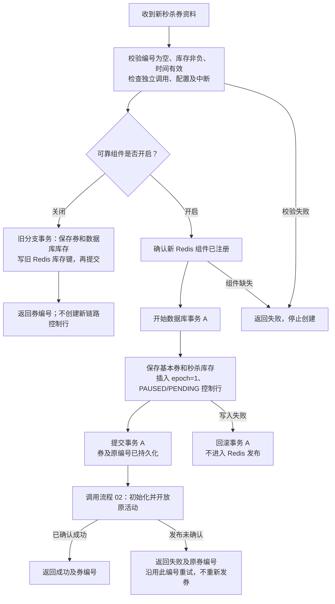

**顺序原因**：先提交 `PAUSED/PENDING`，进程退出后仍能找到原活动。发布阶段失败不能回滚已经提交的新券。
若事务 A 本身的提交结果未知，不能把它直接当作可重建的新券；当前创建接口没有新增客户端发券幂等键。

实现：[VoucherServiceImpl.addSeckillVoucher](../../../backend/src/main/java/com/hmdp/service/impl/VoucherServiceImpl.java#L69)、
[VoucherController](../../../backend/src/main/java/com/hmdp/controller/VoucherController.java)。

## 02. 初始化并开放活动

调用方：新建券流程、`POST /voucher/seckill/{voucherId}/initialize`、后台首次发布恢复。

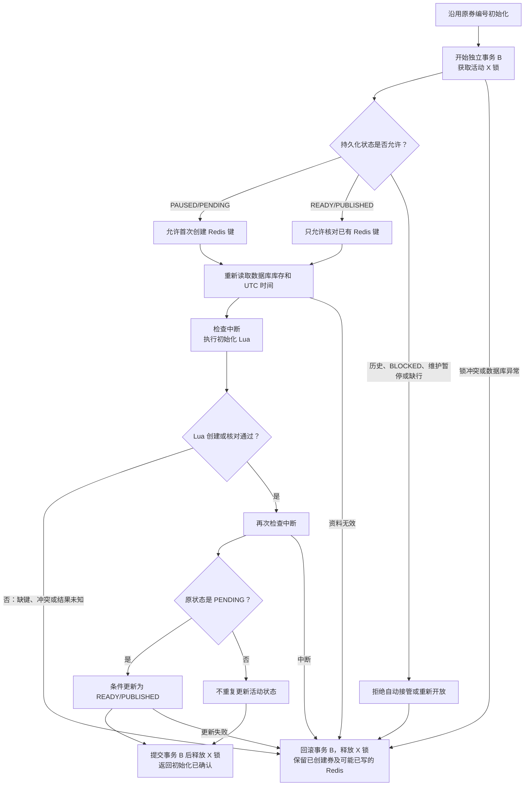

Lua 只在 `stock/meta/users` 三键全部不存在且允许首次创建时写入；已有键只读核对，不执行库存覆盖。
PENDING 重试要求库存仍为数据库初始值且没有用户归属。PUBLISHED 核对不要求 Redis 库存等于数据库库存，因为可能有未建单预占。
已发布活动缺键时也不能借此入口补建。

Redis `ready=1` 先于数据库 `READY` 写入，但受理需要数据库 READY 且活动共享锁不能越过当前排他锁。
提交确认丢失时活动可能已经开放，应以原编号重试查询实际状态，不能声称一定仍为 PAUSED。

实现：[initializeSeckillCampaign](../../../backend/src/main/java/com/hmdp/service/impl/VoucherServiceImpl.java#L111)、
[initialize-campaign.lua](../../../backend/src/main/resources/lua/seckill/initialize-campaign.lua)。

## 03. 领取和执行本地确认／释放任务

本流程是确认和释放共用的任务骨架；具体 Redis 状态逻辑分别见流程 04、05。

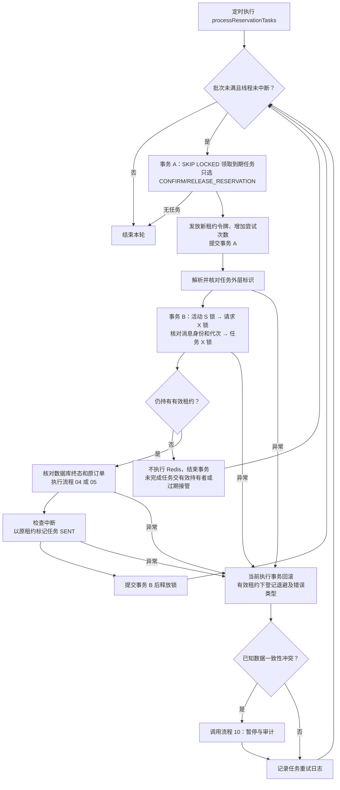

若最终 `markSent` 因租约已过期更新 0 行，当前事务正常结束，任务仍留给下一轮接管；不能凭 Redis 已执行就覆盖新令牌。
若 Redis 已完成而数据库回执事务失败，重试仍执行原订单，依靠 Lua 幂等收敛。
数据库故障导致领取、退避或暂停也失败时，本轮可能提前结束；未确认任务仍由租约与下轮调度恢复。

实现：[processReservationTasks](../../../backend/src/main/java/com/hmdp/service/impl/SeckillMaintenanceServiceImpl.java#L62)、
[finishLocked](../../../backend/src/main/java/com/hmdp/service/impl/SeckillMaintenanceServiceImpl.java#L113)、
[SeckillMaintenanceMapper](../../../backend/src/main/java/com/hmdp/mapper/SeckillMaintenanceMapper.java)。

## 04. 确认成功订单的预占

前提：流程 03 已核对消息、活动代次及有效租约，当前仍持有活动、请求和任务锁。

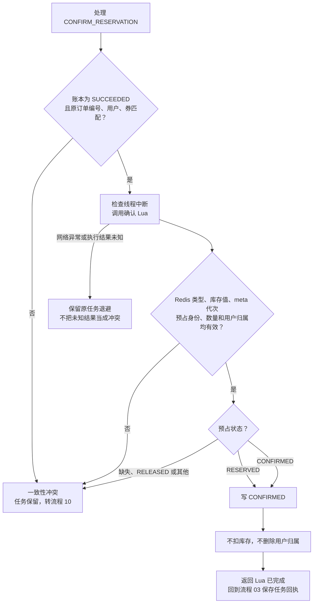

例子：Redis 库存已经因预占从 10 变 9，确认后仍为 9。重复写 CONFIRMED 没有第二次扣库。
进入 Lua 前后的中断会交任务骨架处理，保留中断标记，不返回“自动重试成功”。

实现：[finishLocked](../../../backend/src/main/java/com/hmdp/service/impl/SeckillMaintenanceServiceImpl.java#L113)、
[finish-reservation.lua](../../../backend/src/main/resources/lua/seckill/finish-reservation.lua)。

## 05. 释放关闭请求的预占

前提：流程 03 已核对消息、代次和有效租约。此图覆盖释放 Lua 的各个状态分支。

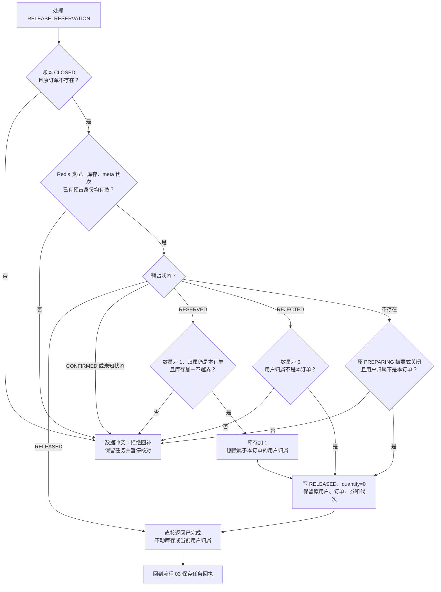

只有 RESERVED 分支执行库存加一。REJECTED 和允许缺失的 PREPARING 分支只写零数量墓碑，不猜测回补。
原 ACCEPTED 的预占丢失属于冲突，不能当作“从未扣过”静默完成。
旧订单已经 RELEASED 时不核删当前归属，避免删除同用户后来新订单的资格。
迟到的预占 Lua 看到 RELEASED 后返回终态，不再扣库存。Redis 网络异常仍走流程 03 的退避分支。

实现：[finish-reservation.lua](../../../backend/src/main/resources/lua/seckill/finish-reservation.lua)、
[reserve-order.lua](../../../backend/src/main/resources/lua/seckill/reserve-order.lua)。

## 06. 受控关闭尚未建单的请求

入口：`POST /ops/seckill/orders/{orderId}/close`。先经过流程 13 的登录和独立令牌校验。

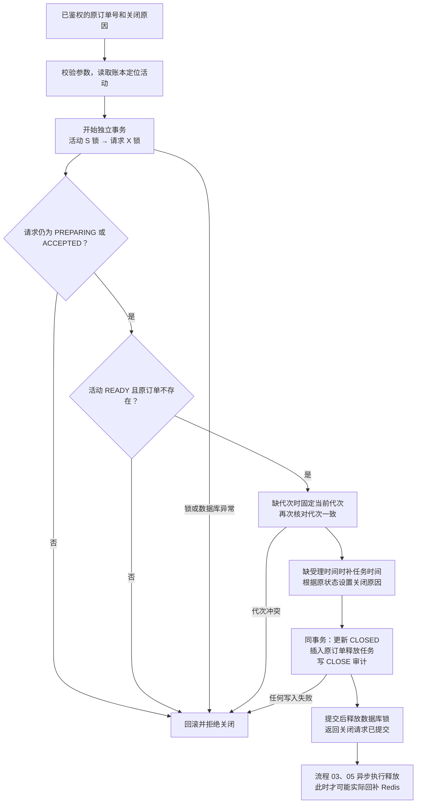

关闭成功不代表当场已回补。与消费者竞争同一个请求锁时，只能有一个终态：消费者先成功，关闭被拒绝；
关闭先提交，迟到消费者读取 CLOSED 后不建单。此接口不取消已创建订单，也不处理支付或退款。

实现：[close](../../../backend/src/main/java/com/hmdp/service/impl/SeckillMaintenanceServiceImpl.java#L340)。

## 07. 后台恢复未发布的新活动

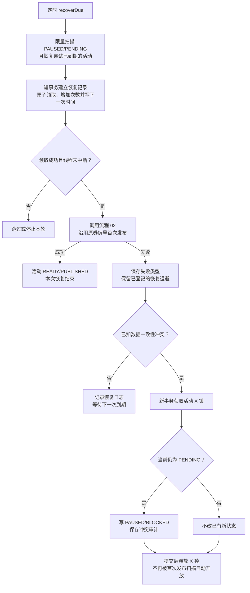

恢复资格在调用 Redis 前已持久化。进程退出后，到下一次恢复时间还能再次领取。
历史 UNMANAGED 和已标记 BLOCKED 的活动不在此扫描范围。锁或数据库故障使本轮暂停保存失败时，仍不能声称已成功隔离。

实现：[recoverDue 的活动分支](../../../backend/src/main/java/com/hmdp/service/impl/SeckillMaintenanceServiceImpl.java#L158)、
[claimRecovery](../../../backend/src/main/java/com/hmdp/service/impl/SeckillMaintenanceServiceImpl.java#L234)。

## 08. 后台恢复长期 PREPARING 请求

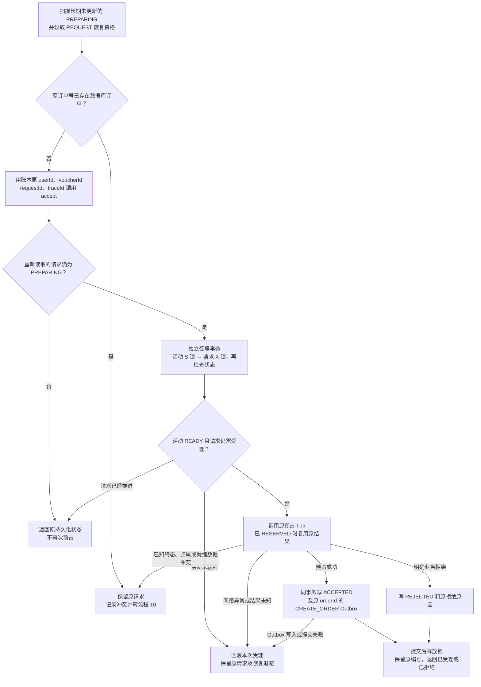

原受理事务先结束，恢复程序再记录失败或暂停，不能带着共享锁直接升级活动排他锁。
已存在的 PREPARING 账本是复用原编号的依据；不覆盖人工删除账本等破坏性修改场景。
图中第一次订单事实检查按候选 PREPARING 快照进入，`accept` 内部才会重新读取和加锁检查最新请求状态。

实现：[recoverDue 的请求分支](../../../backend/src/main/java/com/hmdp/service/impl/SeckillMaintenanceServiceImpl.java#L158)、
[accept](../../../backend/src/main/java/com/hmdp/service/impl/SeckillRequestServiceImpl.java#L132)、
[reserve-order.lua](../../../backend/src/main/resources/lua/seckill/reserve-order.lua)。

## 09. 后台恢复长期 ACCEPTED 请求

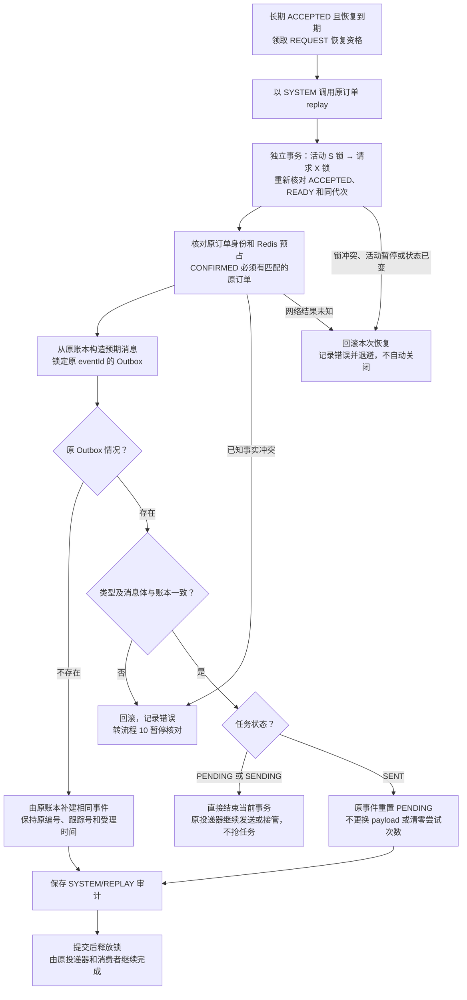

恢复不直接再次扣数据库库存。若原订单已经存在且身份一致，原消费者重投时核对订单、补齐成功状态和确认任务。
本流程仅对 CREATE_ORDER 的原事件操作；本地确认/释放任务由流程 03 处理。
正常的年龄阈值只触发核对和告警，不是关闭依据。

实现：[replayLocked](../../../backend/src/main/java/com/hmdp/service/impl/SeckillMaintenanceServiceImpl.java#L279)、
[verify-reservation.lua](../../../backend/src/main/resources/lua/seckill/verify-reservation.lua)。

## 10. 请求或预占冲突后的活动暂停与审计

适用于请求恢复、原事件重投和本地任务执行发现的已知冲突。首次发布活动的专门重查分支见流程 07。

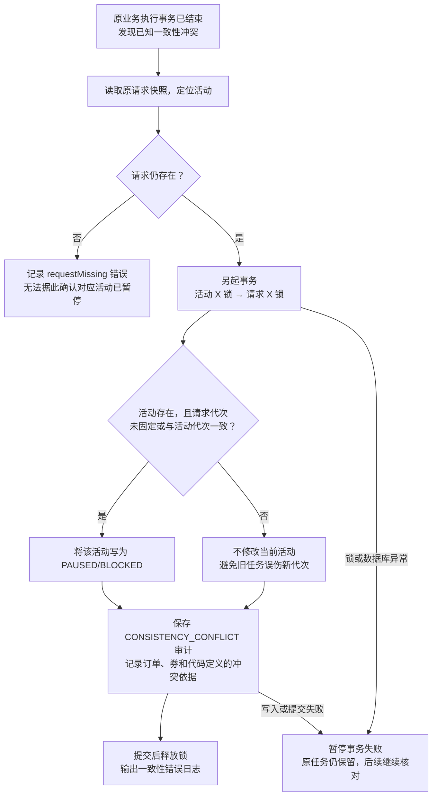

暂停不关闭请求、不释放库存，也不自动重开活动。
同代次且事实一致的已登记确认/释放仍可继续执行；要获得重建所需的静止快照，必须持有活动排他锁协调全部新链路写入口。

实现：[pauseConflict](../../../backend/src/main/java/com/hmdp/service/impl/SeckillMaintenanceServiceImpl.java#L429)、
[SeckillMaintenanceMapper.pause](../../../backend/src/main/java/com/hmdp/mapper/SeckillMaintenanceMapper.java)。

## 11. 普通 MQ 消息消费与非法协议隔离

建单事务属于第三阶段沿用实现；本轮增加可靠隔离并区分协议错误与业务错误。

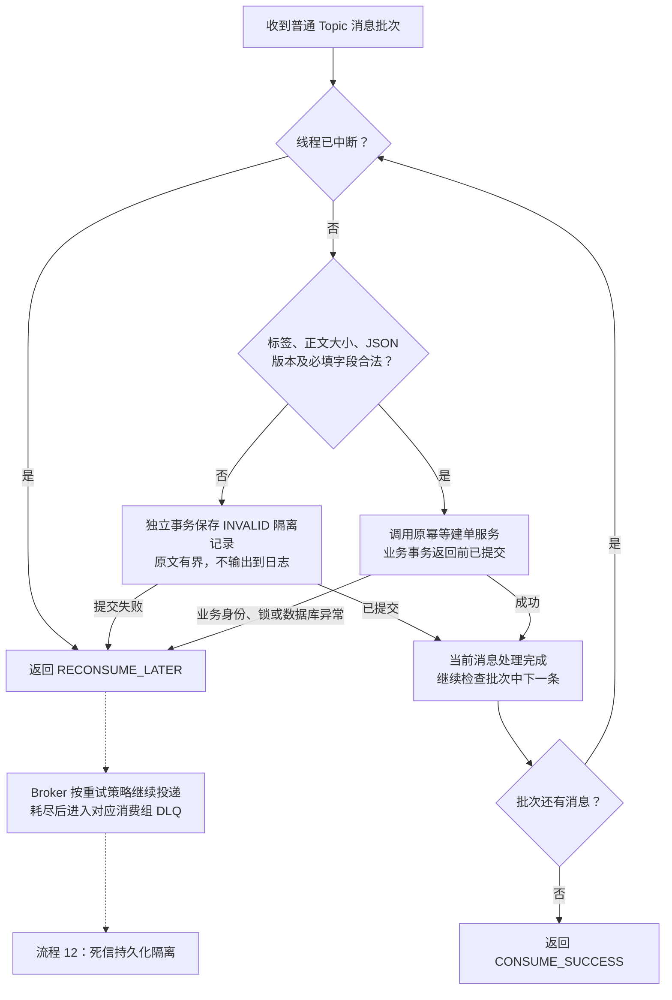

合法 JSON 的业务身份不匹配仍属业务失败，不能按解析失败隔离后直接确认。
隔离提交成功后 Broker 再次投递同一非法消息也可幂等保存；批次中其他消息失败时，已提交结果由各自幂等保护。

实现：[RocketMqOrderListener.consumeMessage](../../../backend/src/main/java/com/hmdp/infrastructure/mq/RocketMqOrderListener.java#L42)、
[OrderMessageFailureStore.record](../../../backend/src/main/java/com/hmdp/infrastructure/mq/OrderMessageFailureStore.java#L40)。

## 12. 死信接收与持久化隔离

入口：独立观察组订阅 `%DLQ%<实际订单消费组>`，前提是 Broker 和 ACL 已允许读取。

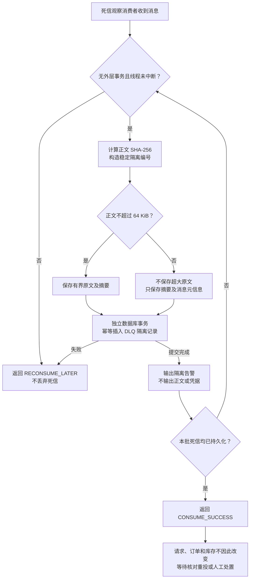

INVALID 与 DLQ 共用同一持久化组件。来源、Topic、物理消息编号及正文摘要共同构成隔离编号的依据；重复接收不覆盖既有处置。
死信观察器本身的隔离失败持续交 Broker 重试，不采用普通订单组的有限重试上限。

实现：[RocketMqDeadLetterListener](../../../backend/src/main/java/com/hmdp/infrastructure/mq/RocketMqDeadLetterListener.java)、
[OrderMessageFailureStore](../../../backend/src/main/java/com/hmdp/infrastructure/mq/OrderMessageFailureStore.java)、
[RocketMqConfiguration](../../../backend/src/main/java/com/hmdp/config/RocketMqConfiguration.java)。

## 13. 运维接口鉴权与分流

以下为 `/ops/seckill` 的保护流程。普通发券及原券初始化接口不属于此独立运维令牌入口。

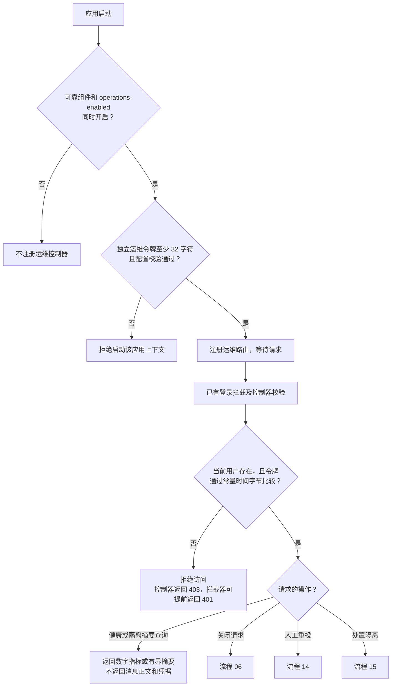

写操作的操作者编号来自当前登录用户，不能由正文覆盖。
HTTP 200 本身不代表业务成功，业务异常沿用现有 Result 失败约定。

实现：[SeckillMaintenanceController](../../../backend/src/main/java/com/hmdp/controller/SeckillMaintenanceController.java)、
[SeckillMaintenanceProperties](../../../backend/src/main/java/com/hmdp/config/SeckillMaintenanceProperties.java)。

## 14. 人工受控重投原事件

入口：`POST /ops/seckill/orders/{orderId}/replay`。与流程 09 共享事实核对，增加人工租约规则和可选隔离处置。

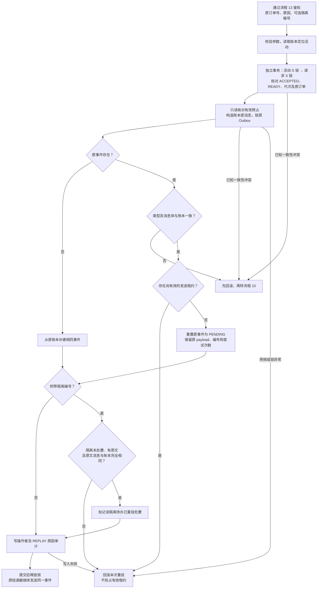

图中事件插入／重置先于隔离原文检查，但它们处于同一数据库事务；隔离检查失败会把先前重投修改一起回滚。
PENDING、SENT 或租约已过期的 SENDING 可以按条件唤醒；尚有效的 SENDING 拒绝重投。
隔离原文与账本不一致的校验失败不会自动替换 payload，也不等同于自动暂停活动。

实现：[replay](../../../backend/src/main/java/com/hmdp/service/impl/SeckillMaintenanceServiceImpl.java#L255)、
[replayLocked](../../../backend/src/main/java/com/hmdp/service/impl/SeckillMaintenanceServiceImpl.java#L279)、
[replayEvent](../../../backend/src/main/java/com/hmdp/mapper/SeckillMaintenanceMapper.java)。

## 15. 人工处置无需重投的隔离消息

入口：`POST /ops/seckill/quarantine/{id}/dismiss`。这是关闭隔离待办，不是关闭业务请求。

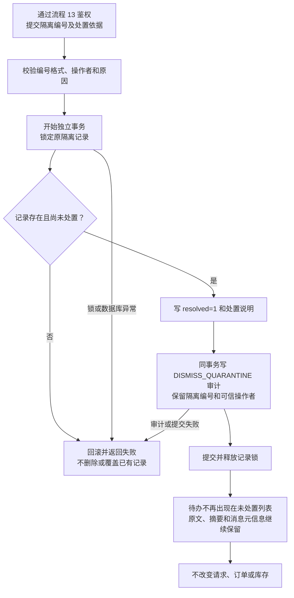

重复处置返回失败，不新增库存动作。恢复扫描仍按账本处理长期请求；处置隔离记录不会阻止该请求按其他恢复路径继续推进。

实现：[dismissQuarantine](../../../backend/src/main/java/com/hmdp/service/impl/SeckillMaintenanceServiceImpl.java#L382)。

## 16. 周期健康检查与日志告警

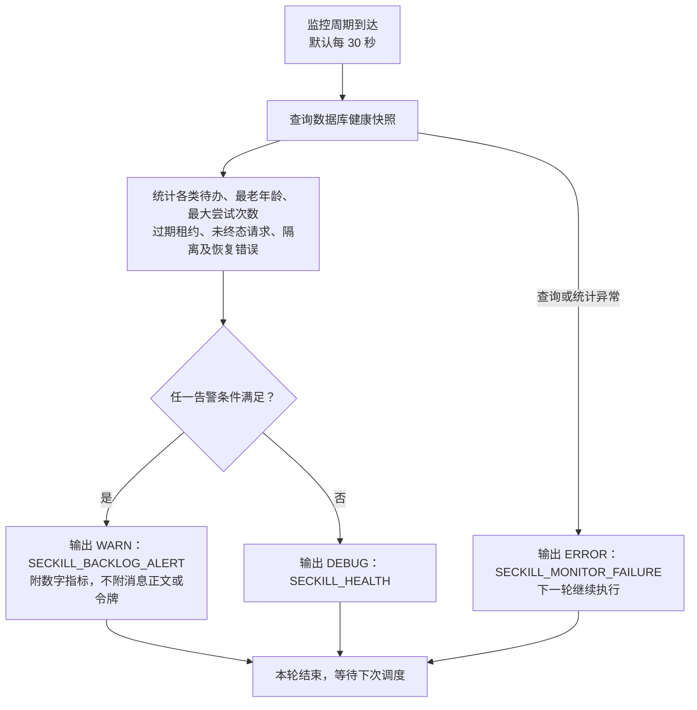

触发条件：最老任务、请求或待发布活动年龄达到阈值；最大任务尝试次数达到阈值；存在 BLOCKED 活动、未处置隔离或活跃资源恢复错误。
默认年龄阈值 120 秒、尝试次数 10。指标中的 `expired_leases` 用于排查，但代码没有把“存在过期租约”单独设为即时告警条件。
这里是数据库业务待办与应用日志监控，不是 Broker 精确队列积压指标，也没有自动发送邮件或短信。

实现：[SeckillMaintenanceJob.monitor](../../../backend/src/main/java/com/hmdp/infrastructure/seckill/SeckillMaintenanceJob.java#L65)、
[SeckillMaintenanceMapper.health](../../../backend/src/main/java/com/hmdp/mapper/SeckillMaintenanceMapper.java)。

## 建议阅读顺序

先看 **01 → 02** 理解活动发布，再看 **03 → 04 → 05 → 06** 理解预占和关闭，
接着看 **07 → 08 → 09 → 10** 理解异常恢复，最后看 **11 → 12 → 13 → 14 → 15 → 16** 理解消息处置与运维。

源码是流程含义的依据。图中把同一事务的多条校验合并为一个节点时，细节以对应实现及 [第四阶段完整说明](ROCKETMQ_PHASE4.md) 为准。
本次没有运行或变更数据库迁移，没有重跑中间件测试，也没有修改第五阶段范围。
