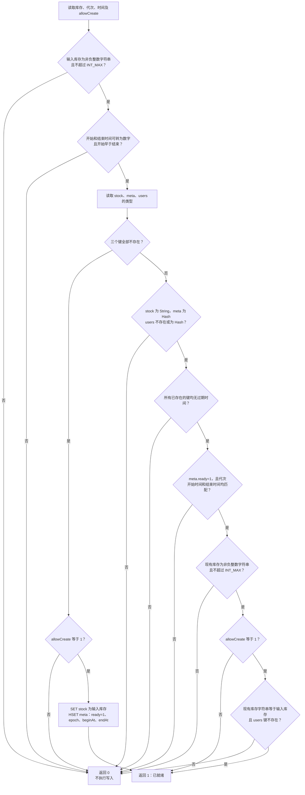
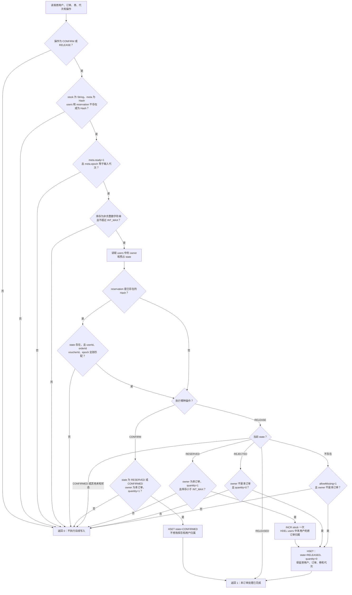
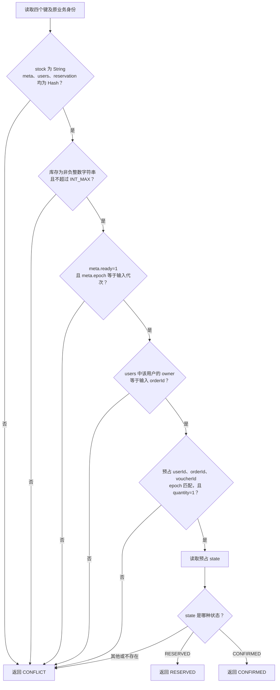

# 订单 RocketMQ 第四阶段：新增 Lua 脚本 Mermaid 图解

日期：2026-10-25。按当前工作区三个新增脚本的实际执行顺序绘制，每个脚本一张完整流程图。
业务层的事务、任务领取和恢复调度见 [第四阶段 16 个业务流程](ROCKETMQ_PHASE4_FLOWS.md)。
本文件只补充说明，不修改 Java 或 Lua 行为。

## 脚本与业务流程对应

| 脚本 | Java 调用 | 对应业务流程 | 返回值 |
|---|---|---|---|
| [initialize-campaign.lua](../../../backend/src/main/resources/lua/seckill/initialize-campaign.lua) | `SeckillReservationStore.initializeCampaign` | 新券首次发布、原券重试、后台发布恢复 | `1` 就绪；`0` 不允许创建或数据不符合要求 |
| [finish-reservation.lua](../../../backend/src/main/resources/lua/seckill/finish-reservation.lua) | `SeckillReservationStore.finish` | 成功预占确认、关闭请求释放 | `1` 已完成，含重复；`0` 操作或数据不符合要求 |
| [verify-reservation.lua](../../../backend/src/main/resources/lua/seckill/verify-reservation.lua) | `SeckillReservationStore.verify` | 长期 ACCEPTED 恢复、人工原事件重投 | `RESERVED`、`CONFIRMED` 或 `CONFLICT` |

共同约定：编号和代次按字符串核对，避免 Lua 大整数转换丢失精度；全部键经 KEYS 传入，使用同券 hash tag。
以下 `INT_MAX` 为 `2147483647`，`owner` 是 `users[userId]`，`state` 是订单预占 Hash 的 `state` 字段。
脚本只操作 Redis；数据库 READY、SUCCEEDED、CLOSED 和订单事实由外层 Service 核对。

## 1. initialize-campaign.lua：首次初始化或核对活动

**目的**：为从未开放的新活动创建 `stock/meta`；已有数据只核对，不覆盖库存，也不修补缺失键。

| 输入 | 含义 |
|---|---|
| KEYS[1..3] | 库存 String、元数据 Hash、用户归属 Hash |
| ARGV[1] | 数据库库存字符串；首次发布时为初始库存 |
| ARGV[2] | 当前活动代次字符串 |
| ARGV[3..4] | UTC 开始、结束时间的 Unix 毫秒字符串 |
| ARGV[5] | `allowCreate`：`1` 允许首次创建；`0` 只核对 |

**逐分支理解**：

- 首次创建：三个键必须全部不存在，且 `allowCreate=1`。只创建库存和元数据；没有预占用户时无需创建空 users Hash。
- 待发布重试：已有键可以通过核对，但库存必须仍等于输入的初始库存，且 users 不存在，防止接管已使用的数据。
- 已发布核对：`allowCreate=0`，已有库存可与数据库库存不同；合法未建单预占会使二者暂时不同。
- 部分缺键、错误类型、TTL、元数据或库存异常：直接返回 0，不删除、不补键、不重置已有库存。
- 已发布活动全部丢键：即使数据库仍有库存，`allowCreate=0` 也拒绝重新创建。

**与外层事务的关系**：脚本写入 `meta.ready=1` 只代表 Redis 已准备好。
外层仍持有活动排他锁，只有 Lua 成功后数据库提交 READY/PUBLISHED，才允许新链路受理。
脚本自身不读取数据库，不判断 `allowCreate` 是否来自合法 PENDING 活动，该资格由调用方保证。

## 2. finish-reservation.lua：幂等确认或释放预占

**目的**：确认不再扣库存；释放仅在 RESERVED 首次处理时回补一份。其他允许的释放分支只写墓碑。

| 输入 | 含义 |
|---|---|
| KEYS[1..4] | 库存 String、元数据 Hash、用户归属 Hash、原订单预占 Hash |
| ARGV[1..4] | userId、orderId、voucherId、epoch 字符串 |
| ARGV[5] | `CONFIRM` 或 `RELEASE` |
| ARGV[6] | `allowMissing`：仅原 PREPARING 被显式关闭时由 Java 传 `1`，允许缺记录时写零数量墓碑 |

**确认分支**：

- RESERVED 和 CONFIRMED 均需数量为 1，且 users 的归属仍为本订单。
- 通过后写 CONFIRMED；重复调用是相同状态写入，不会再次减库存。
- 缺预占、RELEASED、归属或数量异常均返回 0。

**释放分支**：

| 原状态 | 额外条件 | 库存操作 | 用户归属操作 | 结果 |
|---|---|---|---|---|
| RELEASED | 已通过公共类型、元数据、库存及预占身份检查 | 不变 | 不变，不删除后来新订单归属 | 直接返回 1 |
| CONFIRMED | 无允许释放的分支 | 不变 | 不变 | 返回 0 |
| RESERVED | owner 为本订单、quantity=1、库存加一不越界 | 加 1 | 删除本用户属于该订单的归属 | 写零数量 RELEASED，返回 1 |
| REJECTED | quantity=0、owner 不是本订单 | 不变 | 不变 | 写零数量 RELEASED，返回 1 |
| 不存在 | allowMissing=1、owner 不是本订单 | 不变 | 不变 | 写零数量 RELEASED 墓碑，返回 1 |
| 其他状态或条件不符 | — | 不变 | 不变 | 返回 0 |

这里的“预占不存在”不包括“Hash 已存在但没有 state”：后者在公共校验中已返回 0。
RELEASED 的重复执行不重新要求 owner 仍为原订单，因为原用户可能已用另一个请求重新预占；但前面的公共校验仍必须通过。
墓碑让迟到的原订单预占返回终态，不能重新扣库存。

**数据库资格由 Java 保证**：确认前核对 SUCCEEDED 及匹配原订单；释放前核对 CLOSED 且原订单不存在。
Lua 不知道账本原先是 PREPARING 还是 ACCEPTED，因此只有外层验证后才能传 `allowMissing=1`。
关闭和释放任务的登记在数据库事务内完成，库存回补由此脚本异步执行，不把 HTTP 关闭成功等同于已回补。

## 3. verify-reservation.lua：只读核对有效预占

**目的**：重投前核对库存、元数据、用户归属和原订单预占是否相互一致；不修改 Redis。

| 输入 | 含义 |
|---|---|
| KEYS[1..4] | 库存 String、元数据 Hash、用户归属 Hash、原订单预占 Hash |
| ARGV[1..4] | userId、orderId、voucherId、epoch 字符串 |

与释放脚本的公共校验不同，本脚本要求 users 和 reservation 必须已经存在，不能用缺失记录证明一个 ACCEPTED 请求具有有效预占。
库存允许为 0，因为当前订单可能已经拿到了最后一份预占；核对不等于再次购买，不要求当前仍有可用库存。
脚本也不检查活动是否已结束：已经合法受理的请求仍需完成原订单。

`CONFIRMED` 只证明 Redis 中存在匹配的确认状态，不能单独证明数据库已经建单。
Java 在恢复/重投事务中继续核对数据库原订单；“Redis 已 CONFIRMED 但原订单不存在”仍判定为数据冲突。

## 返回值如何交给 Java 处理

| 脚本返回 | `SeckillReservationStore` 处理 | 后续业务含义 |
|---|---|---|
| 初始化／确认释放返回 1 | 正常返回 | 由外层提交活动 READY 或任务回执，不在 Lua 内提交数据库 |
| 初始化／确认释放返回 0 | 抛出 `SeckillConsistencyException` | 不覆盖数据；后台维护按实际流程记录、暂停或保留待办 |
| 核对返回 RESERVED／CONFIRMED | 返回该状态 | 继续核对原事件及数据库事实后，才决定是否重投 |
| 核对返回 CONFLICT | 抛出 `SeckillConsistencyException` | 原请求保留，维护流程核对并按同代次暂停、审计 |
| 返回未知值或调用异常 | 保留未知结果／抛异常 | 网络超时不能认定未执行；任务退避后沿用原编号再核对 |

脚本返回 0／CONFLICT 代表代码中已识别的条件不满足；Redis 调用异常或结果未知不能被当作同一种事实判断。
正常返回 0 的校验均在当前分支写入前完成，但 Redis Lua 发生运行错误时不会自动回滚已经执行的写入。
Lua 的原子执行也不等于 MySQL 与 Redis 跨存储原子事务。

Java 实现：[SeckillReservationStore](../../../backend/src/main/java/com/hmdp/infrastructure/seckill/SeckillReservationStore.java)。
对应外层流程：[初始化发布](ROCKETMQ_PHASE4_FLOWS.md#flow-02)、[确认预占](ROCKETMQ_PHASE4_FLOWS.md#flow-04)、
[释放预占](ROCKETMQ_PHASE4_FLOWS.md#flow-05)、[恢复 ACCEPTED](ROCKETMQ_PHASE4_FLOWS.md#flow-09)、
[受控重投](ROCKETMQ_PHASE4_FLOWS.md#flow-14)。
